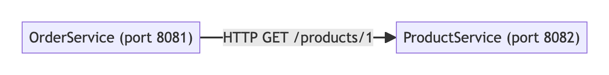
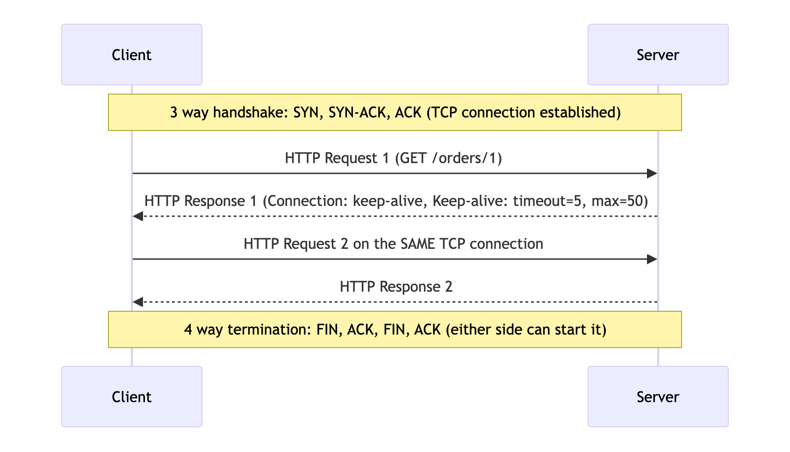
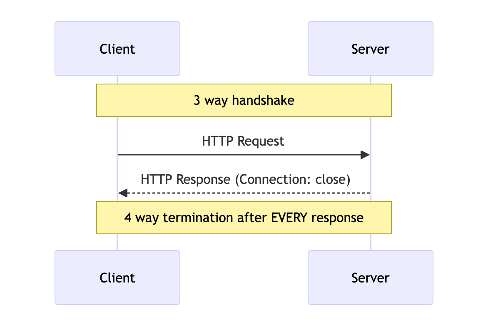
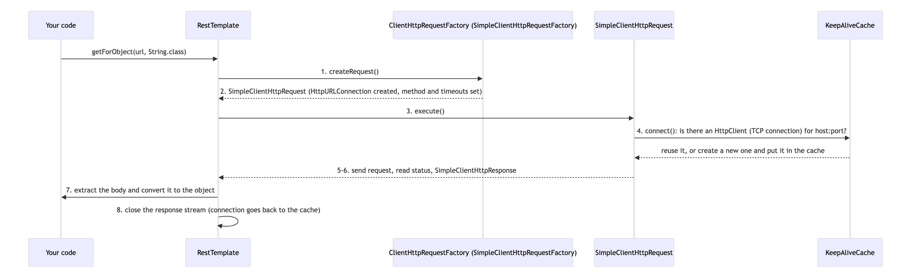

# RestTemplate – Synchronous Communication (Distributed Microservices #1)

<!-- nav -->
[Index](00_Distributed_Microservices_Index.md) · [02 RestClient – Synchronous Communication](02_RestClient_Notes.md) ➡
<!-- nav -->

Source: https://drive.google.com/file/d/1tFNmDMauszX3K8wcAxBaVAX3FidyEfei/view?usp=drive_link

## 1. Set up of 2 microservices

Two Spring Boot services (created from Spring Initializr with the **Spring Web** dependency):

| Service | Port |
|---|---|
| `OrderService` | `server.port=8081` |
| `ProductService` | `server.port=8082` |



`OrderService` has to call `ProductService`. How can two services talk to each other?

## 2. Synchronous communication

- The **client waits for the response** from the server before continuing.
- It is **blocking in nature**: the thread waits until the response is received.

Types of synchronous communication in Spring Boot:

1. `RestTemplate`
2. `RestClient`
3. `FeignClient`

**In simple words:** one service picks up the phone, calls another and stays on the line until the answer comes.

### What an HTTP call looks like

**GET request**

```
GET /orders/1 HTTP/1.1
Host: localhost:8081
User-Agent: curl/8.7.1
Accept: application/json
```

- `GET` = HTTP method, `/orders/1` = path (URI), `HTTP/1.1` = protocol version.
- `Host` = target host, `User-Agent` = which client/tool makes the request, `Accept` = the format in which the client wants the response.

**POST request**

```
POST /products HTTP/1.1
Host: localhost:8081
User-Agent: curl/8.7.1
Accept: application/json
Content-Type: application/json
Content-Length: 65

{ "name": "Ice-Cream", "price": 200 }
```

- `Content-Type` tells the server that the request body is JSON.
- `Content-Length` tells the number of bytes in the request body.

**GET response (with keep alive)**

```
HTTP/1.1 200 OK
Date: Fri, 16 May 2025 10:00:00 GMT
Content-Type: application/json
Content-Length: 65
Connection: keep-alive
Keep-alive: timeout=5, max=50

{ "id": 10, "name": "SJ" }
```

- Status code: `2xx` request is successful, `4xx` client sent an invalid request, `5xx` server error.

### Keep-alive vs close

- By default the connection is **keep-alive in HTTP/1.1**. In HTTP/1.0 the default is **close**.
- `Keep-alive: timeout=5` means close the TCP connection if it is idle for 5 seconds. `max=50` is the maximum number of requests that can be sent over the same TCP connection.
- `Connection: close` means after every response the TCP connection is closed and **not reused**.

**Flow when keep-alive is set:** the 3 way handshake (SYN, SYN-ACK, ACK) happens once, then **many HTTP requests use the same TCP connection**, and finally the 4 way termination (FIN, ACK, FIN, ACK) closes it. Either the client or the server can start the close.



**Flow when `Connection: close` is set:** handshake, one request, one response, termination, and the whole thing again for the next request.



## 3. Calling a REST endpoint with plain Java

Before using the Spring tools, see what it takes with plain Java.

**OrderService**

```java
@RestController
@RequestMapping("/orders")
public class OrderController {

    @GetMapping("/{id}")
    public ResponseEntity<String> getOrder(@PathVariable String id) {

        HttpURLConnection httpURLConnection = null;
        try {
            String url = "http://localhost:8082/products/" + id;

            URL obj = new URL(url);
            /*
              Creates an Object of HttpURLConnection,
              consider it like an envelope or request,
              in which we specify all the details like URL,
              Request Method, timeouts etc.
            */
            httpURLConnection = (HttpURLConnection) obj.openConnection();

            // Setting http request method and header
            httpURLConnection.setRequestMethod("GET");
            httpURLConnection.setRequestProperty("Accept", "application/json");

            // max time to establish TCP connection (ms)
            httpURLConnection.setConnectTimeout(100);
            // max time to wait for server response (ms)
            httpURLConnection.setReadTimeout(500);

            /*
              Here it opens up a TCP connection and sends the HTTP request,
              also reads the response.
              The TCP connection is created when we make the first
              Input/Output request on HttpURLConnection such as:
                - getInputStream()
                - getResponseCode()
                - connect() etc.
              HttpClient object is a wrapper around the TCP connection,
              so before creating a new HttpClient object,
              it first checks with the "KeepAliveCache" class,
              if there is already an object present,
              if not it creates one object and also puts it into the cache.
                key   -> host:port
                value -> httpClient object
            */
            BufferedReader in =
                    new BufferedReader(new InputStreamReader(httpURLConnection.getInputStream()));

            StringBuilder response = new StringBuilder();
            String responseLine;

            while ((responseLine = in.readLine()) != null) {
                response.append(responseLine);
            }

            in.close();
            System.out.println("Response: " + response.toString());

        } catch (Exception e) {
            // exception handling here
        } finally {
            if (httpURLConnection != null) {
                /*
                  If the response is fully read properly, the TCP connection
                  i.e. HttpClient is returned back to the KeepAlive cache,
                  else the TCP connection gets closed. Framework code below:
                    public void disconnect() {
                        if (inputStream not fully read) {
                            httpClient.closeServer();   // close the TCP socket
                        } else {
                            httpClient.finished();      // return to KeepAlive cache
                        }
                    }
                */
                httpURLConnection.disconnect();
            }
        }

        return ResponseEntity.ok("order call successful");
    }
}
```

**ProductService**

```java
@RestController
@RequestMapping("/products")
public class ProductController {

    @GetMapping("/{id}")
    public String getProduct(@PathVariable String id) {
        return "Product fetched with id: " + id;
    }
}
```

**Disadvantages of this approach**

- **Too much boilerplate:** open the connection, set headers, read the response, close streams and connections.
- The response has to be **handled manually**, with no automatic mapping to objects.
- **Limited support for advanced features** like connection pooling, interceptors etc.

## 4. RestTemplate

`RestTemplate` **abstracts the low level code** like creating the `HttpURLConnection` object. It is the **traditional / legacy way** to call REST APIs in a Spring application.

**OrderService**

```java
@Configuration
public class AppConfig {

    @Bean
    public RestTemplate restTemplate() {
        return new RestTemplate();
    }
}

// Or, use the below if we want to set timeouts too
@Configuration
public class AppConfig {

    @Bean
    public RestTemplate restTemplate() {

        SimpleClientHttpRequestFactory factory = new SimpleClientHttpRequestFactory();

        // timeouts in milliseconds
        factory.setConnectTimeout(1000);
        factory.setReadTimeout(5000);

        return new RestTemplate(factory);      // pass the factory, otherwise the timeouts are not applied
    }
}
```

```java
@RestController
@RequestMapping("/orders")
public class OrderController {

    @Autowired
    RestTemplate restTemplate;

    @GetMapping("/{id}")
    public ResponseEntity<String> getOrder(@PathVariable String id) {

        String response = restTemplate.getForObject(
                "http://localhost:8082/products/" + id,
                String.class
        );

        System.out.println("Response from Product API called from order service: " + response);

        return ResponseEntity.ok("order call successful");
    }
}
```

The `ProductService` stays the same. Calling `GET localhost:8081/orders/1` returns `order call successful`, and the log shows `Product fetched with id: 1`.

### What happens internally when `getForObject` is invoked



1. `createRequest()` is called on the `ClientHttpRequestFactory` (the default implementation is `SimpleClientHttpRequestFactory`).
2. It creates the `HttpURLConnection` object, sets the request method and the connect and read timeouts, wraps it in a `SimpleClientHttpRequest` object and returns it.
3. `execute()` is called on the `SimpleClientHttpRequest`. It takes out the `HttpURLConnection` and invokes `connection.connect()`.
4. Internally the `KeepAliveCache` is checked: if an `HttpClient` (the TCP connection) exists for that host:port it is reused, else a new one is created and put in the cache.
5. It invokes `connection.getResponseCode()`, which sends the request to the server and gets the response.
6. A `SimpleClientHttpResponse` object is created with the `HttpURLConnection` inside.
7. The response is handled and the data is extracted (converted to the requested type).
8. The response reading stream is closed.

**Notice:** `RestTemplate` does **not close the TCP connection explicitly**. Once the response stream is closed, the TCP connection (the `HttpClient` object) is ready to be **re-used** until it expires (based on the idle timeout or the max connection configuration).

## 5. Other methods available in RestTemplate

| Method | What it does |
|---|---|
| **GET** | |
| `getForObject(String url, Class<T> responseType)` | returns the response **body** as an object |
| `getForEntity(String url, Class<T> responseType)` | returns the full `ResponseEntity` with status and headers |
| **POST** | |
| `postForObject(String url, Object request, Class<T> responseType)` | sends POST and gets just the response body |
| `postForEntity(String url, Object request, Class<T> responseType)` | sends POST and gets the full `ResponseEntity` |
| **PUT** | |
| `put(String url, Object request)` | sends PUT, no response body is expected |
| **DELETE** | |
| `delete(String url)` | sends DELETE, no response body is expected |
| **GENERAL PURPOSE** | |
| `exchange(url, HttpMethod, HttpEntity<?>, Class<T>)` | when we want to customize the HTTP method, header and body (`HttpEntity`) but still want Spring's automatic conversion |
| `execute(url, HttpMethod, RequestCallback, ResponseExtractor<T>)` | full control, like plain Java with `HttpURLConnection`: header, body, request, response, serialization are handled manually |

```java
// getForObject
String url = "http://localhost:8080/api/products/1";
Product product = restTemplate.getForObject(url, Product.class);

// getForEntity
ResponseEntity<Product> response = restTemplate.getForEntity(url, Product.class);
HttpStatus status = response.getStatusCode();
Product body = response.getBody();

// postForObject
String url = "http://localhost:8080/api/products";
Product newProduct = new Product("Ice-cream", 100);
Product createdProduct = restTemplate.postForObject(url, newProduct, Product.class);

// postForEntity
ResponseEntity<Product> response = restTemplate.postForEntity(url, newProduct, Product.class);

// put
restTemplate.put("http://localhost:8080/api/products/1", new Product("Ice-cream", 150));

// delete
restTemplate.delete("http://localhost:8080/api/products/1");
```

**`exchange`: custom header and body**

```java
String url = "http://localhost:8080/api/products/";

// customizing header
HttpHeaders headers = new HttpHeaders();
headers.setContentType(MediaType.APPLICATION_JSON);
headers.set("Authorization", "Bearer my-token");

// preparing http request body
Product product = new Product();
product.setName("Ice-cream");
product.setPrice(100);

// setting both header and body in the HttpEntity
HttpEntity<Product> requestEntity = new HttpEntity<>(product, headers);

ResponseEntity<Product> response = restTemplate.exchange(
        url,
        HttpMethod.POST,
        requestEntity,
        Product.class
);

Product created = response.getBody();
HttpStatus status = response.getStatusCode();
```

**`execute`: full control with `RequestCallback` and `ResponseExtractor`**

`RequestCallback` gives us full control over the request (set header, write body etc.):

```java
@FunctionalInterface
public interface RequestCallback {
    void doWithRequest(ClientHttpRequest request) throws IOException;
}
```

`ResponseExtractor` gives us full control over how the response is read and converted to the desired object:

```java
@FunctionalInterface
public interface ResponseExtractor<T> {
    T extractData(ClientHttpResponse response) throws IOException;
}
```

```java
RestTemplate restTemplate = new RestTemplate();
String url = "http://localhost:8080/api/products";

// setting both header and body
RequestCallback requestCallback = request -> {
    request.getHeaders().setContentType(MediaType.APPLICATION_JSON);
    Product product = new Product("Ice-cream", 100);
    ObjectMapper mapper = new ObjectMapper();
    byte[] body = mapper.writeValueAsBytes(product);
    StreamUtils.copy(body, request.getBody());
};

// parsing the response
ResponseExtractor<String> responseExtractor = response -> {
    return StreamUtils.copyToString(response.getBody(), StandardCharsets.UTF_8);
};

String response = restTemplate.execute(url, HttpMethod.POST, requestCallback, responseExtractor);
System.out.println("response is: " + response);
```

## 6. Limitations of RestTemplate

- There are already **so many overloaded methods**, so it is hard to remember and maintain (above we covered just a few).
- `RestTemplate` was built **before** concepts like Retry, Circuit Breaker etc. Adding support for them means even more overloaded methods, which is not user friendly.
- `RestTemplate` is in **maintenance mode**: no new features, only bug fixes.

That is where the latest **`RestClient`** comes into the picture ([02 RestClient](02_RestClient_Notes.md)):

- A **fluent, builder-style API** (a more readable and user friendly way of configuring and invoking the endpoint).
- Easy integration with interceptors, filters etc.

**In simple words:** `RestTemplate` saves you from writing 40 lines of `HttpURLConnection` code, but it has become crowded with overloads and is no longer being improved. Use it to understand the basics, prefer `RestClient` for new code.

---

<!-- nav -->
[Index](00_Distributed_Microservices_Index.md) · [02 RestClient – Synchronous Communication](02_RestClient_Notes.md) ➡
<!-- nav -->
