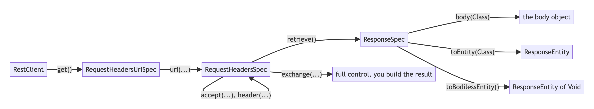
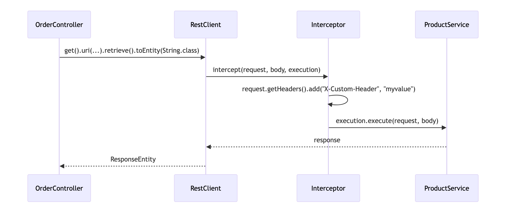

# RestClient – Synchronous Communication (Distributed Microservices #2)

<!-- nav -->
⬅ [01 RestTemplate – Synchronous Communication](01_RestTemplate_Notes.md) · [Index](00_Distributed_Microservices_Index.md) · [03 FeignClient – Synchronous Communication](03_FeignClient_Notes.md) ➡
<!-- nav -->

Source: https://drive.google.com/file/d/1a2Yx3g99nXUw1UlvreHcBJj04ktMBhcD/view?usp=drive_link

To understand `RestClient` it helps to first understand its predecessor `RestTemplate` ([01 RestTemplate](01_RestTemplate_Notes.md)).

## 1. Why RestClient?

The limitations of `RestTemplate` were:

- So many overloaded methods, hard to remember and maintain.
- It was built before concepts like Retry and Circuit Breaker, so adding support means more overloaded methods.
- It is in **maintenance mode**: no new features, only bug fixes.

**`RestClient` is the alternative:**

- Introduced in **Spring Framework 6.0+ and Spring Boot 3.0+**.
- **Synchronous / blocking** in nature: the client waits for the response from the server before continuing.
- A **modern, fluent API** that is more readable and easy to maintain.

**In simple words:** the same job as `RestTemplate` (call another service and wait), but written as one readable chain: `get().uri(...).retrieve().body(...)`.

## 2. First example

`OrderService` (port 8081) needs to invoke `ProductService` (port 8082).

```java
@Configuration
public class AppConfig {

    @Bean
    public RestClient restClientInstance() {
        return RestClient.create();
    }
}
```

```java
// ProductService
@RestController
@RequestMapping("/products")
public class ProductController {

    @GetMapping("/{id}")
    public String getProduct(@PathVariable String id) {
        return "Product fetched with id: " + id;
    }
}
```

```java
// OrderService
@RestController
@RequestMapping("/orders")
public class OrderController {

    @Autowired
    RestClient restClient;

    @GetMapping("/{id}")
    public ResponseEntity<String> getOrder(@PathVariable String id) {

        String response = restClient
                .get()
                .uri("http://localhost:8082/products/" + id)
                .retrieve()
                .body(String.class);

        System.out.println("Response from Product API called from order service: " + response);

        return ResponseEntity.ok("order call successful");
    }
}
```

`GET localhost:8081/orders/1` returns `order call successful` and the log shows `Product fetched with id: 1`.

## 3. How does the Fluent API work?

**Fluent API means chaining of method calls.** Each method call **returns an object (of the next step) that exposes the next set of operations (methods)**. This uses Generics and Wildcards (10–11 Classes and Generic Classes (Java notes)).



- `restClient.get()` returns a `RequestHeadersUriSpec`.
- `.uri(...)` returns a `RequestHeadersSpec`, which offers `accept(...)`, `header(...)` (both return the same spec) and `retrieve()`.
- `.retrieve()` returns a `ResponseSpec`, which offers `body(...)`, `toEntity(...)`, `toBodilessEntity()` and `onStatus(...)`.

**Why does the sequence of calls matter?** If you call `accept(...)` first and then try `uri(...)`, it does not compile: `accept()` returns a `RequestHeadersSpec`, which no longer has a `uri()` method. The type you hold decides what you are allowed to call next.

### GET

```java
RestClient restClient = RestClient.create();

String response = restClient
        .get()
        .uri("http://localhost:8082/products/" + id)
        .accept(MediaType.APPLICATION_JSON)
        .header("X-Custom-Header", "xyz")
        .retrieve()
        .body(String.class);
```

### POST

```java
RestClient restClient = RestClient.create();

ResponseEntity<ProductEntity> response = restClient
        .post()
        .uri("http://localhost:8082/products/create")
        .accept(MediaType.APPLICATION_JSON)
        .header("Content-Type", "application/json")
        .body(new ProductEntity("Ice-cream"))     // some new object which needs to be created
        .retrieve()
        .toEntity(ProductEntity.class);

ProductEntity responseBody = response.getBody();
```

### DELETE

```java
RestClient restClient = RestClient.create();

ResponseEntity<Void> response = restClient
        .delete()
        .uri("http://localhost:8082/products/" + id)
        .retrieve()
        .toBodilessEntity();

HttpStatusCode deletionStatus = response.getStatusCode();
```

## 4. Exception handling with `onStatus`

```java
String responseObj = restClient
        .get()
        .uri("http://localhost:8082/products/" + id)
        .retrieve()
        .onStatus(response -> {

            if (response.getStatusCode().is4xxClientError()) {
                throw new MyCustomException("Invalid request passed");
            } else if (response.getStatusCode().is5xxServerError()) {
                throw new NullPointerException("Something wrong at server");
            }

            return false;
        })
        .body(String.class);
```

(In Spring's API `onStatus` takes a status predicate plus an error handler, or a `ResponsePredicate`. The single-lambda form shown above is the short version. Either way, the idea is the same: look at the status and throw your own exception.)

## 5. `exchange()`: full control

If we want **full control over response building and exception handling**, we can call `exchange()` directly instead of relying on the `ResponseSpec`.

```java
String responseObj = restClient
        .get()
        .uri("http://localhost:8082/products/" + id)
        .exchange((request, response) -> {

            if (response.getStatusCode().is4xxClientError()) {
                throw new MyCustomException("Invalid request passed");
            } else if (response.getStatusCode().is5xxServerError()) {
                throw new InternalError("Something wrong at server");
            } else {
                // response mapping logic if no error
                return StreamUtils.copyToString(
                        response.getBody(),
                        StandardCharsets.UTF_8
                );
            }
        });
```

## 6. Interceptors

An interceptor sits between your code and the HTTP call, so every request can be modified in one place (add a header, log, add an auth token etc.).

**OrderService**

```java
public class MyCustomRequestInterceptor implements ClientHttpRequestInterceptor {

    @Override
    public ClientHttpResponse intercept(
            HttpRequest request,
            byte[] body,
            ClientHttpRequestExecution execution
    ) throws IOException {

        request.getHeaders().add("X-Custom-Header", "myvalue");
        return execution.execute(request, body);
    }
}
```

```java
@Configuration
public class AppConfig {

    @Bean
    public RestClient restClientInstance(ClientHttpRequestInterceptor myCustomInterceptor) {
        return RestClient.builder()
                .requestInterceptor(myCustomInterceptor)
                .build();
    }

    @Bean
    public ClientHttpRequestInterceptor customRequestInterceptor() {
        return new MyCustomRequestInterceptor();
    }
}
```

```java
@RestController
@RequestMapping("/orders")
public class OrderController {

    @Autowired
    RestClient restClient;

    @GetMapping("/{id}")
    public ResponseEntity<String> getOrder(@PathVariable String id) {

        ResponseEntity<String> responseEntityObj = restClient
                .get()
                .uri("http://localhost:8082/products/" + id)
                .retrieve()
                .toEntity(String.class);

        System.out.println("Response from Product API called from order service: " + responseEntityObj.getBody());

        return ResponseEntity.ok("order call successful");
    }
}
```

When `ProductService` is invoked, it can see the header `X-Custom-Header: myvalue` which was added by the interceptor. The interceptor is invoked at step 2 of the flow (after the request is built, before it goes out on the network).



## 7. RestTemplate vs RestClient

| | RestTemplate | RestClient |
|---|---|---|
| Style | many overloaded methods | fluent chain |
| Status | maintenance mode | current, actively developed |
| Since | Spring 3 | Spring 6.0 / Boot 3.0 |
| Interceptors | yes | yes, plus easy builder config |
| Blocking | yes | yes |

**In simple words:** `RestClient` is `RestTemplate` rewritten as a readable pipeline. Same blocking behaviour, much easier to extend. The next step is `FeignClient` ([03 FeignClient](03_FeignClient_Notes.md)), where you do not even write the chain: you declare an interface.

---

<!-- nav -->
⬅ [01 RestTemplate – Synchronous Communication](01_RestTemplate_Notes.md) · [Index](00_Distributed_Microservices_Index.md) · [03 FeignClient – Synchronous Communication](03_FeignClient_Notes.md) ➡
<!-- nav -->
