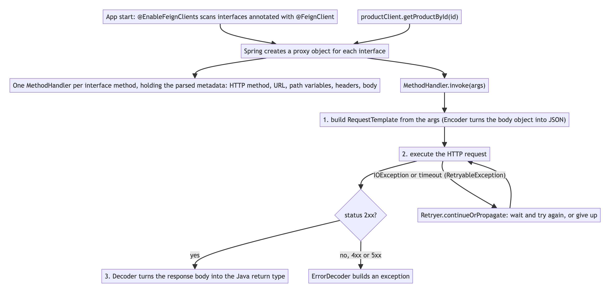
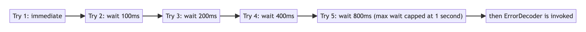

# FeignClient – Synchronous Communication (Distributed Microservices #3)

<!-- nav -->
⬅ [02 RestClient – Synchronous Communication](02_RestClient_Notes.md) · [Index](00_Distributed_Microservices_Index.md) · [04 Service Discovery (Eureka)](04_Service_Discovery_Notes.md) ➡
<!-- nav -->

Source: https://drive.google.com/file/d/1xev4wWJ1dceBUi7l77z2KgTx_YZDbfg1/view?usp=drive_link

## 1. What is Feign?

- Feign is a **declarative HTTP client** developed by Netflix.
- **Declarative** means "we tell **what** to do, not **how** to do it".
- In Spring Boot, the Feign capability is available through the **Spring Cloud OpenFeign** library.
- Spring Cloud is a set of tools and libraries which helps to build distributed microservices. Feign integrates seamlessly with: Service Discovery, Client Side Load Balancing, Circuit Breaker and Resilience, API Gateway, Distributed Tracing, Centralized Configuration etc.

**In simple words:** with `RestTemplate` / `RestClient` you write the call. With Feign you write only an **interface** that describes the remote API, and Spring writes the call for you.

## 2. Setup

**pom.xml**

```xml
<dependency>
    <groupId>org.springframework.cloud</groupId>
    <artifactId>spring-cloud-starter-openfeign</artifactId>
</dependency>
```

In future we will use more Spring Cloud libraries (load balancer, service discovery etc.) and all of them must have **compatible versions**. So we use the dependency management below. That is why the `openfeign` dependency has no version: it is managed here.

```xml
<dependencyManagement>
    <dependencies>
        <dependency>
            <groupId>org.springframework.cloud</groupId>
            <artifactId>spring-cloud-dependencies</artifactId>
            <version>2023.0.1</version>   <!-- Use latest compatible version -->
            <type>pom</type>
            <scope>import</scope>
        </dependency>
    </dependencies>
</dependencyManagement>
```

## 3. First example: OrderService → ProductService

```java
// OrderService
@FeignClient(
        name = "product-service",
        url = "${feign.client.product-service.url}"
)
public interface ProductClient {

    @GetMapping("/products/{id}")
    String getProductById(@PathVariable("id") String id);
}
```

```java
// ProductService
@RestController
@RequestMapping("/products")
public class ProductController {

    @GetMapping("/{id}")
    public String getProduct(@PathVariable String id) {
        return "Product fetched with id: " + id;
    }
}
```

`application.properties` of OrderService:

```properties
server.port=8081

# Base URL for Product Service
feign.client.product-service.url=http://localhost:8082
```

```java
@RestController
@RequestMapping("/orders")
public class OrderController {

    @Autowired
    ProductClient productClient;

    @GetMapping("/{id}")
    public ResponseEntity<String> getOrder(@PathVariable String id) {

        String responseFromProductAPI = productClient.getProductById(id);
        System.out.println("Response from Product api call is: " + responseFromProductAPI);

        return ResponseEntity.ok("order call successful");
    }
}
```

```java
@SpringBootApplication
@EnableFeignClients
public class OrderserviceApplication {

    public static void main(String[] args) {
        SpringApplication.run(OrderserviceApplication.class, args);
    }
}
```

`@EnableFeignClients` **enables Feign support** and tells Spring Boot to **scan for interfaces annotated with `@FeignClient`**. Start the application and invoke the order endpoint.

## 4. How do declarative HTTP calls work?



- At start-up Spring scans the `@FeignClient` interfaces and creates a **proxy object** for each. For every interface method it prepares a **`MethodHandler`** holding the parsed information (HTTP method, URL, path variables, headers, body).
- When you call `productClient.getProductById(id)` you are really calling the proxy. The `MethodHandler.invoke()` knows how to **create the HTTP request object from this info and make the HTTP call**.
- Inside `invoke()`: a `RequestTemplate` is built from the arguments, a clone of the `Retryer` is taken, and then in a `while (true)` loop `executeAndDecode(template, options)` is called. If a `RetryableException` happens, `retryer.continueOrPropagate(e)` decides whether to wait and go around the loop again, or to throw.

## 5. More annotations in one example

The method parameters can be annotated with `@PathVariable`, `@RequestParam`, `@RequestHeader`, `@RequestBody`. **Ordering is not mandatory**, Spring Boot takes care of passing the values according to the annotations.

**Order application**

```java
@FeignClient(
        name = "product-service",
        url = "${feign.client.product-service.url}"
)
public interface ProductClient {

    @GetMapping("/products/{id}")
    String getProductById(@PathVariable("id") String id);

    @PutMapping(
            value = "/products/update/{id}",
            consumes = "application/json"
    )
    Product updateProduct(
            /*
              Ordering is not mandatory,
              Springboot will take care to pass
              values according to annotations.
            */
            @PathVariable("id") String id,
            @RequestParam("sendMail") boolean sendMail,
            @RequestHeader("X-ConceptCoding-ID") String uniqueID,
            @RequestBody Product updatedProductDetails
    );
}
```

**Product application**

```java
@RestController
@RequestMapping("/products")
public class ProductController {

    @GetMapping("/{id}")
    public ResponseEntity<String> getProduct(@PathVariable String id) {
        return ResponseEntity.ok("fetch the product details with id:" + id);
    }

    @PutMapping("/update/{id}")
    public ResponseEntity<Product> createProduct(
            @PathVariable String id,
            @RequestBody Product product,
            @RequestParam("sendMail") boolean sendMail,
            @RequestHeader("X-ConceptCoding-ID") String uniqueID
    ) {

        Product dbProductObject = getProductFromDB(id);
        dbProductObject.setName(product.getName());

        return ResponseEntity.ok(dbProductObject);
    }
}
```

## 6. Encoder and Decoder

- **Encoder:** converts a Java object into a request body (say JSON).
- **Decoder:** converts the HTTP response body (say JSON) into a Java object.

Inside `invoke()`, building the `RequestTemplate` from the arguments uses the **encoder** (by default Jackson, so the body object is put into the request as JSON), and `executeAndDecode` uses the **decoder** (by default also Jackson) to read the response body (a byte stream) and convert it into the Java object, i.e. the return type of the Feign method.

If we want **our own Encoder and Decoder**, point the client to a configuration class:

```java
@FeignClient(
        name = "product-service",
        url = "${feign.client.product-service.url}",
        configuration = ProductClientConfig.class
)
public interface ProductClient {

    @PutMapping(
            value = "/products/update/{id}",
            consumes = "application/json"
    )
    Product updateProduct(
            @PathVariable("id") String id,
            @RequestParam("sendMail") boolean sendMail,
            @RequestHeader("X-ConceptCoding-ID") String uniqueID,
            @RequestBody Product updatedProductDetails
    );
}
```

```java
public class MyCustomProductClientEncoder implements Encoder {

    @Override
    public void encode(
            Object object,
            Type bodyType,
            RequestTemplate template
    ) throws EncodeException {

        try {
            String jsonString = new ObjectMapper().writeValueAsString(object);
            template.body(jsonString);
        } catch (Exception e) {
            throw new EncodeException("Unable to encode object");
        }
    }
}
```

```java
public class MyCustomProductClientDecoder implements Decoder {

    @Override
    public Object decode(Response response, Type type)
            throws IOException, DecodeException, FeignException {

        InputStream responseBody = response.body().asInputStream();

        return new ObjectMapper().readValue(
                responseBody,
                new TypeReference<Object>() {
                    @Override
                    public Type getType() {
                        return type;
                    }
                }
        );
    }
}
```

```java
@Configuration
public class ProductClientConfig {

    @Bean
    public Encoder myCustomEncoder() {
        return new MyCustomProductClientEncoder();
    }

    @Bean
    public Decoder myCustomDecoder() {
        return new MyCustomProductClientDecoder();
    }
}
```

## 7. ErrorDecoder

It is used to **handle non 2xx status codes** like 4xx and 5xx. While handling the response, if the status is not 2xx, `errorDecoder.decode(methodKey, response)` is invoked. By default it returns a `FeignException` which includes the HTTP status, response body and header.

If we want our **custom ErrorDecoder**, use the same `configuration = ProductClientConfig.class` on `@FeignClient`:

```java
public class MyCustomProductClientErrorDecoder implements ErrorDecoder {

    private final ErrorDecoder defaultErrorDecoder = new Default();

    @Override
    public Exception decode(String methodKey, Response response) {

        HttpStatus statusCode = HttpStatus.valueOf(response.status());

        if (statusCode.is4xxClientError()) {
            return new MyCustomBadRequestException("Client Error");
        } else if (statusCode.is5xxServerError()) {
            return new MyCustomServerException("Server Error");
        } else {
            return defaultErrorDecoder.decode(methodKey, response);
        }
    }
}
```

```java
@Configuration
public class ProductClientConfig {

    @Bean
    public ErrorDecoder myCustomErrorDecoder() {
        return new MyCustomProductClientErrorDecoder();
    }
}
```

## 8. Retryer

During `execute`, if any exception happens, it is first checked (`retryer.continueOrPropagate(e)`) whether it can be retried or not.

- A retry only happens for a **connection timeout** or a **network related exception** (like `IOException`).
- After all the retries are finished, then the **ErrorDecoder** is invoked.
- For **4xx and 5xx, retry does not happen**, they are handled by the ErrorDecoder directly.

The default `Retryer.Default`:

- **5 attempts** (includes the 1st call too).
- Initial wait time between retries is **100 ms**.
- Wait time **doubles with each retry**.
- But max wait time is **1 second**.



(That is `Default()` calling `this(100, SECONDS.toMillis(1), 5)`: period, maxPeriod, maxAttempts.)

**If we do not want to retry at all:** use `Retryer.NEVER_RETRY` (already present in the `Retryer` class).

```java
@Configuration
public class ProductClientConfig {

    @Bean
    public Retryer myCustomRetryer() {
        return Retryer.NEVER_RETRY;
    }
}
```

**If we want a custom implementation:**

*Use case 1:* I only want to control the attempts, wait time and max period, and reuse the rest of the `Retryer.Default` logic.

```java
public class MyCustomRetryer extends Retryer.Default {

    // control attempts & wait time, rest uses Default implementation
    public MyCustomRetryer() {
        super(200, 1000, 4);      // period, maxPeriod, maxAttempts
    }
}
```

```java
@Configuration
public class ProductClientConfig {

    @Bean
    public Retryer myCustomRetryer() {
        return new MyCustomRetryer();
    }
}
```

*Use case 2:* I want **full control**, then I implement `Retryer` itself and provide the custom `continueOrPropagate()` method.

```java
public class MyCustomRetryer implements Retryer {

    private int attempt = 1;
    private final int maxAttempts = 5;

    @Override
    public void continueOrPropagate(RetryableException e) {
        if (attempt >= maxAttempts) {
            throw e;
        }
        attempt++;
        try {
            Thread.sleep(100);
        } catch (InterruptedException ie) {
            // ignore
        }
    }

    @Override
    public Retryer clone() {
        return new MyCustomRetryer();
    }
}
```

## 9. What is the `name` in `@FeignClient` used for?

```java
@FeignClient(
        name = "product-service",
        url = "${feign.client.product-service.url}"
)
public interface ProductClient { ... }
```

At the start we said this name is just an arbitrary value, a name we give to our Feign client. **Where is it exactly used?** It comes in handy when we provide configuration in `application.properties`.

Timeouts only for the `product-service` Feign client:

```properties
# timeout applicable only to product-service FeignClient
feign.client.config.product-service.connectTimeout=3000
feign.client.config.product-service.readTimeout=5000
```

Timeouts for **all** Feign clients:

```properties
# timeout applicable to all FeignClients
feign.client.config.default.connectTimeout=3000
feign.client.config.default.readTimeout=5000
```

(Later, with service discovery ([04 Service Discovery](04_Service_Discovery_Notes.md)), this `name` is also the service name used to find the target, so the `url` is no longer needed.)

## 10. Comparing the three

| | RestTemplate | RestClient | FeignClient |
|---|---|---|---|
| Style | imperative, many overloads | fluent chain | declarative interface |
| You write | the call | the call | only the interface |
| Retry, error decoding, encoders | manual | manual / interceptors | built in (`Retryer`, `ErrorDecoder`, `Encoder`, `Decoder`) |
| Fits with Spring Cloud | manual | manual | seamless |

**In simple words:** Feign turns "call another microservice" into "call a Java method on an interface". Retry, error handling and JSON conversion are plug-in points you configure instead of code you write each time.

---

<!-- nav -->
⬅ [02 RestClient – Synchronous Communication](02_RestClient_Notes.md) · [Index](00_Distributed_Microservices_Index.md) · [04 Service Discovery (Eureka)](04_Service_Discovery_Notes.md) ➡
<!-- nav -->
