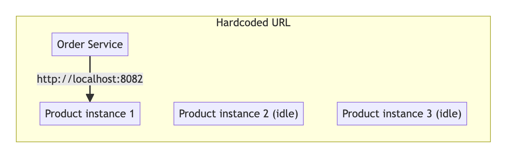
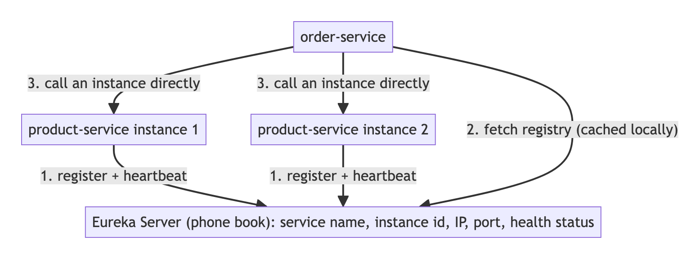
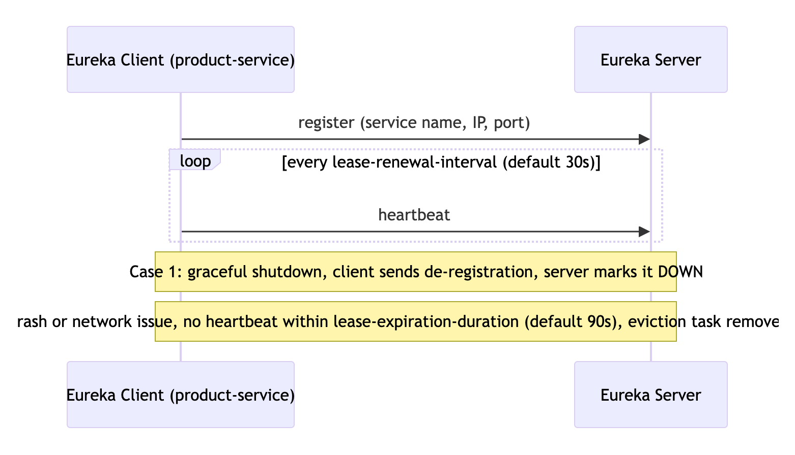
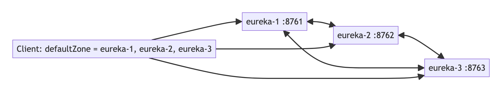

# Service Discovery (Eureka) (Distributed Microservices #4)

<!-- nav -->
⬅ [03 FeignClient – Synchronous Communication](03_FeignClient_Notes.md) · [Index](00_Distributed_Microservices_Index.md) · [05 Client Side Load Balancer](05_Client_Side_Load_Balancer_Notes.md) ➡
<!-- nav -->

Source: https://drive.google.com/file/d/11DAZgXFoArZ17xVLhkIxTYQtUYAJNnr-/view?usp=drive_link

## 1. The problem

In microservices, service (component) instances are **created and deleted dynamically**. We cannot hardcode the URL of a particular instance, it is neither scalable nor feasible.

In the earlier examples ([01](01_RestTemplate_Notes.md), [02](02_RestClient_Notes.md), [03](03_FeignClient_Notes.md)) Order Service hardcodes the URL of Product Service (`http://localhost:8082`). That is fine while Product Service has only 1 instance. With **multiple instances** (and instances that can be removed at any time) the problems are:



- **Single point of failure:** if the hardcoded instance goes down, Order Service cannot talk to any other instance.
- **No load balancing:** only one instance of Product Service gets overburdened while the others stay idle.
- **Tight coupling:** because of the hardcoded URL, without updating Order Service it is not possible to change or move Product Service.
- **Difficulty in testing:** different environments (production, QA, dev) use different URLs, which need frequent config changes. This causes difficulty in testing and is error prone.

**Solution: SERVICE DISCOVERY (like Eureka).**

**In simple words:** instead of saving a friend's phone number in your head, you look it up in a phone book that is always kept up to date.

## 2. Eureka Server and Eureka Client



**Eureka Server** acts like a **phone book**. It has all the instance info of all the registered clients: service name, instance id, IP, port number, health status etc.

**Eureka Client:**

- **Registers itself** with the server.
- **Discovers** an instance of another service via the Eureka Server.

## 3. Set up the Eureka Server application

Create a Spring Boot project from Spring Initializr ([start.spring.io](https://start.spring.io)).

**1. pom.xml**

```xml
<dependency>
    <groupId>org.springframework.cloud</groupId>
    <artifactId>spring-cloud-starter-netflix-eureka-server</artifactId>
</dependency>
```

The version is resolved automatically by the dependency management:

```xml
<dependencyManagement>
    <dependencies>
        <dependency>
            <groupId>org.springframework.cloud</groupId>
            <artifactId>spring-cloud-dependencies</artifactId>
            <version>2023.0.1</version>
            <type>pom</type>
            <scope>import</scope>
        </dependency>
    </dependencies>
</dependencyManagement>
```

**2. Enable Eureka Server functionality**

```java
@SpringBootApplication
/*
  Tells Spring Boot to create necessary beans,
  which are required for Eureka Server like:
  - EurekaController
  - Dashboard etc..
*/
@EnableEurekaServer
public class EurekaServerApplication {

    public static void main(String[] args) {
        SpringApplication.run(EurekaServerApplication.class, args);
    }
}
```

**3. application.properties**

```properties
spring.application.name=eureka-server
server.port=8761

# Since it's a server, we don't want it to register and
# also don't want to fetch the instances details
eureka.client.register-with-eureka=false
eureka.client.fetch-registry=false
```

Start the server and open the dashboard at `http://localhost:8761`.

## 4. Set up a Eureka Client (Product Service)

**1. pom.xml**

```xml
<dependency>
    <groupId>org.springframework.cloud</groupId>
    <artifactId>spring-cloud-starter-netflix-eureka-client</artifactId>
</dependency>
```

(Same `spring-cloud-dependencies` dependency management as above.)

**2. application.properties**

```properties
server.port=8082
spring.application.name=product-service

# path of the Eureka Server
eureka.client.service-url.defaultZone=http://localhost:8761/eureka

# by-default values are true only, so we can even skip below configs
eureka.client.register-with-eureka=true
eureka.client.fetch-registry=true
```

Start Product Service and look at the dashboard again: `PRODUCT-SERVICE` is registered. Similarly register Order Service.

## 5. How Order Service invokes Product Service

**Using RestTemplate**

Without service discovery:

```java
// specifically mentioning the URL
public void callProductAPI(String id) {

    RestTemplate restTemplate = new RestTemplate();
    String response = restTemplate.getForObject(
            "http://localhost:8082/products/" + id,
            String.class
    );

    System.out.println("Response from Product api call is: " + response);
}
```

With service discovery:

```java
import org.springframework.cloud.client.ServiceInstance;
import org.springframework.cloud.client.discovery.DiscoveryClient;

@Autowired
DiscoveryClient discoveryClient;

public void callProductAPI(String id) {

    RestTemplate restTemplate = new RestTemplate();

    List<ServiceInstance> instances = discoveryClient.getInstances("product-service");

    URI uri = instances.get(0).getUri();

    String response = restTemplate.getForObject(
            uri + "/products/" + id,
            String.class
    );

    System.out.println("Response from Product api call is: " + response);
}
```

So with `RestTemplate` the **load balancing logic (choosing an instance of product service) must be handled by us** (here we just took `get(0)`).

**Using FeignClient**

With `FeignClient`, **load balancing is handled automatically by the framework** ([05 Client Side Load Balancer](05_Client_Side_Load_Balancer_Notes.md)). So we also provide the load balancer dependency, apart from `spring-cloud-starter-netflix-eureka-client`:

```xml
<dependency>
    <groupId>org.springframework.cloud</groupId>
    <artifactId>spring-cloud-starter-loadbalancer</artifactId>
</dependency>
```

Earlier, without service discovery:

```java
@FeignClient(
        name = "product-service",
        url = "${feign.client.product-service.url}"
)
public interface ProductClient {

    @GetMapping("/products/{id}")
    String getProductById(@PathVariable("id") String id);
}
```

With service discovery (no `url`, the `name` is the service name registered in Eureka):

```java
@FeignClient(name = "product-service")
public interface ProductClient {

    @GetMapping("/products/{id}")
    String getProductById(@PathVariable("id") String id);
}
```

## 6. Questions a curious engineer asks

**Service registration doubts**

1. How does the Eureka Server know whether a client is UP or DOWN?
2. Where and how is the data stored?
3. What if the Eureka Server itself goes down? Is it a single point of failure?

**Discovery doubts**

4. It can cause a latency issue, as each call now needs 2 hops: first invoke the Eureka Server and then the actual call.
5. What if the local cache is stale? Can this lead to calling a dead instance?

### Q1. How does Eureka know a client is UP or DOWN?



**Through the client's de-registration request.** When a client application is shut down gracefully, the Eureka client sends a de-registration request to the Eureka Server and the server marks the client status as DOWN (you can see it in both the client and the server logs).

**Through the client heartbeat.** The Eureka client **periodically sends a heartbeat** to the Eureka Server. Say the client shuts down without sending any de-registration request (because of a network issue). Then the Eureka Server waits for the heartbeat from the client for a particular interval (decided at registration time), and if no heartbeat is received within that time interval, it **removes the client instance itself**.

Client `application.properties`:

```properties
server.port=8082
spring.application.name=product-service

# path of the Eureka Server
eureka.client.service-url.defaultZone=http://localhost:8761/eureka

# by-default values are true only, so we can even skip below configs
eureka.client.register-with-eureka=true
eureka.client.fetch-registry=true

# every 60 seconds the client will send the heartbeat to the server
eureka.instance.lease-renewal-interval-in-seconds=60

# telling the server to wait this much time, if no heartbeat is received in this time, then remove me.
# for testing, kept it less than lease-renewal-interval
eureka.instance.lease-expiration-duration-in-seconds=5
```

- `eureka.instance.lease-renewal-interval-in-seconds`: after this many seconds the client sends a new heartbeat to the server. **Default is 30 sec.**
- `eureka.instance.lease-expiration-duration-in-seconds`: telling the server to wait only this much time for the heartbeat, after that it can remove the instance from the list. **Default is 90 sec.**

Eureka Server `application.properties`:

```properties
spring.application.name=eureka-server
server.port=8761

# Since it's a server, we don't want it to register and
# also don't want to fetch the instances details
eureka.client.register-with-eureka=false
eureka.client.fetch-registry=false

# by default the Server does not remove the client, even if the heartbeat is missed.
# so we need to turn this OFF and allow the server to remove the client if the heartbeat is missed.
eureka.server.enable-self-preservation=false

# how frequently the eviction task runs
eureka.server.eviction-interval-timer-in-ms=6000
```

Because in the above config the client sends a heartbeat only every 60 seconds while the server waits for it only 5 seconds, **the server removes the client instance from the list even though the client application is running and up.** (Done on purpose here, to see the eviction happen. Never keep the expiration smaller than the renewal interval in a real system.)

**Self-preservation** is a Eureka safety feature: if too many heartbeats are missed at once (possibly a network problem, not dead services), the server stops evicting instances. That is why the property is turned off for the demo.

### Q2. How does the Eureka Server store the data?

Only **in memory**: a `Map<String, Lease<InstanceInfo>>`.

- Key: `appName/instanceId`, for example `PRODUCT-SERVICE/192.157.2.27:product-service:8082`
- Value: an `InstanceInfo` object with instance id, app name, IP address, host name, port, status (UP, DOWN), last renewed timestamp, lease duration etc.

### Q3. What if the Eureka Server goes down?

Yes, a **single Eureka Server is a single point of failure**. Usually a **3 node cluster** is used.



Say we have 3 Eureka Servers on different machines or containers: `eureka-1` at port 8761, `eureka-2` at 8762, `eureka-3` at 8763. Now **each server is a client too**, as they have to register themselves, fetch the registry and replicate changes.

`application.properties` for Eureka server 1:

```properties
spring.application.name=eureka-server
server.port=8761
eureka.instance.hostname=localhost
eureka.client.register-with-eureka=true
eureka.client.fetch-registry=true
eureka.client.service-url.defaultZone=http://localhost:8762/eureka/,http://localhost:8763/eureka/
```

Server 2 (`server.port=8762`) points `defaultZone` to `http://localhost:8761/eureka/,http://localhost:8763/eureka/`, and server 3 (`server.port=8763`) points to `http://localhost:8761/eureka/,http://localhost:8762/eureka/`.

And in the client `application.properties`:

```properties
eureka.client.service-url.defaultZone=http://eureka-1:8761/eureka,http://eureka-2:8762/eureka,http://eureka-3:8763/eureka
```

Now even if 1 server is down, it will not impact the clients' availability.

### Q4. Does every call have 2 hops (latency)?

**No.** The Eureka Server is **not called for every request.** At startup the client (say order-service) fetches the registry (`eureka.client.fetch-registry=true`) and **caches it locally**. All future requests use this local copy to find the instance. We can control how often it refreshes:

```properties
# after every 30 seconds the client will refresh its cache copy
eureka.client.registry-fetch-interval-seconds=30
```

### Q5. What if the local cache is stale? Can it lead to calling a dead instance?

It is a valid scenario and you can say it is a **trade off**: Eureka favours **availability over strict consistency**. For a short window a client may still hold a dead instance. That is why discovery is combined with **retry and circuit breaker** ([08 Retry](08_Retry_Notes.md), [09 Circuit Breaker](09_Circuit_Breaker_Notes.md)) and with load balancer health checks.

## 7. From the GitLab repo

The repo ([springboot-microservices](https://gitlab.com/shrayansh8/springboot-microservices), folder `apigateway_part1`) has exactly this setup as a runnable sample:

| Module | Port | `spring.application.name` | Eureka config |
|---|---|---|---|
| `EurekaServer` | 8761 | `eureka-server` | `register-with-eureka=false`, `fetch-registry=false` |
| `productservice` | 8082 | `product-service` | `defaultZone=http://localhost:8761/eureka` |
| `orderservice` | 8081 | `order-service` | `defaultZone=http://localhost:8761/eureka` |
| `apigateway` | 8083 | `apigateway` | `defaultZone=http://localhost:8761/eureka`, routes with `lb://product-service` and `lb://order-service` ([10 API Gateway Part 1](10_API_Gateway_Part1_Notes.md)) |

Both services only depend on `spring-cloud-starter-netflix-eureka-client`: in current Spring Cloud versions a service registers itself automatically, `@EnableDiscoveryClient` is optional.

**In simple words:** Eureka is the phone book of your microservices. Services register themselves and keep saying "I am alive" (heartbeat). Callers look the address up by name, cache the answer, and run several Eureka servers so the phone book itself is never a single point of failure.

---

<!-- nav -->
⬅ [03 FeignClient – Synchronous Communication](03_FeignClient_Notes.md) · [Index](00_Distributed_Microservices_Index.md) · [05 Client Side Load Balancer](05_Client_Side_Load_Balancer_Notes.md) ➡
<!-- nav -->
