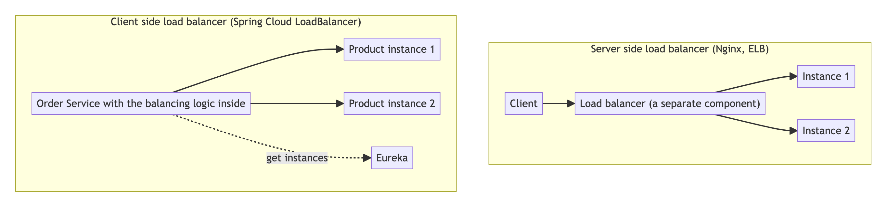
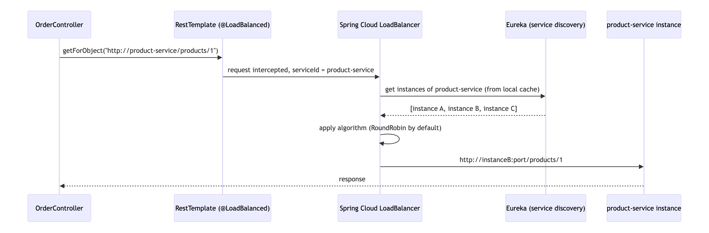

# Client Side Load Balancer (Distributed Microservices #5)

<!-- nav -->
⬅ [04 Service Discovery (Eureka)](04_Service_Discovery_Notes.md) · [Index](00_Distributed_Microservices_Index.md) · [06 Rate Limiter: Fault-Tolerant Microservice (Part 1)](06_Rate_Limiter_Notes.md) ➡
<!-- nav -->

Source: https://drive.google.com/file/d/1uERH11qv6xWBvwHc0BoOJlnn89IzWt95/view?usp=drive_link

Prerequisite: [04 Service Discovery](04_Service_Discovery_Notes.md).

## 1. What is a load balancer?

- It helps in **distributing traffic to multiple instances** of a server.
- It helps in preventing a single server from being **overloaded** with huge traffic.



**Types**

- **Server side:** a centralized load balancer like **Nginx** (like a separate microservice) or **ELB (Elastic Load Balancer)**.
- **Client side:** the load balancing capability is present **inside the client (the caller)**, or it uses a library to take the decision. Like **Spring Cloud LoadBalancer**, Netflix Ribbon, Istio with sidecar etc.

**In simple words:** with a server side balancer all callers send traffic to one front desk that hands out work. With a client side balancer every caller carries its own copy of the "who should I call next" logic, so there is no extra hop and no central front desk to fail.

## 2. Client side load balancing with RestTemplate, before the library

After setting up service discovery, with `RestTemplate` we fetch the list of instances using the `DiscoveryClient` object, and then **the client manually chooses an instance** from the list and invokes the endpoint.

```java
@RestController
@RequestMapping("/orders")
public class OrderController {

    @Autowired
    DiscoveryClient discoveryClient;

    @Autowired
    RestTemplate restTemplate;

    @GetMapping("/{id}")
    public void callProductAPI(@PathVariable String id) {

        List<ServiceInstance> instances = discoveryClient.getInstances("product-service");

        URI uri = instances.get(0).getUri();       // we pick the instance ourselves

        String response = restTemplate.getForObject(
                uri + "/products/" + id,
                String.class
        );

        System.out.println("Response from Product api call is: " + response);
    }
}

@Configuration
public class Config {

    @Bean
    public RestTemplate restTemplateObj() {
        return new RestTemplate();
    }
}
```

## 3. Using Spring Cloud LoadBalancer

**1. Add the dependency**

```xml
<dependency>
    <groupId>org.springframework.cloud</groupId>
    <artifactId>spring-cloud-starter-loadbalancer</artifactId>
</dependency>
```

**2. Mark the `RestTemplate` as `@LoadBalanced`**, and call the service by **its name**:

```java
@RestController
@RequestMapping("/orders")
public class OrderController {

    @Autowired
    RestTemplate restTemplate;

    @Value("${product.service.baseurl}")
    String productBaseURL;

    @GetMapping("/{id}")
    public void callProductAPI(@PathVariable String id) {

        String response = restTemplate.getForObject(
                productBaseURL + "/products/" + id,
                String.class
        );

        System.out.println("Response from Product api call is: " + response);
    }
}

@Configuration
public class Config {

    @Bean
    /*
      With this annotation, the framework starts
      intercepting the request, calls Service Discovery,
      gets instances & applies the load balancing algorithm.
    */
    @LoadBalanced
    public RestTemplate restTemplateObj() {
        return new RestTemplate();
    }
}
```

`application.properties`:

```properties
server.port=8081
spring.application.name=order-service

eureka.client.service-url.defaultZone=http://localhost:8761/eureka

product.service.baseurl=http://product-service
```

Notice `http://product-service`: no host or port, just the **service id**, which the load balancer resolves to a real instance.



## 4. Algorithms

- Each load balancing algorithm is attached to a **ServiceId**. The ServiceId is nothing but the client name, like `"product-service"`.
- By default Spring Cloud LoadBalancer picks the **`RoundRobinLoadBalancer`** algorithm.
- If we do not want the default, we need to define **for which client (ServiceId) which algorithm** we need.
- Spring Cloud LoadBalancer supports **only 2 algorithms: RoundRobin and Random.**
- For others like Weighted, Least Connection etc., either write a **custom implementation** or switch to a **service mesh like Istio with a sidecar**.

### Use `RandomLoadBalancer` only for `product-service`

The controller and `Config` stay the same as above. Add `@LoadBalancerClient` on the application class:

```java
@SpringBootApplication
@EnableFeignClients
@LoadBalancerClient(
        name = "product-service",
        configuration = LoadBalancerProductClientConfig.class
)
public class OrderserviceApplication {

    public static void main(String[] args) {
        SpringApplication.run(OrderserviceApplication.class, args);
    }
}
```

A normal config class generally runs only at application startup. This **`@LoadBalancerClient` config is invoked at runtime too**, when `"product-service"` is used in `http://product-service/xyz`.

```java
@Configuration
public class LoadBalancerProductClientConfig {

    @Bean
    public ReactorLoadBalancer<ServiceInstance> productClientLoadBalancer(
            LoadBalancerClientFactory factory) {

        return new RandomLoadBalancer(
                factory.getLazyProvider(
                        "product-service",
                        ServiceInstanceListSupplier.class
                ),
                "product-service"
        );
    }
}
```

- `ServiceInstanceListSupplier` is the one which **helps to invoke Service Discovery and ask for the instances** of `"product-service"`.
- `new RandomLoadBalancer(ServiceInstanceListSupplier, serviceId)`: we pass the serviceId because this algorithm is mapped to this service id only. So for `"product-service"` only `RandomLoadBalancer` is used.

### Algorithm A for `product-service`, algorithm B for all others

```java
@SpringBootApplication
@EnableFeignClients
/*
  First the child clients config will be loaded, then the default one.
*/
@LoadBalancerClients(
        defaultConfiguration = LoadBalancerGlobalConfig.class,
        value = {
                @LoadBalancerClient(
                        name = "product-service",
                        configuration = LoadBalancerProductClientConfig.class
                )
        }
)
public class OrderserviceApplication {

    public static void main(String[] args) {
        SpringApplication.run(OrderserviceApplication.class, args);
    }
}
```

This `@LoadBalancerClients` config is loaded at runtime for each service id, so `environment.getProperty(LoadBalancerClientFactory.PROPERTY_NAME)` is resolved at runtime. **`@ConditionalOnMissingBean` is required on the global config class**, because for `"product-service"` two `ReactorLoadBalancer` beans should not get created (one from `LoadBalancerProductClientConfig` and another from `LoadBalancerGlobalConfig`).

So below: for `"product-service"` the **Random** algorithm is used and for all other services the **RoundRobin** algorithm is used.

```java
@Configuration
@ConditionalOnMissingBean(ReactorLoadBalancer.class)
public class LoadBalancerGlobalConfig {

    @Bean
    public ReactorLoadBalancer<ServiceInstance> roundRobinLoadBalancer(
            LoadBalancerClientFactory factory,
            Environment environment) {

        String serviceId = environment.getProperty(LoadBalancerClientFactory.PROPERTY_NAME);

        return new RoundRobinLoadBalancer(
                factory.getLazyProvider(
                        serviceId,
                        ServiceInstanceListSupplier.class
                ),
                serviceId
        );
    }
}

@Configuration
public class LoadBalancerProductClientConfig {

    @Bean
    public ReactorLoadBalancer<ServiceInstance> productClientLoadBalancer(
            LoadBalancerClientFactory factory) {

        return new RandomLoadBalancer(
                factory.getLazyProvider(
                        "product-service",
                        ServiceInstanceListSupplier.class
                ),
                "product-service"
        );
    }
}
```

### Our own custom algorithm

```java
public class MyCustomLoadBalancer implements ReactorServiceInstanceLoadBalancer {

    private final ObjectProvider<ServiceInstanceListSupplier> serviceInstanceSuppliers;
    private final String serviceId;

    public MyCustomLoadBalancer(
            ObjectProvider<ServiceInstanceListSupplier> serviceInstanceSuppliers,
            String serviceId) {

        this.serviceInstanceSuppliers = serviceInstanceSuppliers;
        this.serviceId = serviceId;
    }

    @Override
    public Mono<Response<ServiceInstance>> choose(Request request) {

        return serviceInstanceSuppliers
                .getIfAvailable()
                .get()
                .next()
                .map(instances -> {
                    if (instances == null || instances.isEmpty()) {
                        return new EmptyResponse();
                    }
                    // Custom load balancing algorithm (demo: pick first instance)
                    return new DefaultResponse(instances.get(0));
                });
    }
}
```

Then return `new MyCustomLoadBalancer(factory.getLazyProvider("product-service", ServiceInstanceListSupplier.class), "product-service")` from the `@Bean` method in `LoadBalancerProductClientConfig`.

## 5. FeignClient

During service discovery ([04](04_Service_Discovery_Notes.md)) we saw that **FeignClient handles load balancing automatically**. So for the load balancer everything is the same as with `RestTemplate`, no change at all (the `@LoadBalancerClient` config also applies):

```java
@RestController
@RequestMapping("/orders")
public class OrderController {

    @Autowired
    ProductClient productClient;

    @GetMapping("/{id}")
    public void callProductAPI(@PathVariable String id) {

        String response = productClient.getProductById(id);
        System.out.println("Response from Product api call is: " + response);
    }
}
```

**In simple words:** mark the `RestTemplate` as `@LoadBalanced` (or just use Feign), call `http://product-service`, and the framework fetches the instances from Eureka and picks one for you. Round robin by default, random if you say so, anything else if you write your own `choose()`.

---

<!-- nav -->
⬅ [04 Service Discovery (Eureka)](04_Service_Discovery_Notes.md) · [Index](00_Distributed_Microservices_Index.md) · [06 Rate Limiter: Fault-Tolerant Microservice (Part 1)](06_Rate_Limiter_Notes.md) ➡
<!-- nav -->
