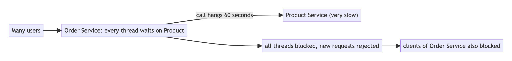
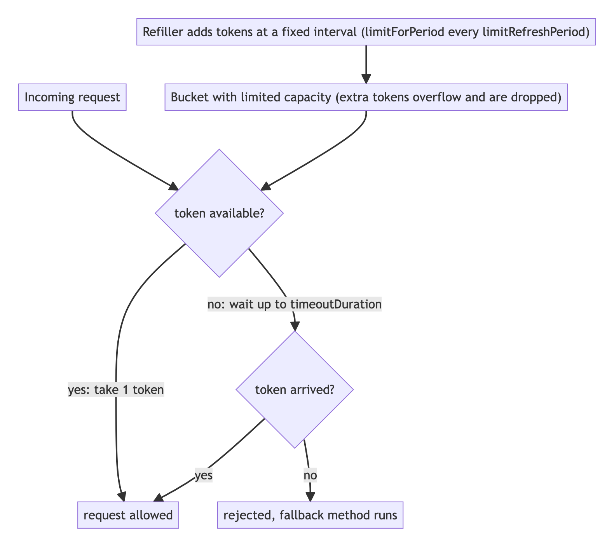

# Rate Limiter: Fault-Tolerant Microservice (Part 1) (Distributed Microservices #6)

<!-- nav -->
⬅ [05 Client Side Load Balancer](05_Client_Side_Load_Balancer_Notes.md) · [Index](00_Distributed_Microservices_Index.md) · [07 Bulkhead: Fault-Tolerant Microservice (Part 2)](07_Bulkhead_Notes.md) ➡
<!-- nav -->

Source: https://drive.google.com/file/d/1EwfhhSiBNJw87tqvoaseW5ZKUKB-YJDx/view?usp=drive_link

## 1. What is a fault-tolerant microservice?

A fault tolerant microservice is a service which **continues to work even when a downstream system fails**. Instead of crashing or causing cascading failures, it **handles the failure gracefully**.

### Why is it required?

In microservices, different services communicate **over the network**, and it is possible that **one service's unavailability brings down the whole system**.

Say, because of buggy code or an infrastructure issue, the **Product** service becomes too slow and takes 60 seconds to respond. If proper fault tolerance is not applied:



- A call from Order service hangs for 60 seconds, so **a thread is blocked** for that period.
- If a sudden burst of requests comes from Order to Product, **all threads get blocked** (waiting for the response).
- Because of this, the **clients of Order service also get blocked**.
- Eventually services **run out of threads** and start rejecting requests.

This is known as a **CASCADING FAILURE**: the issue is at Product service, but it has now propagated to other services too. To avoid it we need to **build fault tolerant microservices**.

**In simple words:** one slow shop in a mall can make every queue in the mall stop moving. Fault tolerance is the set of safety valves that keeps one slow service from jamming the others.

### The recommended order of the safety valves

```
RateLimiter → Bulkhead → TimeLimiter → CircuitBreaker → Retry
```

(Parts: [06 Rate Limiter](06_Rate_Limiter_Notes.md), [07 Bulkhead](07_Bulkhead_Notes.md), [08 Retry](08_Retry_Notes.md), [09 Circuit Breaker](09_Circuit_Breaker_Notes.md).)

**Why does the ordering matter?** For example, always apply the RateLimiter **before** Retry, so that the retry logic does not overwhelm the system with traffic which would be blocked by the RateLimiter anyway. Otherwise we end up retrying traffic that gets blocked by the RateLimiter later.

## 2. RateLimiter

It controls **the number of requests allowed to a microservice in a given time window.** In other words it protects our system from a **sudden traffic spike** (like in a DDoS attack).

### Algorithms

#### 1. Fixed Window Counter

- Counts how many requests happen in a fixed window. If the count crosses the limit, **reject the request**.
- Example: Limit = 5, fixed window size = 10 seconds.
- **Disadvantage:** if traffic arrives at the **edge** (end of the 1st window and the start of the 2nd window) there is a chance of a sudden spike: even though the limit is 5 in 10 seconds, **10 requests can arrive in just 1 second.**

#### 2. Sliding Log

- For each accepted request it **stores the exact timestamp**.
- When a request comes in, it first checks **how many requests happened in the last X seconds (the window size)**. If the number of requests has reached the LIMIT, the request is rejected.
- Window = 10 seconds, limit = 5. As time moves the slider moves on, so only requests **inside the slider window** are counted. If the window already has 5 requests the new one is rejected; if it has only 4 the new one is accepted.
- **Disadvantage:** needs to keep timestamp info for each accepted request, so **more memory**. Extra overhead of **cleaning up** expired timestamps.

#### 3. Sliding Window Counter with sub-windows

- The main window is **divided into equal sized sub-windows**. It keeps track of the **number of requests in each sub-window**. To decide whether a request must be rejected, it considers only the **active sub-windows**. The main window slides (by the sub-window size) over time.
- Window = 10 s, sub-window = 2 s, limit = 5. A request at the 9th second sums the active sub-windows SW1(0-2) + SW2(2-4) + SW3(4-6) + SW4(6-8) + SW5(8-10) = 1 + 1 + 1 + 1 + 0 = 4, which is less than 5, so it is **allowed**.
- When time crosses the 10th second the window **jumps by one sub-window**. A request at the 11th second sums SW1(2-4) + SW2(4-6) + SW3(6-8) + SW4(8-10) + SW5(10-12) = 4, so it is also allowed.
- **Disadvantage:** more complex than the fixed window; needs to maintain the sub-window info and a request count per sub-window, so more memory.

#### 4. Sliding Window Counter with weighted window

- It simplifies the logic by **removing the sub-window granularity** and bringing in some **approximation**. It combines the Fixed Window and Sliding Log ideas.
- A slider window (equal to the fixed window size, say 10 s) can be **between two fixed windows**; it uses a **percentage** to decide how much of it lies in the previous window and how much in the current window:

```
count = requests in current fixed window + (percent overlap) x requests in previous window
```

- Limit = 5. A request at the 11th second (slider is 90% in the previous window): 0 in the current window + 90% of the 5 requests of the previous window = 4.5 → rounded up to ~5. 0 + 5 = 5, the limit is reached, so the request is **rejected**.
- A request at the 12th second (80% overlap): 0 + 80% of 5 = 4, which is less than 5, so it is **permitted**.
- **Disadvantage:** it **assumes a uniform distribution of traffic**, which might not be true sometimes.

#### 5. Token Bucket

- A limited number of **tokens** are placed in a bucket. **Each request consumes one token.** If there is no token left, the request is denied.
- A **re-filler** adds tokens to the bucket at a regular time interval. If the bucket is full, the extra token **overflows** and is dropped.
- **Disadvantage:** a **quick burst** is possible if the token capacity is not set properly. If the system stays idle, tokens keep accumulating, and when a sudden burst comes it is allowed because the tokens are present.



#### 6. Leaky Bucket

- Requests are **queued** and **processed at a fixed rate**. If the queue is full, the incoming request **overflows** (is rejected).
- **Disadvantage:** **latency increases**, as a request might have to wait in the queue for its turn. The queue size is a bottleneck, so it must be set properly.

| Algorithm | Memory | Burst handling | Main weakness |
|---|---|---|---|
| Fixed window | very low | double burst at the window edge | boundary spike |
| Sliding log | high (one timestamp per request) | exact | memory and cleanup |
| Sliding window (sub-windows) | medium | good | complexity |
| Sliding window (weighted) | low | approximate | assumes uniform traffic |
| Token bucket | low | allows bursts up to bucket size | bursts after idle time |
| Leaky bucket | queue size | smooths traffic | added latency |

## 3. Implementation in Spring Boot

**Resilience4j by default applies the token bucket algorithm.**

**pom.xml**

```xml
<dependency>
    <groupId>io.github.resilience4j</groupId>
    <artifactId>resilience4j-spring-boot3</artifactId>
    <version>2.1.0</version>
</dependency>
```

(The `@RateLimiter` annotation is applied with AOP, so `spring-boot-starter-aop` should also be on the classpath.)

```java
@RestController
@RequestMapping("/orders")
public class OrderController {

    @Autowired
    OrderService orderService;

    @GetMapping("/{id}")
    public void callProductAPI(@PathVariable String id) {
        orderService.invokeProductAPI(id);
    }
}
```

```java
@FeignClient(name = "product-service")
public interface ProductClient {

    @GetMapping(value = "/products/{id}")
    String getProductById(@PathVariable("id") String id);
}
```

```java
@Component
public class OrderService {

    @Autowired
    ProductClient productClient;

    /*
      Internally it uses AOP functionality, that's why
      the method on which this @RateLimiter annotation applies
      needs to be public and a Spring managed bean.
    */
    @RateLimiter(name = "productRateLimiter", fallbackMethod = "rateLimitedFallback")
    public void invokeProductAPI(String id) {
        String response = productClient.getProductById(id);
        System.out.println("Response from Product api call is: " + response);
    }

    /*
      Fallback method: return type and parameters
      (additionally only Throwable needs to be added)
      should match with the original method, else the default
      fallback method provided by the RateLimiter framework will get invoked.
    */
    public void rateLimitedFallback(String id, Throwable t) {
        System.out.println("Rate limit exceeded. Try later");
        // throw an exception here and handle it gracefully
    }
}
```

`application.properties`

```properties
server.port=8081
spring.application.name=order-service
eureka.client.service-url.defaultZone=http://localhost:8761/eureka

# bucket filled with 2 tokens every 10 seconds,
# if there is no token wait for 1 sec before rejecting the request
resilience4j.ratelimiter.instances.productRateLimiter.limitForPeriod=2
resilience4j.ratelimiter.instances.productRateLimiter.limitRefreshPeriod=10s
resilience4j.ratelimiter.instances.productRateLimiter.timeoutDuration=1s
```

| Property | Meaning |
|---|---|
| `limitForPeriod` | tokens added per refresh period (here 2) |
| `limitRefreshPeriod` | how often the bucket is refilled (here every 10 s) |
| `timeoutDuration` | how long a request waits for a token before being rejected (here 1 s) |

**Output:** hit the API frequently: after 2 calls the tokens are finished and the next call gets the *Rate limit exceeded* message. After waiting 10 seconds, a token is available again and the API can be hit again.

The `@RateLimiter` annotation works in the same way if we use `RestTemplate` or `RestClient`, no change.

## 4. Custom rate limiting logic with AOP

If we want to write custom rate limiting logic, we can do it easily using AOP:

```java
@Target(ElementType.METHOD)
@Retention(RetentionPolicy.RUNTIME)
public @interface CustomRateLimiter {
    int limit();              // max requests
    int windowInSeconds();    // sliding window duration
}
```

```java
@Aspect
@Component
public class RateLimiterAspect {

    @Around("@annotation(customRateLimiter)")
    public Object rateLimit(ProceedingJoinPoint pjp,
                            CustomRateLimiter customRateLimiter) throws Throwable {

        // custom rate limiting logic, if request accepted, invoke the method
        return pjp.proceed();
    }
}
```

```java
@CustomRateLimiter(limit = 5, windowInSeconds = 60)
public String getProducts() {
    // service call
    return "List of products";
}
```

**In simple words:** a rate limiter is the bouncer at the door: only N people per time slice. Resilience4j gives you a token-bucket bouncer with one annotation, and you can write your own bouncer with an aspect. Next: [07 Bulkhead](07_Bulkhead_Notes.md), TimeLimiter, [09 Circuit Breaker](09_Circuit_Breaker_Notes.md) and [08 Retry](08_Retry_Notes.md).

---

<!-- nav -->
⬅ [05 Client Side Load Balancer](05_Client_Side_Load_Balancer_Notes.md) · [Index](00_Distributed_Microservices_Index.md) · [07 Bulkhead: Fault-Tolerant Microservice (Part 2)](07_Bulkhead_Notes.md) ➡
<!-- nav -->
