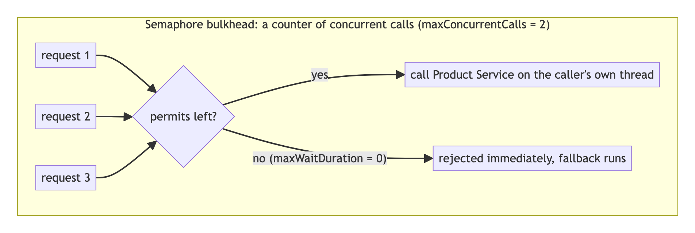
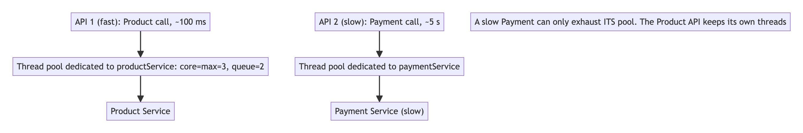

# Bulkhead: Fault-Tolerant Microservice (Part 2) (Distributed Microservices #7)

<!-- nav -->
⬅ [06 Rate Limiter: Fault-Tolerant Microservice (Part 1)](06_Rate_Limiter_Notes.md) · [Index](00_Distributed_Microservices_Index.md) · [08 Retry](08_Retry_Notes.md) ➡
<!-- nav -->

Source: https://drive.google.com/file/d/1CSXu3bNRsvwhsvIr2EdTkbyP7fUHQMt7/view?usp=drive_link

To build fault tolerant microservices, Resilience4j provides several mechanisms ([06 Rate Limiter](06_Rate_Limiter_Notes.md) was the first). Now Bulkhead.

## 1. Rate Limiter vs Bulkhead

**Rate Limiter**

- Protects our application **from our clients**, by limiting **how many requests we accept within a specific time window**.
- Example: our application is "Order". The rate limiter never talks about the concurrency.

**Bulkhead**

- It helps to control **how many concurrent requests can go to a downstream service**.
- It also protects our application **from our downstream services**, by limiting **how many threads we allocate to them**.

**In simple words:** a ship is divided into watertight compartments (bulkheads), so one leak does not sink the ship. In code, each downstream service gets its own limited compartment of threads or permits, so one slow downstream cannot take all of them.

**Use case 1 (limit concurrent calls):** "Product" is a small, light weight service and can only handle 3 concurrent requests. This is solved with the **Semaphore Bulkhead**.

**Use case 2 (isolate threads):** our Order Service has 2 APIs:

- API 1 makes a downstream call to Product service (takes ~100 ms, a fast service).
- API 2 makes a downstream call to Payment service (takes ~5 s, a slow service).

What if there is a sudden spike in API 2 traffic and more and more calls go to Payment service (say the calls are not concurrent)? Since Payment service is slow, it holds (blocks) the thread longer (~5 s), and it is possible that **all the threads of Order service are now blocked by the Payment service only**. Now even the fast endpoint of Order service (API 1) becomes unavailable, as there are no threads available. This is solved with the **Thread Pool Bulkhead**.

## 2. Semaphore Bulkhead

- **Limits the number of concurrent calls using a counter.**
- If the limit is reached, further calls are **rejected immediately or blocked for a specific wait time**.
- It limits the concurrent calls via a **Semaphore lock** (see the Semaphore section of 32 Locks and Condition (Java notes)).



**pom.xml**

```xml
<dependency>
    <groupId>io.github.resilience4j</groupId>
    <artifactId>resilience4j-spring-boot3</artifactId>
    <version>2.1.0</version>
</dependency>
```

```java
@RestController
@RequestMapping("/orders")
public class OrderController {

    @Autowired
    OrderService orderService;

    @GetMapping("/{id}")
    public void callProductAPI(@PathVariable String id) {
        orderService.invokeProductAPI(id);
    }
}

@FeignClient(name = "product-service")
public interface ProductClient {

    @GetMapping(value = "/products/{id}")
    String getProductById(@PathVariable("id") String id);
}
```

```java
@Component
public class OrderService {

    @Autowired
    ProductClient productClient;

    @Bulkhead(
            name = "productService",
            type = Bulkhead.Type.SEMAPHORE,
            fallbackMethod = "productFallback"
    )
    public void invokeProductAPI(String id) {
        String response = productClient.getProductById(id);
        System.out.println("Response from Product api call is: " + response);
    }

    public void productFallback(String id, Throwable t) {
        System.out.println("too many concurrent request, pls try again later");
        // throw exception here and handle it gracefully
    }
}
```

`application.properties`

```properties
server.port=8081

spring.application.name=order-service

eureka.client.service-url.defaultZone=http://localhost:8761/eureka

# only 2 concurrent calls allowed and
# for further requests, if there is no permit available, the request will fail immediately
resilience4j.bulkhead.instances.productService.maxConcurrentCalls=2
resilience4j.bulkhead.instances.productService.maxWaitDuration=0
```

**`maxWaitDuration` accepted values:** `<number><time-unit>`

| Unit | Meaning |
|---|---|
| `ms` | milliseconds |
| `s` | seconds |
| `m` | minutes |
| `h` | hours |
| `d` | days (not typical, but valid) |

```properties
resilience4j.bulkhead.instances.productService.maxWaitDuration=0      # Reject immediately
resilience4j.bulkhead.instances.productService.maxWaitDuration=300ms  # Wait 300 milliseconds
resilience4j.bulkhead.instances.productService.maxWaitDuration=2s     # Wait 2 seconds
resilience4j.bulkhead.instances.productService.maxWaitDuration=1m     # Wait 1 minute
```

(Properties files do not allow trailing `#` comments on the same line; keep the comment on its own line when you use them.)

## 3. Thread Pool Bulkhead

- Assign a **dedicated thread pool for each service**.
- **Only that pool is used** to call the downstream. (How thread pools and `ThreadPoolExecutor` work: 34 Thread Pools (Java notes).)



```java
@Component
public class OrderService {

    @Autowired
    ProductClient productClient;

    /*
      • The AOP proxy intercepts your method call.
      • It submits your method to the Bulkhead's thread pool
        (configured via application.properties):

            CompletableFuture.supplyAsync(() -> {
                return ourMethodLogic();     // The whole method body runs here
            }, bulkheadThreadPoolExecutor);

      • It returns a CompletableFuture to the caller for async response.
      • Inside your method, CompletableFuture.completedFuture(...)
        just wraps the result in a completed future,
        it does NOT run anything in a thread pool.
    */
    @Bulkhead(
            name = "productService",
            type = Bulkhead.Type.THREADPOOL,
            fallbackMethod = "productFallback"
    )
    public CompletableFuture<String> invokeProductAPI(String id) {
        return CompletableFuture.completedFuture(
                productClient.getProductById(id)
        );
    }

    public CompletableFuture<String> productFallback(String id, Throwable t) {
        // even though it's async, we need to properly handle the exception
        // else our client will get a 500 response with BulkheadFullException
        return CompletableFuture.completedFuture("Product Service is busy");
    }
}
```

`application.properties`

```properties
server.port=8081

spring.application.name=order-service
eureka.client.service-url.defaultZone=http://localhost:8761/eureka

# max 3 threads in the pool and that's the max pool size too.
# if all 3 threads are busy, max 2 more requests will be put into the queue
# from the 6th request onwards, it will start rejecting the requests.
resilience4j.thread-pool-bulkhead.instances.productService.coreThreadPoolSize=3
resilience4j.thread-pool-bulkhead.instances.productService.maxThreadPoolSize=3
resilience4j.thread-pool-bulkhead.instances.productService.queueCapacity=2
```

A thread pool for `productService` is created with these configurations (the same core / max / queue idea as `ThreadPoolExecutor`).

**Testing the output:** add a `System.out.println("Thread name is:" + Thread.currentThread().getName());` inside `invokeProductAPI` and print `"Product Service is busy"` in the fallback. Max thread pool size is 3 and the queue size is 2. Invoke the API 6 times: the first 3 run on the 3 pool threads, the next 2 wait in the queue, and the 6th is rejected so the fallback prints `Product Service is busy`.

| | Semaphore bulkhead | Thread pool bulkhead |
|---|---|---|
| Limits | number of concurrent calls (a counter) | threads and queue per downstream |
| Runs on | the caller's own thread | a dedicated pool thread |
| Method return | normal | `CompletableFuture` |
| Best for | a light downstream that handles only N concurrent calls | isolating slow downstreams so they cannot starve the rest of the service |

## 4. Time Limiter

- **Time Limiter** is used to prevent an **async call from hanging indefinitely**.
- Time Limiter is **non-blocking** in Resilience4j. It is mainly designed for **asynchronous operations** that return a reactive type like `Mono`, `Flux` etc.
- But so far we have covered **blocking calls** like `RestTemplate`, `RestClient` and `FeignClient`, and we already covered how to control the timeout of blocking calls (connect and read timeout, e.g. the Feign example in [03 FeignClient](03_FeignClient_Notes.md)).
- The Time Limiter concept is the same but for reactive calls. It will be covered when we start Spring WebFlux (reactive programming).

**In simple words:** the rate limiter says "how many people may enter per minute", the bulkhead says "how many people may be inside at the same time, and each group gets its own room". Use the semaphore one to protect a small downstream, the thread pool one to protect your own threads from a slow downstream.

---

<!-- nav -->
⬅ [06 Rate Limiter: Fault-Tolerant Microservice (Part 1)](06_Rate_Limiter_Notes.md) · [Index](00_Distributed_Microservices_Index.md) · [08 Retry](08_Retry_Notes.md) ➡
<!-- nav -->
