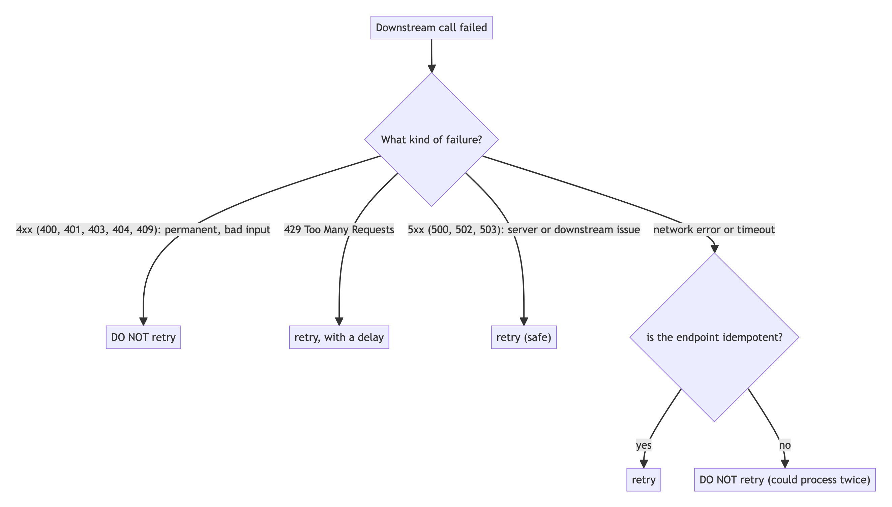
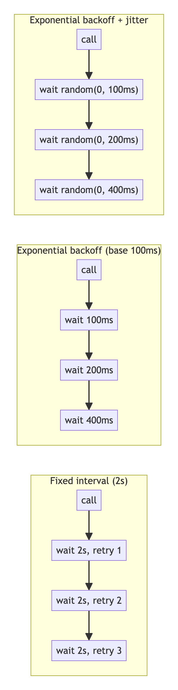

# Retry (Distributed Microservices #8)

<!-- nav -->
⬅ [07 Bulkhead: Fault-Tolerant Microservice (Part 2)](07_Bulkhead_Notes.md) · [Index](00_Distributed_Microservices_Index.md) · [09 Circuit Breaker: Fault-Tolerant Microservice (Part 4)](09_Circuit_Breaker_Notes.md) ➡
<!-- nav -->

Source: https://drive.google.com/file/d/1F4e2EwjCfi11-q7RdujOqiPgt7oCbO7B/view?usp=drive_link

## 1. What and why

In a distributed system, a call to a downstream service might fail because of **transient issues**: short, temporary problems like a network glitch or a timeout. A **retry of the same request after a short delay can succeed**.

**A question:** why should we retry? Why can't the user or client invoke our API again, so that we automatically invoke the downstream again?

For each call a lot of heavy processing is done, and it is **not free** (memory, time, resources). Say 90% of the API functionality is completed and then, while invoking the downstream, a transient issue comes. Is it a good idea to throw away the 90% of work done and perform the same 90% again with a new API call? Or **retry** only the failed part: if it succeeds we save the cost **and** give a better user experience.

**In simple words:** if the phone call drops at the last step of a booking, you redial that step, you do not start the whole booking again.

So now the questions: **when** to retry and **how** to retry?

## 2. When to retry?



- **Do not retry on permanent failures**, e.g. 4xx errors. 4xx are validation errors, meaning there is an issue with the input request, so even if you retry with the same request it will fail again with the same validation error.
- **Do not retry if the operation is non-idempotent.** Idempotency makes sure that if a request is retried multiple times, **duplicate processing does not happen**. For example, if a payment call timed out but the endpoint is not idempotent, retrying could charge the user twice. (Idempotency and how to design such APIs is covered in the HLD notes.)
- **Rule of thumb: retry on 5xx errors.** A 5xx means there is an issue with the system and the request was not successful. It could be a transient issue, and it is pretty safe to retry those.
- **Retry network errors and timeouts only if the endpoint ensures idempotency.**

### Retry decision table

| HTTP status | Meaning | Retry? |
|---|---|---|
| 200 | OK, success | No |
| 400 | Bad Request, client error (invalid input) | No |
| 401 | Unauthorized, authentication needed | No |
| 403 | Forbidden, access denied | No |
| 404 | Not Found, resource not found | No |
| 409 | Conflict | No |
| 429 | Too Many Requests, rate limiting | Yes (with delay) |
| 500 | Internal Server Error, server issue | Yes |
| 502 | Bad Gateway, downstream service failure | Yes |
| 503 | Service Unavailable, down or overloaded | Yes |
| Network error | connection failure, timeout | Yes (idempotent only) |

## 3. How to retry? Types of retry



### 3.1 Fixed interval

Retry after a **constant delay**. Example: total attempts = 4 (the original call + 3 retries) with a 2 second fixed interval: the original call, then retries after 2 s, 4 s and 6 s from the first failure.

- **Advantage:** very simple, easy to configure and debug.
- **Disadvantage:** high chance of a **retry storm (thundering herd problem)**: many clients retry at the same time, causing a surge of retry traffic, and the system spends its resources on retries instead of handling new requests. (Thundering herd and its solution are covered in the HLD notes.)

```java
@RestController
@RequestMapping("/orders")
public class OrderController {

    @Autowired
    OrderService orderService;

    @GetMapping("/{id}")
    public void callProductAPI(@PathVariable String id) {
        orderService.invokeProductAPI(id);
    }
}

@FeignClient(name = "product-service")
public interface ProductClient {

    @GetMapping(value = "/products/{id}")
    String getProductById(@PathVariable("id") String id);
}
```

```java
@Component
public class OrderService {

    @Autowired
    ProductClient productClient;

    /*
      @Retry is applied on top of the method where only the downstream service
      invocation is present. Do make sure that the method contains only that code
      which you want to retry.
      When all retries finish off, then the fallback method will be invoked.
    */
    @Retry(name = "productService", fallbackMethod = "productFallback")
    public void invokeProductAPI(String id) {
        String response = productClient.getProductById(id);
    }

    public void productFallback(String id, Throwable t) {
        System.out.println("Product Service is busy");
    }
}
```

`application.properties`

```properties
server.port=8081
spring.application.name=order-service
eureka.client.service-url.defaultZone=http://localhost:8761/eureka

# fixed delay interval
resilience4j.retry.instances.productService.maxAttempts=3
resilience4j.retry.instances.productService.waitDuration=2s
```

**Testing:** stop the Product service so the failure happens at invocation, and add a try/catch with a print inside the method (and rethrow, otherwise the retry cannot see the failure):

```java
@Retry(name = "productService", fallbackMethod = "productFallback")
public void invokeProductAPI(String id) {

    String response = "";
    try {
        response = productClient.getProductById(id);
    } catch (Exception e) {
        System.out.println("not able to invoke Product");
        throw e;
    }

    System.out.println("Response from product api call: " + response);
}
```

**Output:** max attempts is 3, which means 1 original call and 2 retry calls (3 times "not able to invoke Product", then the fallback prints `Product Service is busy`).

**Internally what might have happened:** AOP generated proxy code that looks like this programmatic version:

```java
public Retry fixedRetry() {
    RetryConfig config = RetryConfig.custom()
            .maxAttempts(4)
            /*
              IntervalFunction helps to determine the delay between retries.
              It has many pre-defined functions like:
              - IntervalFunction of(long intervalMillis)                         // for fixed delay
              - IntervalFunction ofExponentialBackoff(long initialIntervalMillis,
                                                      double multiplier, long maxIntervalMillis)
              etc..
            */
            .intervalFunction(IntervalFunction.of(2000))
            /*
              Retry will only happen for these exceptions or their subclass exceptions.
            */
            .retryExceptions(IOException.class, ArithmeticException.class)
            .build();

    return Retry.of("fixedRetry", config);
}
```

### 3.2 Exponential backoff

The delay **increases exponentially**: `delay = Base * 2^(number of failed retry attempts)`.

Example: total attempts = 4 (original + 3 retries), base = 100 ms:

| Retry | Delay |
|---|---|
| 1st | 100 * 2^0 = 100 ms |
| 2nd | 100 * 2^1 = 200 ms |
| 3rd | 100 * 2^2 = 400 ms |

- **Advantage:** reduces load on the downstream service during an outage; helps to avoid the thundering herd problem to some extent.
- **Disadvantage:** if the outage period is short, the user might wait longer than needed. There is still some risk of the thundering herd problem, because all clients use the **same formula** (`Base * 2^retry attempt`) to calculate the retry interval.

Everything is the same, only the configuration changes:

```properties
server.port=8081

spring.application.name=order-service

eureka.client.service-url.defaultZone=http://localhost:8761/eureka

# exponential backoff
resilience4j.retry.instances.productService.maxAttempts=4
resilience4j.retry.instances.productService.waitDuration=1s
resilience4j.retry.instances.productService.enableExponentialBackoff=true
resilience4j.retry.instances.productService.exponentialBackoffMultiplier=2
```

The framework class that computes it (`Backoff.java`):

```java
/*
  Formula is:
  initial wait time * (factor ^ no of failed retry attempts)

  1st retry = 1000ms * (2^0) = 1000ms = 1sec delay
  2nd retry = 1000ms * (2^1) = 2000ms = 2sec delay
  3rd retry = 1000ms * (2^2) = 4000ms = 4sec delay
*/
nextBackoff = firstBackoff.multipliedBy((long) Math.pow(factor, (context.iteration() - 1)));
if (nextBackoff.compareTo(maxBackoffInterval) >= 0) {
    nextBackoff = maxBackoffInterval;
}
```

**Output:** max attempts is 4 (1 original call and 3 retry calls). The AOP proxy equivalent:

```java
public Retry exponentialRetry() {

    RetryConfig config = RetryConfig.custom()
            .maxAttempts(4)
            .intervalFunction(
                    IntervalFunction.ofExponentialBackoff(1000, 2)   // initialIntervalMillis, multiplier
            )
            .retryExceptions(Exception.class)
            .build();

    return Retry.of("exponentialBackOffRetry", config);
}
```

### 3.3 Exponential backoff + jitter

Similar to exponential backoff, but adds **jitter (randomness)** to the delay to avoid retry storms.

```
delay = random_between(0, min(maxDelay, baseDelay * 2^(failed retry attempts)))
```

- **Advantage:** best for distributed systems, the probability of a thundering herd becomes very low. Retries are **spread over time**, reducing the peak load.
- **Disadvantage:** not easy to debug, a little complex.

```properties
server.port=8081
spring.application.name=order-service
eureka.client.service-url.defaultZone=http://localhost:8761/eureka

# exponential backoff + jitter
resilience4j.retry.instances.productService.maxAttempts=4
resilience4j.retry.instances.productService.waitDuration=1s
resilience4j.retry.instances.productService.enableExponentialBackoff=true
resilience4j.retry.instances.productService.exponentialBackoffMultiplier=2
resilience4j.retry.instances.productService.enableRandomizedWait=true
```

Programmatic equivalent:

```java
public Retry exponentialJitterRetry() {

    RetryConfig config = RetryConfig.custom()
            .maxAttempts(6)
            .intervalFunction(
                    /*
                      Using the appropriate IntervalFunction method for delay computation
                    */
                    IntervalFunction.ofExponentialRandomBackoff(
                            2000,    // initialIntervalMillis
                            2        // multiplier
                    )
            )
            .retryExceptions(Exception.class)
            .build();

    return Retry.of("exponentialBackOffRetry", config);
}
```

### 3.4 Custom retry

Define your own retry delay strategy.

- **Advantage:** full control and flexibility.
- **Disadvantage:** harder to maintain.

```java
@Configuration
public class Config {

    @Bean
    public Retry customRetry() {

        /*
          IntervalFunction defines the wait time between retries.
        */
        IntervalFunction fibonacciInterval = attempt -> {
            return 2000L;       // return milliseconds as long
        };

        /*
          Within the RetryConfig object, we provide all the configs like max
          attempt, which IntervalFunction to use to compute the delay etc.
        */
        RetryConfig config = RetryConfig.custom()
                .maxAttempts(6)
                .intervalFunction(fibonacciInterval)
                .retryExceptions(Exception.class)
                .build();

        /*
          Then create the Retry object from RetryConfig. We can give any name to our Retry.
        */
        return Retry.of("customRetry", config);
    }
}
```

```java
@Component
public class OrderService {

    @Autowired
    ProductClient productClient;

    @Autowired
    Retry customRetry;

    public void invokeProductAPI(String id) {
        try {
            /*
              Need to manually wrap the call within Retry.
              As the @Retry annotation works only for those Retry
              types for which we can provide config in application.properties.
            */
            customRetry.executeSupplier(() -> {
                System.out.println("calling product service at " + java.time.LocalTime.now());
                return productClient.getProductById(id);
            });
        } catch (Exception e) {
            System.out.println("all retries failed, this is fallback");
        }
    }
}
```

(The name `fibonacciInterval` in the example just returns a fixed 2000 ms as a placeholder; plug in your own formula using `attempt`.)

## 4. Summary

| Strategy | Delay | Good | Bad |
|---|---|---|---|
| Fixed | constant | simple | retry storm |
| Exponential backoff | grows exponentially | reduces downstream load | same formula for all clients |
| Exponential + jitter | random up to the exponential value | best for distributed systems, spreads load | harder to debug |
| Custom | your own `IntervalFunction` | full control | harder to maintain |

**In simple words:** retry only the failures that can heal (5xx, timeouts on idempotent calls), wait a bit longer each time, and add randomness so thousands of clients do not all come back at the same millisecond. Retry sits **after** rate limiter, bulkhead and circuit breaker in the recommended order ([09 Circuit Breaker](09_Circuit_Breaker_Notes.md)).

---

<!-- nav -->
⬅ [07 Bulkhead: Fault-Tolerant Microservice (Part 2)](07_Bulkhead_Notes.md) · [Index](00_Distributed_Microservices_Index.md) · [09 Circuit Breaker: Fault-Tolerant Microservice (Part 4)](09_Circuit_Breaker_Notes.md) ➡
<!-- nav -->
