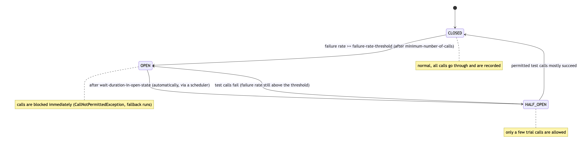
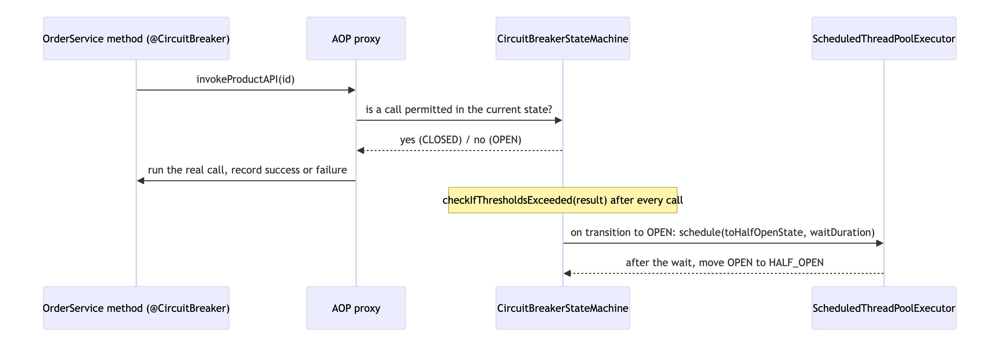

# Circuit Breaker: Fault-Tolerant Microservice (Part 4) (Distributed Microservices #9)

<!-- nav -->
⬅ [08 Retry](08_Retry_Notes.md) · [Index](00_Distributed_Microservices_Index.md) · [10 API Gateway – Part 1](10_API_Gateway_Part1_Notes.md) ➡
<!-- nav -->

Source: https://drive.google.com/file/d/1ApUVMYBXzsEiW_tCL_ZpfX0IGKZQ2IZe/view?usp=drive_link

Earlier parts: [06 Rate Limiter](06_Rate_Limiter_Notes.md), [07 Bulkhead](07_Bulkhead_Notes.md), [08 Retry](08_Retry_Notes.md). Resilience4j provides all of these mechanisms.

## 1. What is a Circuit Breaker?

This pattern **prevents an application from making repeated calls to a downstream service that is likely to fail.**

Without it (say the Product service is down or very slow), every Order request still calls it, and:

- It **unnecessarily adds load** to the Product service, and because of that the Product service might take longer to recover.
- Order service **wastes its own resources** (latency and thread blocking) by making calls that are likely going to fail.

So how does Order service know **when to stop** calling the Product service and **when to restart**? The answer is the **Circuit Breaker**.

**In simple words:** like the electric fuse at home. When too many calls fail, the breaker "trips" and calls stop going out for a while (they fail instantly instead of waiting). After a pause it lets a few test calls through, and if they work the breaker closes again.

## 2. States of a Circuit Breaker



| State | Behaviour |
|---|---|
| **CLOSED** | normal operation, every call goes to the downstream and its result (success / failure) is recorded in the sliding window |
| **OPEN** | the failure rate crossed the threshold, so calls are **blocked immediately** without calling the downstream (the fallback runs). Stays open for `wait-duration-in-open-state` |
| **HALF_OPEN** | after the wait, only a **limited number of test calls** are allowed. If the downstream looks healthy again the breaker goes to CLOSED, otherwise back to OPEN |

## 3. Implementation

**pom.xml**

```xml
<dependency>
    <groupId>io.github.resilience4j</groupId>
    <artifactId>resilience4j-spring-boot3</artifactId>
    <version>2.1.0</version>
</dependency>
```

```java
@RestController
@RequestMapping("/orders")
public class OrderController {

    @Autowired
    OrderService orderService;

    @GetMapping("/{id}")
    public void callProductAPI(@PathVariable String id) {
        orderService.invokeProductAPI(id);
    }
}

@FeignClient(name = "product-service")
public interface ProductClient {

    @GetMapping(value = "/products/{id}")
    String getProductById(@PathVariable("id") String id);
}
```

```java
@Component
public class OrderService {

    @Autowired
    ProductClient productClient;

    /*
      Fallback method is invoked for each failure attempt.
    */
    @CircuitBreaker(name = "productService", fallbackMethod = "fallback")
    public void invokeProductAPI(String id) {
        productClient.getProductById(id);
    }

    public void fallback(Throwable ex) {
        System.out.println("not able to invoke product service");
    }
}
```

`application.properties`

```properties
server.port=8081
spring.application.name=order-service
eureka.client.service-url.defaultZone=http://localhost:8761/eureka

# product service - circuit breaker configurations
resilience4j.circuitbreaker.instances.productService.sliding-window-type=COUNT_BASED
resilience4j.circuitbreaker.instances.productService.sliding-window-size=10
resilience4j.circuitbreaker.instances.productService.minimum-number-of-calls=5
resilience4j.circuitbreaker.instances.productService.failure-rate-threshold=50
resilience4j.circuitbreaker.instances.productService.wait-duration-in-open-state=10s
resilience4j.circuitbreaker.instances.productService.permitted-number-of-calls-in-half-open-state=3
resilience4j.circuitbreaker.instances.productService.automatic-transition-from-open-to-half-open-enabled=true
```

### What each property means

| Property | Meaning |
|---|---|
| `sliding-window-type=COUNT_BASED` + `sliding-window-size=10` | tracks the **last N calls** (here 10) |
| `sliding-window-type=TIME_BASED` + `sliding-window-size=10s` | tracks the calls made **in the last N seconds** (here 10 s) |
| `minimum-number-of-calls` | minimum number of calls required in a window before it **starts evaluating the failure rate** |
| `failure-rate-threshold` | once this **percentage** is reached, the circuit moves to OPEN |
| `wait-duration-in-open-state` | how long the circuit stays OPEN before it moves to HALF_OPEN (automatically, if `automatic-transition-from-open-to-half-open-enabled` is true) |
| `permitted-number-of-calls-in-half-open-state` | number of test calls allowed in HALF_OPEN to find out if the downstream is healthy |

By default the Circuit Breaker records **all `RuntimeException`s and `Error`s as failures**. If we want specific exceptions to be recorded or ignored, we can configure it:

```properties
resilience4j.circuitbreaker.instances.productService.record-exceptions=java.io.IOException,org.springframework.web.client.HttpServerErrorException
resilience4j.circuitbreaker.instances.productService.ignore-exceptions=java.lang.IllegalArgumentException
```

**Output (HALF_OPEN → OPEN):** since the max trial call limit was reached and the success was not 100%, the status changed from HALF_OPEN to OPEN again.

## 4. How it works internally



The AOP proxy **intercepts the call and passes it to `CircuitBreakerStateMachine.java`**, which has the complete logic of changing one state to another whenever there is a failure. A sample method from the framework class:

```java
// Transitions to open state when thresholds have been exceeded.
//
// Params: result – the Result
private void checkIfThresholdsExceeded(Result result) {
    if (Result.hasExceededThresholds(result)
            && isClosed.compareAndSet(true, false)) {
        /*
          After every error, it checks if the state needs to be changed or not.
          Like here it is checking, if the threshold limit is reached and the state is CLOSED,
          then transit to OPEN state.

          Likewise a similar method is present for the different states with
          specific transition logic.
        */
        publishCircuitThresholdsExceededEvent(result, circuitBreakerMetrics);
        transitionToOpenState();
    }
}
```

**A question:** okay, for every failure call we check whether the state needs to change, that makes sense. But once it moved to OPEN, how does it move **automatically** to HALF_OPEN, say after 10 seconds, with no call coming in? It uses a **`ScheduledThreadPoolExecutor`** (see 37 Scheduled ThreadPool (Java notes)). The `OpenState` constructor from `CircuitBreakerStateMachine.java`:

```java
OpenState(final int attempts,
          final long waitDurationInMillis,
          final Instant retryAfterWaitDuration,
          CircuitBreakerMetrics circuitBreakerMetrics) {

    this.attempts = attempts;
    this.retryAfterWaitDuration = retryAfterWaitDuration;
    this.circuitBreakerMetrics = circuitBreakerMetrics;

    if (circuitBreakerConfig.isAutomaticTransitionFromOpenToHalfOpenEnabled()) {
        ScheduledExecutorService scheduledExecutorService = schedulerFactory.getScheduler();
        /*
          It passes the request to ScheduledThreadPoolExecutor.
          1st parameter is the Task i.e. "toHalfOpenState" to transit the state
          from OPEN to HALF_OPEN

          2nd parameter is the delay: like 10 or 20 or 30
          3rd parameter is the Time Unit: second or minutes or millisecond
        */
        transitionToHalfOpenFuture = scheduledExecutorService
                .schedule(this::toHalfOpenState, waitDurationInMillis, TimeUnit.MILLISECONDS);
    } else {
        transitionToHalfOpenFuture = null;
    }

    isOpen = new AtomicBoolean(true);
}
```

Internally the `ScheduledThreadPoolExecutor` uses the concept of a **DelayedQueue**:

- Each available worker thread looks at the **head** of the Delayed Queue.
- If the task's delay has not yet expired, the thread **waits (blocks) for that remaining delay period**. When the delay is over, the OS wakes up the thread.
- One thread picks the task from the head and starts executing it.
- Another thread moves on to the next task in the delayed queue; if that task is not yet ready, it waits (blocks) again.

## 5. Putting the five together

```
RateLimiter → Bulkhead → TimeLimiter → CircuitBreaker → Retry
```

| Pattern | Question it answers |
|---|---|
| Rate Limiter | how many requests may **come in** per time window? |
| Bulkhead | how many calls may be **in flight** to one downstream? |
| Time Limiter | how long do we wait for an async call? |
| Circuit Breaker | should we even **try** the downstream right now? |
| Retry | should we **try again** after a transient failure? |

**In simple words:** the circuit breaker stops you from hammering a service that is already down. It counts recent failures, trips when too many, waits, then carefully tests with a few calls before trusting the service again.

---

<!-- nav -->
⬅ [08 Retry](08_Retry_Notes.md) · [Index](00_Distributed_Microservices_Index.md) · [10 API Gateway – Part 1](10_API_Gateway_Part1_Notes.md) ➡
<!-- nav -->
