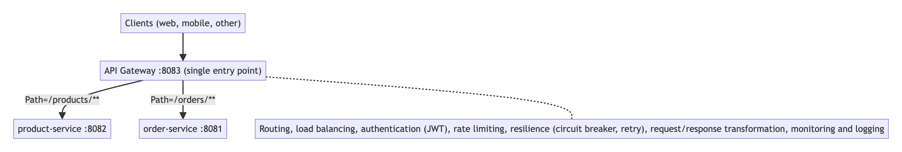
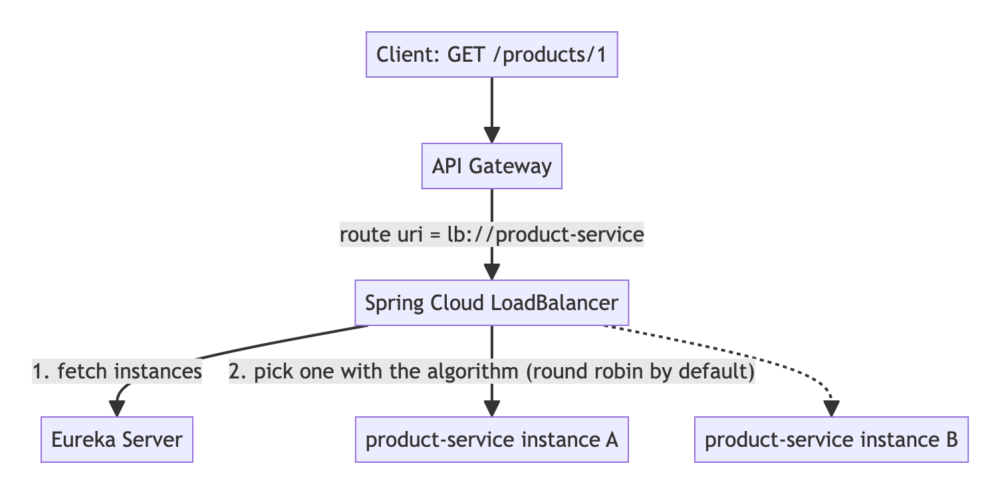

# API Gateway – Part 1 (Distributed Microservices #10)

<!-- nav -->
⬅ [09 Circuit Breaker: Fault-Tolerant Microservice (Part 4)](09_Circuit_Breaker_Notes.md) · [Index](00_Distributed_Microservices_Index.md) · [11 API Gateway – Part 2: Filters](11_API_Gateway_Part2_Notes.md) ➡
<!-- nav -->

Source: https://drive.google.com/file/d/1CbIz2ZgwcinR0y69Q7O-MRSgWgu-b-Ze/view?usp=drive_link

## 1. What is an API Gateway?

It provides a **single entry point to access all microservices.** And this single entry point provides a lot of benefits:

1. **Routing:** forward requests to the right microservices.
2. **Load balancing.**
3. **Authentication** like JWT.
4. **Rate limiting.**
5. **Resilience features** (circuit breaker, retry etc.).
6. **Request / response transformation.**
7. **Monitoring and logging.**
8. Etc.



**In simple words:** the gateway is the reception desk of a big office. Visitors (clients) do not need to know which floor or room each team sits in. They tell the desk what they want and the desk routes them, checks their ID, and limits how many come in at a time.

Let us see how we can achieve each of these with the API Gateway.

## 2. Routing: forward requests to the right microservice

Assume this: if one microservice is further divided into 2 microservices, or multiple microservices are merged together, then **all clients need to update their routing logic**. But with an API Gateway in the middle, **the change is required at only 1 place, i.e. the Gateway.**

### Let us implement this

**Product Controller class** (`application.properties`: `server.port=8082`, `spring.application.name=product-service`)

```java
@RestController
@RequestMapping("/products")
public class ProductController {

    @GetMapping("/{id}")
    public ResponseEntity<String> getProduct(@PathVariable String id) {
        return ResponseEntity.ok().body("fetch the product details with id:" + id);
    }
}
```

**Order Controller class** (`application.properties`: `server.port=8081`, `spring.application.name=order-service`)

```java
@RestController
@RequestMapping("/orders")
public class OrderController {

    @GetMapping("/{id}")
    public ResponseEntity<String> getOrder(@PathVariable String id) {
        return ResponseEntity.ok().body("fetch the Order details with id:" + id);
    }
}
```

**Create a new Gateway application** via Spring Initializr. In `pom.xml` the below dependency gets added:

```xml
<dependency>
    <groupId>org.springframework.cloud</groupId>
    <artifactId>spring-cloud-starter-gateway</artifactId>
</dependency>
```

`application.properties`

```properties
spring.application.name=apigateway
server.port=8083

# Route: Forward /products/** to product-service
# id: this is just a unique name for this route
spring.cloud.gateway.routes[0].id=product-service
# uri: microservice host and port number
spring.cloud.gateway.routes[0].uri=http://localhost:8082
# predicates: pattern matching to decide the routing.
spring.cloud.gateway.routes[0].predicates[0]=Path=/products/**
# apart from Path, we can also have a predicate on Method like:
# spring.cloud.gateway.routes[0].predicates[1]=Method=GET,POST
# means GET and POST requests to /products/** will match this route.

# Route: Forward /orders/** to order-service
spring.cloud.gateway.routes[1].id=order-service
spring.cloud.gateway.routes[1].uri=http://localhost:8081
spring.cloud.gateway.routes[1].predicates[0]=Path=/orders/**
```

Start all 3 servers: Product, Order and API Gateway. Now `GET localhost:8083/products/1` and `GET localhost:8083/orders/1` both work through the single gateway port.

## 3. API Gateway and Load Balancer

Service Discovery ([04](04_Service_Discovery_Notes.md)) and the Client Side Load Balancer ([05](05_Client_Side_Load_Balancer_Notes.md)) are already covered. With them the gateway no longer needs hardcoded hosts.

**Product Service**

```xml
<dependency>
    <groupId>org.springframework.cloud</groupId>
    <artifactId>spring-cloud-starter-netflix-eureka-client</artifactId>
</dependency>
```

```properties
server.port=8082
spring.application.name=product-service

# path of the Eureka Server
eureka.client.service-url.defaultZone=http://localhost:8761/eureka
```

**Order Service** is the same, with `server.port=8081` and `spring.application.name=order-service`.

**Eureka Server (Service Discovery)**

```xml
<dependency>
    <groupId>org.springframework.cloud</groupId>
    <artifactId>spring-cloud-starter-netflix-eureka-server</artifactId>
</dependency>
```

```properties
spring.application.name=eureka-server
server.port=8761

# Since it's a server, we don't want it to register and
# also don't want to fetch the instances details
eureka.client.register-with-eureka=false
eureka.client.fetch-registry=false
```

```java
@SpringBootApplication
@EnableEurekaServer
public class EurekaServerApplication {

    public static void main(String[] args) {
        SpringApplication.run(EurekaServerApplication.class, args);
    }
}
```

**API Gateway**

```xml
<dependency>
    <groupId>org.springframework.cloud</groupId>
    <artifactId>spring-cloud-starter-gateway</artifactId>
</dependency>

<dependency>
    <groupId>org.springframework.cloud</groupId>
    <artifactId>spring-cloud-starter-netflix-eureka-client</artifactId>
</dependency>
```

```properties
spring.application.name=apigateway
server.port=8083

# Route: Forward /products/** to product-service
spring.cloud.gateway.routes[0].id=product-service
# Replaced the hardcoded URI: http://localhost:8082
# Now internally it will use the Spring Cloud LoadBalancer framework to perform the load balancing:
# - first it fetches the instances from Service Discovery and
# - performs the load balancing algorithm
spring.cloud.gateway.routes[0].uri=lb://product-service
spring.cloud.gateway.routes[0].predicates[0]=Path=/products/**

# Route: Forward /orders/** to order-service
spring.cloud.gateway.routes[1].id=order-service
spring.cloud.gateway.routes[1].uri=lb://order-service
spring.cloud.gateway.routes[1].predicates[0]=Path=/orders/**

# path of the Eureka Server to fetch the microservices host details
eureka.client.service-url.defaultZone=http://localhost:8761/eureka
```

`lb://product-service` means: "do not use a fixed host, ask the load balancer for an instance of `product-service`".



## 4. From the GitLab repo

The repo ([springboot-microservices](https://gitlab.com/shrayansh8/springboot-microservices)) folder `apigateway_part1` has these four runnable modules, exactly as above:

| Module | Port | Role |
|---|---|---|
| `EurekaServer` | 8761 | service discovery (`@EnableEurekaServer`) |
| `productservice` | 8082 | `GET /products/{id}`, Eureka client |
| `orderservice` | 8081 | `GET /orders/{id}`, Eureka client |
| `apigateway` | 8083 | routes `/products/**` and `/orders/**` through `lb://` URIs |

Its `apigateway` module is a plain `@SpringBootApplication` with all routing done through `application.properties`, no Java code. The same routes can also be written in Java with `RouteLocatorBuilder` if you need logic, but properties are enough for static routes. The next part ([11 API Gateway Part 2](11_API_Gateway_Part2_Notes.md)) adds the other features (filters, JWT, circuit breaker, rate limiting) in the `apigateway_part2` module.

**In simple words:** one door for all clients. A route says "if the path looks like this, send it to that service". Replace the host with `lb://service-name` and the gateway also finds and balances the instances for you.

---

<!-- nav -->
⬅ [09 Circuit Breaker: Fault-Tolerant Microservice (Part 4)](09_Circuit_Breaker_Notes.md) · [Index](00_Distributed_Microservices_Index.md) · [11 API Gateway – Part 2: Filters](11_API_Gateway_Part2_Notes.md) ➡
<!-- nav -->
