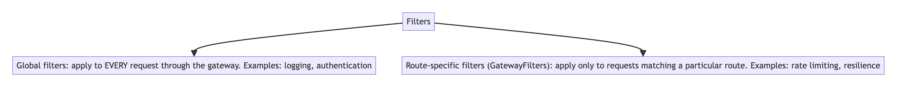
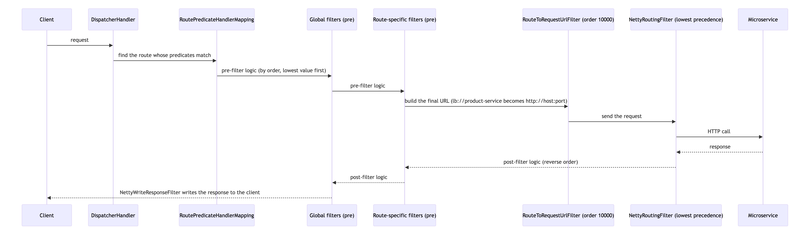

# API Gateway – Part 2: Filters (Distributed Microservices #11)

<!-- nav -->
⬅ [10 API Gateway – Part 1](10_API_Gateway_Part1_Notes.md) · [Index](00_Distributed_Microservices_Index.md) · [12 Centralized Configuration (Spring Cloud Config)](12_Centralized_Configuration_Notes.md) ➡
<!-- nav -->

Source: https://drive.google.com/file/d/14bbYUgLn3q5CXVKL90pMYb9TbAuu0GKd/view?usp=drive_link

Recap from [10 API Gateway Part 1](10_API_Gateway_Part1_Notes.md): the gateway is a **single entry point** that gives routing, load balancing, authentication (JWT), rate limiting, resilience (circuit breaker, retry), request/response transformation, monitoring and logging.

To apply authentication, rate limiting, resilience etc. in the API Gateway we need to understand **filters**.

## 1. Filters in API Gateway

A filter can **intercept and modify the HTTP request and response as they pass through the gateway.**



| Type | Applies to | Good examples |
|---|---|---|
| **Global filters** | every request that goes through the gateway | logging, authentication |
| **Route-specific filters** (`GatewayFilter`s) | only the requests matching a particular route, rather than applying globally | rate limiting, resilience |

Routes used in this part:

```properties
spring.application.name=apigateway
server.port=8083

# Route: Forward /products/** to product-service
spring.cloud.gateway.routes[0].id=product-service
spring.cloud.gateway.routes[0].uri=http://localhost:8082
spring.cloud.gateway.routes[0].predicates[0]=Path=/products/**

# Route: Forward /orders/** to order-service
spring.cloud.gateway.routes[1].id=order-service
spring.cloud.gateway.routes[1].uri=http://localhost:8081
spring.cloud.gateway.routes[1].predicates[0]=Path=/orders/**
```

### The full flow of one request



1. The client request reaches the `DispatcherHandler`.
2. The route mapping handler finds the route whose **predicates** match.
3. The **pre-filter logic** of the global filters and the route-specific filters run (each filter calls `chain.filter(...)` to hand over to the next one).
4. `RouteToRequestUrlFilter` (global) builds the final URL, e.g. turns `lb://product-service` into a real host:port.
5. `NettyRoutingFilter` (global) sends the request to the microservice and gets the response.
6. The **post-filter logic** runs on the way back, in the **reverse order**.
7. `NettyWriteResponseFilter` writes the response back to the client.

## 2. Ordering

A question should have come to your mind: **"why are some global filters after the route specific filters?"** The answer is **ORDERING**.

- In the API Gateway **each filter (global or route-specific) is given an ORDER.**
- **Minimum order value = high priority; maximum order value = low priority.** Example: a filter with order value -1 runs before a filter with order value 0.
- Generally most of the global filters are given a lower value than the route-specific filters, but some global filters like `RouteToRequestUrlFilter` and `NettyRoutingFilter` are **intentionally given a high value so that they execute last**:

```java
// RouteToRequestUrlFilter
public static final int ROUTE_TO_URL_FILTER_ORDER = 10000;

// NettyRoutingFilter
public static final int ORDER = Ordered.LOWEST_PRECEDENCE;
```

**Default values:**

- **Global filter:** if we do not define the order, the default value is `Ordered.LOWEST_PRECEDENCE`.
- **Route-specific filter:** if we have 3 route-specific filters, the index value (0, 1, 2) is assigned as the order value by default.

## 3. Global filters: our own authentication filter

There are many pre-existing global filters in the flow above. Let us create our own custom global filter for **authentication** (JWT; what JWT is and how to verify it is covered in the Spring Boot Security JWT note).

```java
@Component
public class JwtAuthGlobalFilter implements GlobalFilter, Ordered {

    @Override
    public Mono<Void> filter(ServerWebExchange exchange, GatewayFilterChain chain) {

        String uriPath = exchange.getRequest().getURI().getPath();

        // Skip JWT validation for auth endpoints
        if (uriPath.startsWith("/auth")) {
            return chain.filter(exchange);
        }

        // Extract Authorization header
        String authHeader = exchange.getRequest()
                .getHeaders()
                .getFirst(HttpHeaders.AUTHORIZATION);

        if (authHeader == null) {
            // if token is missing
            exchange.getResponse().setStatusCode(HttpStatus.UNAUTHORIZED);
            return exchange.getResponse().setComplete();
        }

        String token = authHeader.substring(7);       // strip "Bearer "
        try {
            // verify JWT token logic here.....
        } catch (Exception e) {
            exchange.getResponse().setStatusCode(HttpStatus.UNAUTHORIZED);
            return exchange.getResponse().setComplete();
        }

        // call next filter chain and also add post-filter logic
        return chain.filter(exchange).then(
                Mono.fromRunnable(() -> {
                    // post filter logic here
                })
        );
    }

    @Override
    public int getOrder() {
        // lower value means higher priority
        return -1;
    }
}
```

- `GlobalFilter` makes it apply to every route. `Ordered` with `getOrder() = -1` makes it run **early**, before the route-specific filters.
- Everything **before** `chain.filter(exchange)` is the **pre filter**, everything inside `.then(...)` is the **post filter**.
- Returning `exchange.getResponse().setComplete()` with a 401 **stops the chain**: the request never reaches the microservice.

## 4. Route-specific filters

Pre-existing route-specific filters in Spring Cloud Gateway:

| Filter | Use |
|---|---|
| `AddRequestHeader` | add a header to the request |
| `AddResponseHeader` | add a header to the response |
| `RemoveRequestHeader` | remove a request header |
| `RemoveResponseHeader` | remove a response header |
| `Retry` | retry the request on failure (configurable) |
| `RequestRateLimiter` | apply rate limiting |
| `CircuitBreaker` | stop making repeated calls to a failed downstream |

**Remove a request header:**

```properties
spring.cloud.gateway.routes[0].id=product-service
spring.cloud.gateway.routes[0].uri=lb://product-service
spring.cloud.gateway.routes[0].predicates[0]=Path=/products/**

## FILTERS ##

# Remove a request header
spring.cloud.gateway.routes[0].filters[0].name=RemoveRequestHeader
spring.cloud.gateway.routes[0].filters[0].args.name=Api-private-Key
```

**Multiple route-specific filters on one route:**

```properties
## FILTERS ##
# Add a request header
spring.cloud.gateway.routes[0].filters[0].name=AddRequestHeader
spring.cloud.gateway.routes[0].filters[0].args.name=X-Test-RequestHeader
spring.cloud.gateway.routes[0].filters[0].args.value=ApiGatewayRequest

# Add a response header
spring.cloud.gateway.routes[0].filters[1].name=AddResponseHeader
spring.cloud.gateway.routes[0].filters[1].args.name=X-Test-ResponseHeader
spring.cloud.gateway.routes[0].filters[1].args.value=ApiGatewayResponse

# Remove a request header
spring.cloud.gateway.routes[0].filters[2].name=RemoveRequestHeader
spring.cloud.gateway.routes[0].filters[2].args.name=Api-private-Key
```

**Naming convention:** the filter `name` maps to a Java class `<Name>GatewayFilterFactory`, and `args` map to its config class. For example `AddRequestHeader` → `AddRequestHeaderGatewayFilterFactory.java`, whose config is:

```java
public static class NameValueConfig {
    protected String name;
    protected String value;
    // ...
}
```

### Retry route-specific filter

```properties
spring.cloud.gateway.routes[0].id=product-service
spring.cloud.gateway.routes[0].uri=lb://product-service
spring.cloud.gateway.routes[0].predicates[0]=Path=/products/**

## FILTERS ##
# retry on failure, max 4 attempts, on GET and DELETE requests only
spring.cloud.gateway.routes[0].filters[0].name=Retry
spring.cloud.gateway.routes[0].filters[0].args.retries=4
spring.cloud.gateway.routes[0].filters[0].args.methods=GET,DELETE
```

Class: `RetryGatewayFilterFactory.java`, config:

```java
public static class RetryConfig {
    int retries;
    List<HttpStatus> statuses;
    List<HttpMethod> methods;
    // ...
}
```

(Retry only on idempotent methods, as in [08 Retry](08_Retry_Notes.md).)

To test it, the Product controller purposely fails the first 3 calls and passes from the 4th call onwards:

```java
@RestController
@RequestMapping("/products")
public class ProductController {

    int counter = 0;

    @GetMapping("/{id}")
    public ResponseEntity<String> getProduct(@PathVariable String id) {

        counter++;

        if (counter <= 3) {
            return ResponseEntity
                    .status(HttpStatus.INTERNAL_SERVER_ERROR)
                    .body("Fail");
        }

        return ResponseEntity
                .ok()
                .body("fetch the product details on " + counter + " attempt");
    }
}
```

A single `GET /products/1` through the gateway succeeds, because the gateway retried the 500s internally (the client sees only the 4th attempt's answer).

### Circuit Breaker route-specific filter

(The circuit breaker itself is explained in [09 Circuit Breaker](09_Circuit_Breaker_Notes.md).)

**pom.xml**

```xml
<dependency>
    <groupId>org.springframework.cloud</groupId>
    <artifactId>spring-cloud-starter-gateway</artifactId>
</dependency>

<dependency>
    <groupId>org.springframework.cloud</groupId>
    <artifactId>spring-cloud-starter-netflix-eureka-client</artifactId>
</dependency>

<dependency>
    <groupId>org.springframework.cloud</groupId>
    <artifactId>spring-cloud-starter-circuitbreaker-reactor-resilience4j</artifactId>
</dependency>
```

`application.properties`

```properties
spring.application.name=apigateway
server.port=8083

spring.cloud.gateway.routes[0].id=product-service
spring.cloud.gateway.routes[0].uri=lb://product-service
spring.cloud.gateway.routes[0].predicates[0]=Path=/products/**

## FILTERS ##

# Circuit breaker (redirect to fallback endpoint if service fails)
spring.cloud.gateway.routes[0].filters[0].name=CircuitBreaker
spring.cloud.gateway.routes[0].filters[0].args.name=myCircuitBreakerName
spring.cloud.gateway.routes[0].filters[0].args.fallbackUri=forward:/fallback

# CircuitBreaker config
resilience4j.circuitbreaker.instances.myCircuitBreakerName.sliding-window-type=COUNT_BASED
resilience4j.circuitbreaker.instances.myCircuitBreakerName.sliding-window-size=10
resilience4j.circuitbreaker.instances.myCircuitBreakerName.minimum-number-of-calls=5
resilience4j.circuitbreaker.instances.myCircuitBreakerName.failure-rate-threshold=50
resilience4j.circuitbreaker.instances.myCircuitBreakerName.wait-duration-in-open-state=10s
resilience4j.circuitbreaker.instances.myCircuitBreakerName.permitted-number-of-calls-in-half-open-state=3
logging.level.io.github.resilience4j.circuitbreaker=DEBUG

# path of the Eureka Server to fetch the microservices host details
eureka.client.service-url.defaultZone=http://localhost:8761/eureka
```

**Fallback controller:**

```java
@Controller
public class FallbackController {

    @GetMapping("/fallback")
    public ResponseEntity<String> fallback() {
        return ResponseEntity.ok("Service is temporarily unavailable, please try again later.");
    }
}
```

For testing, the Product microservice server was not started. After more than 5 calls the **failure threshold was crossed**, the circuit opened, and the gateway answered from `/fallback` immediately (the debug log shows the state change).

### Our own custom route-specific filter

`application.properties`

```properties
# Custom Route Specific filter testing
spring.cloud.gateway.routes[0].filters[5].name=CustomRoute
spring.cloud.gateway.routes[0].filters[5].args.country=India
```

```java
@Component
public class CustomRouteGatewayFilterFactory
        extends AbstractGatewayFilterFactory<CustomRouteGatewayFilterFactory.CustomConfig> {

    public CustomRouteGatewayFilterFactory() {
        super(CustomConfig.class);
    }

    @Override
    public GatewayFilter apply(CustomConfig config) {
        return (exchange, chain) -> {

            System.out.println("pre filter logic here, config value: " + config.getCountry());

            return chain.filter(exchange).then(Mono.fromRunnable(() -> {
                System.out.println("post filter logic here");
            }));
        };
    }

    public static class CustomConfig {
        private String country;

        public String getCountry() {
            return country;
        }

        public void setCountry(String country) {
            this.country = country;
        }
    }
}
```

The class name `CustomRoute` + `GatewayFilterFactory` is what links the `name=CustomRoute` in the properties to this class, and `args.country` is filled into `CustomConfig`.

## 5. From the GitLab repo

The folder `apigateway_part2/apigateway` of [springboot-microservices](https://gitlab.com/shrayansh8/springboot-microservices) has all of this working together in one `application.properties`, on route `product-service` with `lb://product-service`:

| Filter index | Filter | Purpose |
|---|---|---|
| 0 | `AddRequestHeader` | `X-Test-RequestHeader: ApiGatewayRequest` |
| 1 | `AddResponseHeader` | `X-Test-ResponseHeader: ApiGatewayResponse` |
| 2 | `RemoveRequestHeader` | removes `Api-private-Key` |
| 3 | `Retry` | 4 retries (the repo uses `POST,DELETE`; the classroom example used `GET,DELETE`) |
| 4 | `CircuitBreaker` | `myCircuitBreakerName`, fallback `forward:/fallback` |
| 5 | `CustomRoute` | custom filter, `country=India` |

Plus the Java classes `FallbackController`, `JwtAuthGlobalFilter` (order -1; in the repo it also skips `/products` and `/orders` "for testing purpose only", so you can call them without a token) and `CustomRouteGatewayFilterFactory`.

**In simple words:** a filter is a checkpoint on the road to the microservice. Global checkpoints stand on every road (like checking the ID), route checkpoints only on one road (like a toll for just that road). Each has a number that decides who goes first, and each gets a chance to act **before** the request goes in and **after** the response comes out.

---

<!-- nav -->
⬅ [10 API Gateway – Part 1](10_API_Gateway_Part1_Notes.md) · [Index](00_Distributed_Microservices_Index.md) · [12 Centralized Configuration (Spring Cloud Config)](12_Centralized_Configuration_Notes.md) ➡
<!-- nav -->
