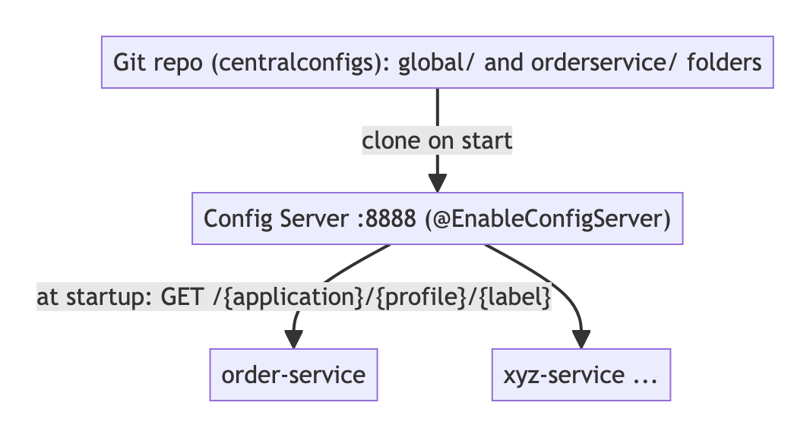
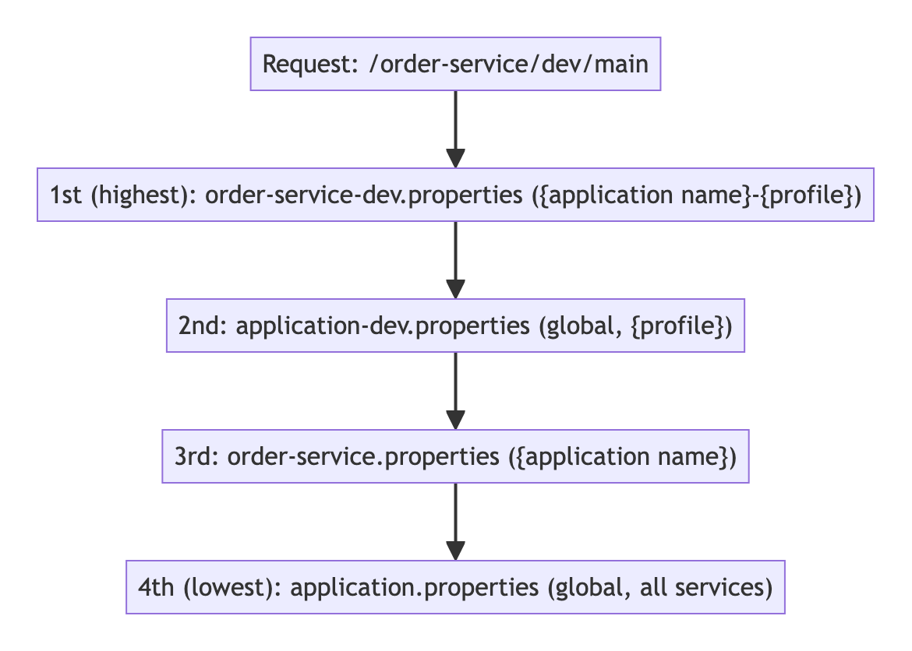

# Centralized Configuration (Spring Cloud Config) (Distributed Microservices #12)

<!-- nav -->
⬅ [11 API Gateway – Part 2: Filters](11_API_Gateway_Part2_Notes.md) · [Index](00_Distributed_Microservices_Index.md) · [13 @RefreshScope](13_Refresh_Scope_Notes.md) ➡
<!-- nav -->

Source: https://drive.google.com/file/d/1jyj0NGktH3DEA6dQr2ziAVQk0PwaS3S9/view?usp=drive_link

## 1. The problems first

**Problem 1: rebuild and redeploy**

```properties
# Order application
server.port=8081
spring.application.name=order-service

custom.message=hello world
```

```java
@Service
public class OrderService {

    @Value("${custom.message}")
    private String message;

    public String getOrder() {
        return "fetch the Order details with message:" + message;
    }
}
```

If the config is kept inside the microservice resources (`application.properties`), then **any change** means: edit the `application.properties` file, **rebuild the JAR**, **redeploy** the service.

**Problem 2: inconsistent config across services.** Say both the Order and the Payment application have a common configuration `db.url=jdbc:mysql://localhost:3306/order-db`. When an update is needed, **both services' `application.properties` need to be changed** (and it is easy to forget one).

**Problem 3: no runtime update.** The local `application.properties` is loaded **only once at startup**. If a value changes (e.g. an endpoint URL), the app must restart.

**Problem 4: time consuming rollback.** Each service keeps its own `application.properties` locally. Suppose we change `db.url=jdbc:mysql://prod-db:3306/order-db`, but this new DB is misconfigured and because of that all the services crash in production. To fix it we must manually edit each affected service's config file, rebuild the jar and redeploy the service, and if multiple services were updated, fix all of them.

**In simple words:** config copied into every service is like the same phone number written on 20 sticky notes. Change it once and you must find all 20 notes. Centralized config is one address book that everyone reads.

## 2. Solution: Centralized Configuration with Spring Cloud Config



### Setup step 1: a Git repository with only the config files

**Global / common properties**

- `application.properties`: applied to **all services and all profiles** (dev, qa, prod etc.)
- `application-{profile}.properties`: applied to **all services with a specific profile** (dev or qa or prod etc.)

**Service-specific properties**

- `{application name}.properties`: applied to **a particular service** and all profiles.
- `{application name}-{profile}.properties`: applied to a particular service with a **specific profile**.

(Profiles are explained in the Spring Boot notes.)

**Precedence** (when the same key is in more than one file; the first one wins):



1. `{application name}-{profile}.properties` (highest)
2. `application-{profile}.properties`
3. `{application name}.properties`
4. `application.properties` (lowest)

### Setup step 2: the Config Server

`application.properties` of the config server:

```properties
server.port=8888

# Public Git repo link of the centralized config
spring.cloud.config.server.git.uri=https://gitlab.com/shrayansh8/centralconfigs

# Only required when we have created folders in our central config git repo.
# Tells which all folders need to be scanned.
spring.cloud.config.server.git.search-paths=global, orderservice

# Download the properties from central config at the time of application startup,
# if it is false, it will be downloaded at the time of the first request.
spring.cloud.config.server.git.clone-on-start=true

# This tells which branch to use to fetch the properties.
# By default it is the "main" branch only.
spring.cloud.config.server.git.default-label=main
```

**If the centralized config Git repo is private**, we have to provide username and password (token) too:

- **GitLab:** Project settings → Access Tokens → Add new token.
- **GitHub:** profile settings → Developer Settings → Personal Access Token → Fine-grained tokens.

```properties
server.port=8888

# Generally this is the username, in both GitLab and GitHub
spring.cloud.config.server.git.uri=https://gitlab.com/shrayansh8/centralconfigs

# For safety purposes, we always set the tokens either in environment variables
# or in a key management server
spring.cloud.config.server.git.username=${GIT_USERNAME}
spring.cloud.config.server.git.password=${GIT_ACCESS_TOKEN}
spring.cloud.config.server.git.search-paths=global, orderservice
spring.cloud.config.server.git.clone-on-start=true
spring.cloud.config.server.git.default-label=main
```

(In IntelliJ set the two values under Run → Edit Configurations → Environment variables.)

**Turn this Spring Boot application into the central configuration server:**

```java
@SpringBootApplication
/*
  Turn this Spring Boot app into a central configuration server.

  Load properties file from the central config repo during application startup
  and expose config endpoints:

  Expose endpoints like:

  - {application}/{profile}/{label}
*/
@EnableConfigServer
public class ConfigServerApplication {

    public static void main(String[] args) {
        SpringApplication.run(ConfigServerApplication.class, args);
    }
}
```

**Test till this point.** The central config repo (from the GitLab repo `centralconfigs`) looks like this:

```
global/
    application.properties          custom.message=Hello from global default!
    application-dev.properties      custom.message=Hello from global dev!
    application-qa.properties       custom.message=Hello from global qa!
    application-prod.properties     custom.message=Hello from global prod!
orderservice/
    order-service.properties        custom.message=Hello from order default!
    order-service-dev.properties    custom.message=Hello from order dev!
    order-service-qa.properties     custom.message=Hello from order qa!
    order-service-prod.properties   custom.message=Hello from order prod!
```

Start the config server and hit the endpoint `http://localhost:8888/order-service/dev/main`, i.e. `/{application}/{profile}/{label}`. The response contains an **array of property sources in precedence order**:

| Order | Source | `custom.message` |
|---|---|---|
| 1st | `order-service-dev.properties` | Hello from order dev! |
| 2nd | `global/application-dev.properties` | Hello from global dev! |
| 3rd | `order-service.properties` | Hello from order default! |
| 4th | `global/application.properties` | Hello from global default! |

The first source that has the key wins, so the order service in `dev` gets **"Hello from order dev!"**.

### Setup step 3: adding the microservices

At startup the microservices **fetch their properties from the config server**.

```text
Config files (Git)  →  Config server  →  Order Service, ..., xyz Service (fetch properties at application startup)
```

**pom.xml** of the client (add Spring Cloud **Config Client**: `spring-cloud-starter-config`, with the `spring-cloud-dependencies` dependency management from [03 FeignClient](03_FeignClient_Notes.md)).

`application.properties` of the Order application:

```properties
spring.application.name=order-service

# This "optional:configserver" tells that getting the properties from
# the config server is NON FATAL, meaning even if the config server is down or unreachable,
# we can start the app using local properties.
spring.config.import=optional:configserver:http://localhost:8888
spring.profiles.active=dev

# config for all profiles (dev, qa, prod etc)
custom.message=Hello from local default!
```

`application-dev.properties` (local): `custom.message=Hello from local dev!`

```java
@RestController
@RequestMapping("/orders")
public class OrderController {

    @Value("${custom.message}")
    private String message;

    @GetMapping("/fetch")
    public String getOrders() {
        return "fetched orders and message: " + message;
    }
}
```

Start the Order application and hit the API: `fetched orders and message: Hello from order dev!`. The value from the **config server wins over the local files**, the local `Hello from local default!` / `Hello from local dev!` are used only if the server is unreachable (`optional:`).

## 3. From the GitLab repo

The repo ([springboot-microservices](https://gitlab.com/shrayansh8/springboot-microservices), folder `centralConfigManagement`) has the two applications:

| Module | What it is |
|---|---|
| `configManagement` | config server, `@EnableConfigServer`, port 8888, `git.uri=https://gitlab.com/shrayansh8/centralconfigs`, `search-paths=global, orderservice`, `clone-on-start=true`, `default-label=main`, credentials from `${GIT_USERNAME}` and `${GIT_ACCESS_TOKEN}` |
| `orderMicroservice` | client, `spring.config.import=optional:configserver:http://localhost:8888`, `spring.profiles.active=dev`, endpoint `GET /orders/fetch` returning `custom.message` |

and the separate `centralconfigs` repo holds exactly the 8 property files in the table above, with the four-level precedence demo.

## 4. What about changes made while the app is running?

One question might have come to mind: our Order application is running and someone updates the central config for the order service. **Do I need to restart the app every time?** The answer is **NO**. There is the concept of **`@RefreshScope`**, which can load the properties dynamically (without restarting the order service). But to understand `@RefreshScope` we first need to understand **Actuator**. That is in the next note: [13 Refresh Scope](13_Refresh_Scope_Notes.md).

**In simple words:** keep all config in one Git repo, run a small Config Server that serves it, and make each service ask the server for its config at startup. Rolling back a bad config becomes a Git revert, and global values are written once.

---

<!-- nav -->
⬅ [11 API Gateway – Part 2: Filters](11_API_Gateway_Part2_Notes.md) · [Index](00_Distributed_Microservices_Index.md) · [13 @RefreshScope](13_Refresh_Scope_Notes.md) ➡
<!-- nav -->
