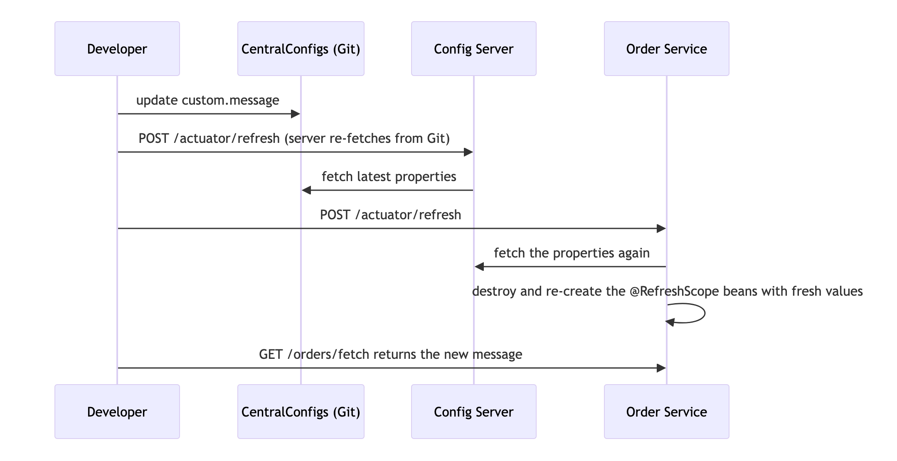

# @RefreshScope (Distributed Microservices #13)

<!-- nav -->
⬅ [12 Centralized Configuration (Spring Cloud Config)](12_Centralized_Configuration_Notes.md) · [Index](00_Distributed_Microservices_Index.md) · [14 Spring Cloud Bus](14_Cloud_Bus_Notes.md) ➡
<!-- nav -->

Source: https://drive.google.com/file/d/1Yb-qJjcNWHNtIZ7QaZxgKdHNoty9i-1F/view?usp=drive_link

We have covered Centralized Configuration ([12](12_Centralized_Configuration_Notes.md)) and finished with 1 question: our Order application is running and someone has updated the central config for the order service, **do I need to restart the app every time?** The answer is **NO**, and the solution is **`@RefreshScope`**.

## 1. Reproduce the problem first

**Git repo for CentralConfigs:** the same repo, now using a test branch (the config server `default-label=refreshscope_test` for this demo).

**Config Server**

```xml
<dependency>
    <groupId>org.springframework.cloud</groupId>
    <artifactId>spring-cloud-config-server</artifactId>
</dependency>
```

```java
@SpringBootApplication
@EnableConfigServer
public class ConfigServerApplication {

    public static void main(String[] args) {
        SpringApplication.run(ConfigServerApplication.class, args);
    }
}
```

```properties
server.port=8888

spring.cloud.config.server.git.uri=https://gitlab.com/shrayansh8/centralconfigs
spring.cloud.config.server.git.username=${GIT_USERNAME}
spring.cloud.config.server.git.password=${GIT_ACCESS_TOKEN}
spring.cloud.config.server.git.search-paths=global, orderservice
spring.cloud.config.server.git.clone-on-start=true
spring.cloud.config.server.git.default-label=refreshscope_test
```

**Order Microservice**

```xml
<dependency>
    <groupId>org.springframework.cloud</groupId>
    <artifactId>spring-cloud-starter-config</artifactId>
</dependency>
```

```properties
spring.application.name=order-service
spring.config.import=optional:configserver:http://localhost:8888
spring.profiles.active=dev

# config for all profiles (dev, qa, prod etc)
custom.message=Hello from local default!
```

```java
@Component
@ConfigurationProperties(prefix = "custom")
public class OrderProperties {

    private String message;

    public String getMessage() {
        return message;
    }

    public void setMessage(String message) {
        this.message = message;
    }
}
```

```java
@RestController
@RequestMapping("/orders")
public class OrderController {

    private int counter = 0;

    @Autowired
    OrderProperties orderProperties;

    @GetMapping("/fetch")
    public String getOrders() {
        counter++;
        return "fetched orders and message: " + orderProperties.getMessage()
                + " and counter value is: " + counter;
    }
}
```

Start both the Config Server and the Order server. Now **update the central config property** in Git and hit the Order API again: **the old message is still returned.** The property was loaded only at startup.

## 2. `@RefreshScope`

It marks a **bean which needs to be destroyed and re-created (with the latest values) when a refresh event occurs.**

```java
@Component
@ConfigurationProperties(prefix = "custom")
@RefreshScope
public class OrderProperties {

    private String message;

    public String getMessage() {
        return message;
    }

    public void setMessage(String message) {
        this.message = message;
    }
}
```

**In simple words:** a normal bean is created once and kept forever. A `@RefreshScope` bean is thrown away and built again when you press "refresh", so it picks up the new values.

But the question now: **how does the refresh event occur** so that the beans marked with `@RefreshScope` get updated with the latest property value?

## 3. Refresh through Actuator

One way is **Actuator** (covered in depth in the Spring Boot notes, including how to create your own custom Actuator endpoint). Spring Cloud Config makes use of that functionality and provides one custom actuator endpoint: **`/actuator/refresh`**.

```java
/*
  Id: forms the URL path: /actuator/{id}
*/
@Endpoint(id = "refresh")
public class RefreshEndpoint {

    private static final Log LOG = LogFactory.getLog(RefreshEndpoint.class);

    private final ContextRefresher contextRefresher;

    public RefreshEndpoint(ContextRefresher contextRefresher) {
        this.contextRefresher = contextRefresher;
    }

    @WriteOperation
    public Collection<String> refresh() {
        /*
          @WriteOperation is similar to a POST operation

          1. If it is a Config Server: it fetches the properties from the CentralConfigs Repo

          2. If it is a Config Client like Order Service: it will invoke the ConfigServer,
             fetch the properties again and then look for @RefreshScope marked beans
             and re-create them with fresh property values.
        */
        Set<String> keys = this.contextRefresher.refresh();
        LOG.info("Refreshed keys : " + keys);
        return keys;
    }
}
```

All we need to do is **add the Actuator dependency** and expose the endpoint.

**Config Server**

```xml
<dependency>
    <groupId>org.springframework.boot</groupId>
    <artifactId>spring-boot-starter-actuator</artifactId>
</dependency>
```

```properties
server.port=8888

spring.cloud.config.server.git.uri=https://gitlab.com/shrayansh8/centralconfigs
spring.cloud.config.server.git.username=${GIT_USERNAME}
spring.cloud.config.server.git.password=${GIT_ACCESS_TOKEN}
spring.cloud.config.server.git.search-paths=global, orderservice
spring.cloud.config.server.git.clone-on-start=true
spring.cloud.config.server.git.default-label=refreshscope_test

management.endpoints.web.exposure.include=refresh,health
```

**Order Microservice**

```xml
<dependency>
    <groupId>org.springframework.boot</groupId>
    <artifactId>spring-boot-starter-actuator</artifactId>
</dependency>
```

```properties
spring.application.name=order-service
spring.config.import=optional:configserver:http://localhost:8888
spring.profiles.active=dev

# config for all profiles (dev, qa, prod etc)
custom.message=Hello from local default!

management.endpoints.web.exposure.include=health,refresh
```

`OrderProperties` has `@RefreshScope` (above) and the controller has no change.

### Test



1. Start the Config Server and the Order Microservice.
2. Update the property in CentralConfigs (Git).
3. Hit the Order API: still the **old** value.
4. Invoke `POST /actuator/refresh` on the **ConfigServer** (it re-fetches from Git).
5. Invoke `POST /actuator/refresh` on the **Order Service** (it re-fetches from the Config Server and re-creates the `@RefreshScope` beans).
6. Hit `/fetch` again: the **new** message is returned, and the `counter` keeps increasing, because the controller itself was not re-created.

## 4. Why `@ConfigurationProperties` and not `@RefreshScope` on the controller?

Remember: when a bean is refreshed it is **first destroyed and then re-created**, so you **lose its object state**. That is why it is **never recommended to put `@RefreshScope` over a Controller or a Service. It is not safe.**

`@ConfigurationProperties` classes are **stateless**, just properties holders, so it is safe to use `@RefreshScope` on them. Understand with the unsafe example below:

```java
@RestController
@RequestMapping("/orders")
@RefreshScope
public class OrderController {

    private int counter = 0;

    @Value("${custom.message}")
    String message;

    @GetMapping("/fetch")
    public String getOrders() {
        counter++;
        return "fetched orders and message: " + message
                + " and counter value is: " + counter;
    }
}
```

After a refresh the controller is re-created, so **`counter` resets to 0.** That is the reason I used `@ConfigurationProperties` with `@RefreshScope` on the properties class, instead of on the controller.

## 5. Refreshing every service at once

One last question: with the Actuator approach we have to call refresh on the config server **and on every microservice** one by one. What if I want to do the refresh **only once at the Config Server** and have **all the microservices get notified and refresh themselves**? That is also possible with **Spring Cloud Bus** ([14 Cloud Bus](14_Cloud_Bus_Notes.md)).

## 6. From the GitLab repo

- `RefreshScope/configManagement` and `RefreshScope/orderMicroservice`: the setup shown above (the repo version already has the extra `busrefresh` exposure and RabbitMQ settings for the Cloud Bus part).
- `Actuator/`: the Spring Boot Actuator sample used as a prerequisite. Worth knowing:

| Item | What it shows |
|---|---|
| `management.endpoints.web.base-path=/manage` | by default the path is `/actuator`, here changed to `/manage` |
| `management.endpoints.web.exposure.include=my-custom-stats,health,info` | by default only `health` and `info` are exposed; `*` exposes all; or give a comma separated list like `health, info, metrics, loggers` |
| `SecurityConfig` + `spring.security.user.*` | all actuator endpoints are protected with HTTP basic auth (user / pass / role ADMIN) |
| `DatabaseHealthIndicator`, `CacheHealthIndicator` | custom `HealthIndicator` beans: return `Health.up()` / `Health.down()` with a detail; the overall `/health` becomes DOWN if any indicator is DOWN (the cache one is hard coded `false`) |
| `MyCustomStatsEndpoint` (`@Endpoint(id = "my-custom-stats")`) | a custom endpoint with `@ReadOperation` (GET, with `@Selector` path parts), `@WriteOperation` (POST) and `@DeleteOperation` (DELETE) |
| `management.datadog.metrics.export.*` | exporting metrics to Datadog (API key, `step=5s`) |

`RefreshEndpoint` above is exactly this same mechanism: a built-in `@Endpoint(id = "refresh")` with a `@WriteOperation`.

**In simple words:** a running app does not notice changes in Git. Mark the config holder bean `@RefreshScope`, expose `/actuator/refresh`, and calling it makes the app fetch the config again and rebuild only those beans. Keep `@RefreshScope` off controllers and services, because rebuilding them wipes their state.

---

<!-- nav -->
⬅ [12 Centralized Configuration (Spring Cloud Config)](12_Centralized_Configuration_Notes.md) · [Index](00_Distributed_Microservices_Index.md) · [14 Spring Cloud Bus](14_Cloud_Bus_Notes.md) ➡
<!-- nav -->
