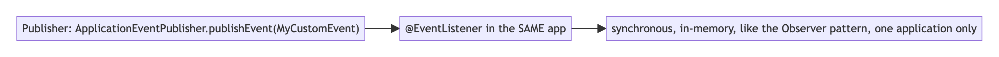
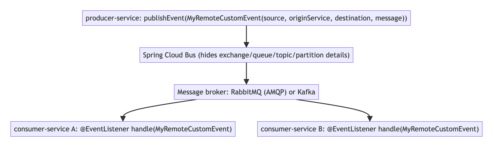
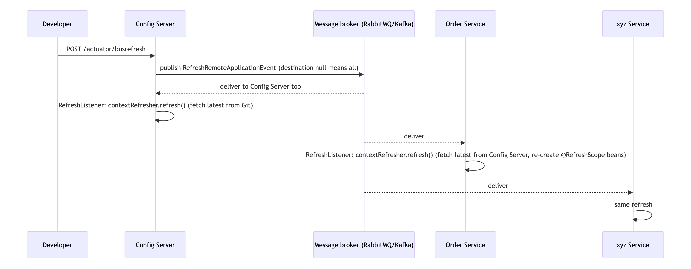

# Spring Cloud Bus (Distributed Microservices #14)

<!-- nav -->
⬅ [13 @RefreshScope](13_Refresh_Scope_Notes.md) · [Index](00_Distributed_Microservices_Index.md) · [15 Distributed Tracing (Micrometer + OpenTelemetry)](15_Distributed_Tracing_Notes.md) ➡
<!-- nav -->

Source: https://drive.google.com/file/d/1Byww5BZPKMRqwHLgMJnx7_CczEHNDcFi/view?usp=drive_link

This is where we ended in [13 @RefreshScope](13_Refresh_Scope_Notes.md): do I have to invoke `/actuator/refresh` on these **hundreds of microservices**?

- If we use the Actuator approach to create a refresh event, **YES**.
- But if we want **only one REFRESH at the Config Server and all the microservices to get notified and refresh themselves**, that is possible with **Spring Cloud Bus**.

## 1. First: an event inside one application



**The event class**

```java
package com.concepts.WithoutSpringCloudBus;

import org.springframework.context.ApplicationEvent;

public class MyCustomEvent extends ApplicationEvent {
    private final String message;

    public MyCustomEvent(Object source, String message) {
        super(source);
        this.message = message;
    }

    public String getMessage() {
        return message;
    }
}
```

`MyCustomEvent` is the event we need to publish to the listeners. This event class **should extend `ApplicationEvent`**, as the `publishEvent()` method accepts the `ApplicationEvent` type.

**The publisher**

```java
@Service
public class MyEventPublisher {

    @Autowired
    private ApplicationEventPublisher publisher;

    public void publish(String msg) {
        publisher.publishEvent(new MyCustomEvent(this, msg));
    }
}
```

The `ApplicationEventPublisher` interface **abstracts the event publishing functionality**. We invoke `publishEvent(ApplicationEvent object)` and it takes care of publishing the event to all the listeners.

**The listener**

```java
@Component
public class MyEventListener {

    @EventListener
    public void handleEvent(MyCustomEvent event) {
        System.out.println("Received event message: " + event.getMessage());
    }
}
```

`MyEventListener` is listening to `MyCustomEvent`. During application startup the framework maintains a list like:

```
MyCustomEvent  -> MyEventListener, Listener2, ...
SomeOtherEvent -> Listener3, Listener4, ...
```

**A controller to test it**

```java
@RestController
public class EventController {

    @Autowired
    private MyEventPublisher publisher;

    @GetMapping("/withinApp/publish")
    public String publish(@RequestParam String message) {
        publisher.publish(message);
        return "Event published: " + message;
    }
}
```

**How is it working?** Very similar to the **Observer design pattern** (LLD), and it is all in a **synchronous** manner and **within one application**.

**But how do we handle it when the Publisher and the Listener are not in the same app, they are in different microservices?** Here comes **Spring Cloud Bus**.

## 2. What is Spring Cloud Bus?



Spring Cloud Bus **abstracts all the details of the message broker**:

- If we are using **RabbitMQ (AMQP protocol):** we do not have to create the exchange and the queue, no logic to bind the queue and exchange with a routing key etc.
- If we are using **Kafka:** we do not have to create topics, partitions etc.

Everything is created and managed by Spring Cloud Bus and it is all abstracted away from us. It is just a **wrapper above the message broker like Kafka and RabbitMQ**: we just pass the event to the bus and leave it to the broker and its configuration to decide on retaining messages, retry, or what to do in case of failure etc.

**Designed for:** low volume and **non critical messages** like refresh config, clear cache etc.

**Not recommended** for a very critical and high volume system. If we need full control over topic/queue creation, retry mechanism, message persistence logic, ACK etc., then it is recommended to use **Spring Cloud Stream** or a Kafka template etc., and not Spring Cloud Bus.

**In simple words:** Spring Cloud Bus is a notice board shared by all your services. You pin a message to the board and every service reads it, without you setting up any of the mail-room machinery (queues, exchanges, topics).

## 3. A custom event with Spring Cloud Bus

**Step 1: a message broker.** Since Spring Cloud Bus uses RabbitMQ or Kafka in the background, we need to set up one for testing. RabbitMQ on Mac:

```bash
brew update
brew install rabbitmq

# start
brew services start rabbitmq
```

**Step 2: the publisher**

```java
package com.concepts.WithSpringCouldBus;

import org.springframework.cloud.bus.event.RemoteApplicationEvent;

public class MyRemoteCustomEvent extends RemoteApplicationEvent {

    public MyRemoteCustomEvent() {}      // default constructor for deserialization

    public MyRemoteCustomEvent(Object source, String originService,
                               String destination, String message) {
        super(source, originService, destination);
        this.message = message;
    }

    private String message;

    public String getMessage() {
        return message;
    }
}
```

This event class **should extend `RemoteApplicationEvent`**, only then it will be intercepted by Spring Cloud Bus.

| Constructor argument | Meaning |
|---|---|
| `source` | details about this event class and object |
| `originService` | which application is publishing the event |
| `destination` | the target microservice(s): `*` broadcasts to all, or a specific application name |

**Very important:** when publishing, the Spring Cloud Bus framework checks that **I only publish the event which is generated by me, not on behalf of someone else.** This is required to **prevent infinite looping**. The `originService` name tells which service generated this message, and it **must match this service's Bus ID**, else the publish will not happen.

```java
@Service
public class MyRemoteEventPublisher {

    @Autowired
    private ApplicationEventPublisher publisher;

    @Value("${spring.cloud.bus.id}")
    String myBusID;

    public void publish(String msg) {
        publisher.publishEvent(new MyRemoteCustomEvent(this, myBusID, "*", msg));
    }
}
```

`@Value("${spring.cloud.bus.id}") String myBusID;` reads the bus id from the properties. If we do not want this, we can also use a form like `producer-service:**`; then internally the framework compares only the application name (port and UUID matching is skipped).

All the info about the message broker (Kafka or RabbitMQ) is abstracted. We just publish.

```properties
spring.application.name=producer-service
server.port=8081

spring.cloud.bus.id=${spring.application.name}-${server.port}

# RabbitMQ connection
spring.rabbitmq.host=localhost
spring.rabbitmq.port=5672
spring.rabbitmq.username=guest
spring.rabbitmq.password=guest
```

A controller class, just to invoke the flow:

```java
@RestController
public class RemoteEventController {

    @Autowired
    MyRemoteEventPublisher publisher;

    @GetMapping("/publish")
    public String publish(@RequestParam String message) {
        publisher.publish(message);
        return "Event published: " + message;
    }
}
```

**Step 3: the listener**

`pom.xml` has the Spring Cloud Bus dependency (`spring-cloud-starter-bus-amqp` for RabbitMQ) and the `application.properties`:

```properties
spring.application.name=consumer-service
server.port=8082

spring.rabbitmq.host=localhost
spring.rabbitmq.port=5672
spring.rabbitmq.username=guest
spring.rabbitmq.password=guest
```

```java
@Component
public class MyRemoteCustomEventListener {

    @EventListener
    public void handle(MyRemoteCustomEvent event) {
        System.out.println("Received remote event in client-service: " + event.getMessage());
    }
}
```

This `MyRemoteCustomEvent` class can be put in a **common place** so that both the publisher and the listener can access it, or **duplicated** at both places (here duplicated).

```java
@SpringBootApplication
@RemoteApplicationEventScan(basePackages = "com.concepts")
public class CloudBusConsumerApp {
    public static void main(String[] args) {
        SpringApplication.run(CloudBusConsumerApp.class, args);
    }
}
```

When Spring Cloud Bus does the deserialization (JSON → Java object), it needs to know which classes to look for. With `@RemoteApplicationEventScan` we tell it to **look in this base package and its sub packages**.

Start the publisher and the listener, hit `GET localhost:8081/publish?message=hello`, and the listener on 8082 prints `Received remote event in client-service: hello`.

## 4. Real world use case: dynamic configuration refresh

Prerequisites: [12 Centralized Configuration](12_Centralized_Configuration_Notes.md) and [13 RefreshScope](13_Refresh_Scope_Notes.md).



**Without Spring Cloud Bus:** call `/actuator/refresh` on the Config Server and then on every microservice.

**With Spring Cloud Bus:** call `/actuator/busrefresh` **once, on the Config Server**.

```text
Config files → Config server (invoke /actuator/busrefresh) → RabbitMQ/Kafka → Order Service, ..., xyz Service
                                                        each one invokes its @EventListener and refreshes its @RefreshScope beans
```

**Config server** `pom.xml`: the same as before, **only the bus dependency is added newly**:

```xml
<dependency>
    <groupId>org.springframework.boot</groupId>
    <artifactId>spring-boot-starter-web</artifactId>
</dependency>
<dependency>
    <groupId>org.springframework.cloud</groupId>
    <artifactId>spring-cloud-config-server</artifactId>
</dependency>
<dependency>
    <groupId>org.springframework.boot</groupId>
    <artifactId>spring-boot-starter-actuator</artifactId>
</dependency>
<!-- Only this is added newly -->
<dependency>
    <groupId>org.springframework.cloud</groupId>
    <artifactId>spring-cloud-starter-bus-amqp</artifactId>
</dependency>
```

```properties
server.port=8888
spring.application.name=config-server

spring.cloud.config.server.git.uri=https://gitlab.com/shrayansh8/centralconfigs
spring.cloud.config.server.git.username=${GIT_USERNAME}
spring.cloud.config.server.git.password=${GIT_ACCESS_TOKEN}
spring.cloud.config.server.git.search-paths=global, orderservice
spring.cloud.config.server.git.clone-on-start=true
spring.cloud.config.server.git.default-label=main

# exposed the actuator endpoint
management.endpoints.web.exposure.include=refresh,health,busrefresh

# message broker details
spring.rabbitmq.host=localhost
spring.rabbitmq.port=5672
spring.rabbitmq.username=guest
spring.rabbitmq.password=guest
```

**Order microservice** `pom.xml`: web, `spring-cloud-starter-config`, actuator, and **only `spring-cloud-starter-bus-amqp` is added newly**.

```properties
spring.application.name=order-service
spring.config.import=optional:configserver:http://localhost:8888
spring.profiles.active=dev

# config for all profiles (dev, qa, prod etc)
custom.message=Hello from local default!

management.endpoints.web.exposure.include=health,refresh

# for spring cloud bus (message broker details)
spring.rabbitmq.host=localhost
spring.rabbitmq.port=5672
spring.rabbitmq.username=guest
spring.rabbitmq.password=guest
```

**No change in the controller** and **no change in the `@ConfigurationProperties` + `@RefreshScope` properties class** (both already explained in [13](13_Refresh_Scope_Notes.md)).

**Test:**

1. Start both servers (the logs of both show the connection to RabbitMQ).
2. `GET localhost:8080/orders/fetch`: properly gets the value from CentralConfigs (`Hello from order dev!`, counter 1).
3. Update the property in CentralConfigs (`Hello from order dev-this is updated to test RefreshScope!`).
4. Hit the Order API again: still the old value (counter 2).
5. **`POST localhost:8888/actuator/busrefresh` on the Config Server.**
6. Hit the Order API again: **the value is refreshed without doing anything at the Order microservice.**

### How it works internally

Hitting `/busrefresh` at the Config Server internally invokes the `RefreshBusEndpoint`:

```java
@WriteOperation
public void busRefresh() {
    publish(new RefreshRemoteApplicationEvent(this, getInstanceId(), null));
}
```

It publishes a `RefreshRemoteApplicationEvent`. The destination is `null`, so it is **broadcast to all, to everyone connected to the bus, including the Config Server itself.** Notice one thing: the **Config Server at this point just publishes an event, it has not refreshed its own configs yet.**

Then every application, **including the Config Server**, receives the event through the broker and the framework's `RefreshListener` class runs `contextRefresher.refresh()`:

- **Config Server:** fetches the latest config from the Git config repo.
- **Order microservices (and every other client):** fetch the latest config from the Config Server and re-create their `@RefreshScope` beans.

(That is why the Config Server also has to be connected to the broker and exposes `busrefresh`.)

## 5. From the GitLab repo

| Module | What it contains |
|---|---|
| `SpringCloudBusPublisher` (`producer-service`, port 8081) | `WithoutSpringCloudBus` package (`MyCustomEvent`, `MyEventPublisher`, `MyEventListener`, `EventController` at `/withinApp/publish`) and `WithSpringCouldBus` package (`MyRemoteCustomEvent`, `MyRemoteEventPublisher`, `RemoteEventController` at `/publish`), `spring.cloud.bus.id=${spring.application.name}-${server.port}` |
| `SpringCloudBusConsumer` (`consumer-service`, port 8082) | `MyRemoteCustomEvent` (duplicated), `MyRemoteCustomEventListener`, and `@RemoteApplicationEventScan(basePackages = "com.concepts")` on the main class |
| `RefreshScope/` | the config server and order service already wired for the bus part (`management.endpoints.web.exposure.include=refresh,health,busrefresh` and the RabbitMQ settings) |

**In simple words:** with the plain Actuator you must ring each service's doorbell to refresh. With Spring Cloud Bus you ring one bell at the Config Server, it shouts the message through RabbitMQ or Kafka, and every service hears it and refreshes itself. Use it for light, non critical messages like config refresh and cache clear.

---

<!-- nav -->
⬅ [13 @RefreshScope](13_Refresh_Scope_Notes.md) · [Index](00_Distributed_Microservices_Index.md) · [15 Distributed Tracing (Micrometer + OpenTelemetry)](15_Distributed_Tracing_Notes.md) ➡
<!-- nav -->
