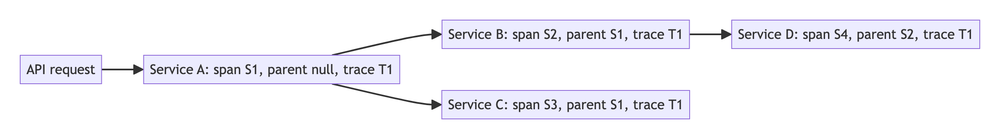
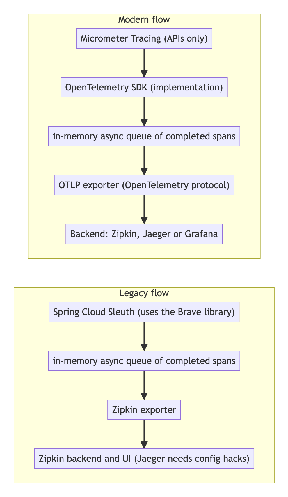
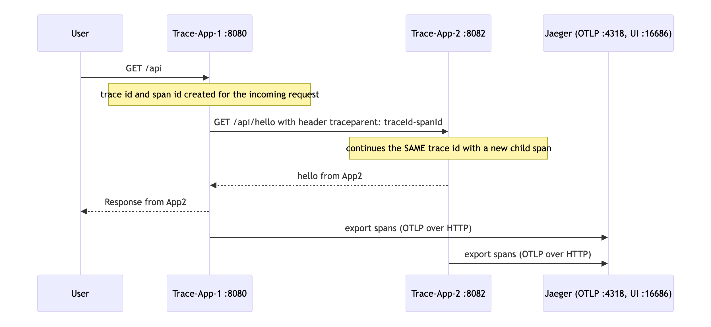

# Distributed Tracing (Micrometer + OpenTelemetry) (Distributed Microservices #15)

<!-- nav -->
⬅ [14 Spring Cloud Bus](14_Cloud_Bus_Notes.md) · [Index](00_Distributed_Microservices_Index.md) · [16 Distributed Logging – Part 1: How Logging Works in One Application](16_Distributed_Logging_Part1_Notes.md) ➡
<!-- nav -->

Source: https://drive.google.com/file/d/10ngkU6IzaZ_htyX3g1oSZ2e9FnwRrRJQ/view?usp=drive_link

## 1. Logs vs Tracing

### Logs

- A log contains plain text or JSON to record **what events happened during the processing of an API request within the application.**
- We can record Information, Warning or Error, which is crucial for:
  - **Debugging**: to know what happened within an application while processing the API request.
  - **Tracking errors and failures** with a stack trace.
  - **Monitoring application behaviour** for unusual patterns.
- Logs can record **API level details**, such as: incoming request information (URL, method, headers, body), events happening while an API request is being processed in an application, outgoing response details (status code, time taken, payload).

**Limitation:**

- Logs **do not show the end-to-end journey** of an API request across microservices.
- We do not know the **time breakdown per service**, which would help us know where the request spent more time.

Example: if a request goes `OrderService → PaymentService`, each application has its logs independently:

```
[OrderService]   Order created for userId=55
[PaymentService] Payment timeout userId=55
```

But we cannot easily tie them together (whether both these logs belong to the same API request or not), and how long each step took we also do not know. That is where **Distributed Tracing** comes into the picture.

### Tracing

- Tracing **tracks the path of a request across microservices.**
- It shows high level info, like: which service called which service, how much time each service took, status code (200, 400, 500) of each service etc.
- But it does **NOT store detailed logs.**

To achieve this, Distributed Tracing creates a **TRACE_ID and SPAN_ID**:

- **Trace ID:** connects the request across microservices with **1 unique ID**.
- **Span ID:** each service has its own unique Span ID, representing the **individual parts of the work done inside each service.**



| Service | Span_Id | Parent_Span_Id | Trace_Id |
|---|---|---|---|
| Service A | S1 | null | T1 |
| Service B | S2 | S1 | T1 |
| Service C | S3 | S1 | T1 |
| Service D | S4 | S2 | T1 |

The **Trace_Id is common** for each service. In a timeline view, ServiceA's span covers the whole request, ServiceB and ServiceC spans sit inside it, and ServiceD's span sits inside B's.

**In simple words:** a trace is the whole parcel journey with one tracking number, and each span is one leg of the journey (one warehouse), with a start, an end and a pointer to the leg before it.

### Note: how logs and tracing work together

A modern distributed logging system uses the **Trace Id generated by distributed tracing to stitch together logs from multiple microservices that belong to the same API request.**

If a request goes `OrderService → PaymentService`, each application has its logs independently but stitched with a unique and common Trace_Id:

```
TRACE-ID=T123 [OrderService]   Order created for userId=55
TRACE-ID=T123 [PaymentService] Payment timeout userId=55
```

Even though these are separate logs from separate services, they can be combined in Kibana / CloudWatch etc. When we search using `traceId = T123`, all the related logs from the different services involved in a single API request appear together. (Distributed logging is the next topic: [16 Distributed Logging Part 1](16_Distributed_Logging_Part1_Notes.md).) Today the focus is distributed tracing and its implementation.

## 2. How does it work?



**Old / legacy flow:**

- Used **Spring Cloud Sleuth**, which uses the **Brave** library, compatible with the **Zipkin** backend service.
- So supporting another backend like Jaeger is not straightforward (needs some configuration hacks).
- The pieces: Sleuth (creates Trace_Id and Span_Id, helps propagate the Trace_Id to different microservices) → in-memory async queue (stores completed spans) → Zipkin exporter (picks the completed spans from time to time and pushes them to the backend) → Zipkin backend (stores all the span info, either in a DB or in memory as configured; creates a tree using Trace_Id, Span_Id and Parent_Span_Id so that we can see the complete track of the API request when searched with a Trace Id).

**Modern flow:**

- **Micrometer** provides the **tracing APIs only** (interfaces, not implementation).
- **OpenTelemetry SDK** provides the **implementation** of those tracing APIs. It takes care of creation of Trace_Id and Span_Id and helps in propagation of the Trace_Id to different microservices.
- An in-memory async queue stores completed spans → the **OTLP exporter** (OTLP = OpenTelemetry protocol) picks the completed spans from time to time and pushes them to the configured backend → backend: **Zipkin, Jaeger or Grafana** (all work, because OTLP is a standard protocol).

## 3. Implementation

### Step 1: choose a backend service and make its server up

I am going with **Jaeger**. We can use Docker to install and run it:

```bash
docker run -d -p 16686:16686 -p 4317:4317 -p 4318:4318 jaegertracing/all-in-one:latest
```

Docker does these steps: checks if the image exists locally, if not pulls it from Docker Hub, creates a container, runs it in the background (`-d`), and exposes the ports:

| Port | Use |
|---|---|
| 16686 | Jaeger UI (open `http://localhost:16686`) |
| 4317 | OTLP gRPC endpoint |
| 4318 | OTLP HTTP endpoint |

Open the UI: it is up and currently shows 0 services, which is expected.

### Step 2: Application 1 setup

**pom.xml**

```xml
<!-- With Actuator, internally it brings the Micrometer dependency too (which has interfaces, not implementation) -->
<dependency>
    <groupId>org.springframework.boot</groupId>
    <artifactId>spring-boot-starter-actuator</artifactId>
</dependency>

<!-- OpenTelemetry SDK, implementation of the Micrometer APIs -->
<dependency>
    <groupId>io.micrometer</groupId>
    <artifactId>micrometer-tracing-bridge-otel</artifactId>
</dependency>

<!-- OpenTelemetry exporter, to push the spans to a backend like Jaeger -->
<dependency>
    <groupId>io.opentelemetry</groupId>
    <artifactId>opentelemetry-exporter-otlp</artifactId>
</dependency>
```

**application.properties**

```properties
server.port=8080
spring.application.name=Trace-App-1

# Micrometer tracing
management.tracing.sampling.probability=1.0

# OTLP exporter (Jaeger)
management.otlp.tracing.endpoint=http://localhost:4318/v1/traces
```

(`sampling.probability=1.0` means 100% of requests are traced. In production use a smaller value like `0.1` to cut the cost.)

That is all we need. Now tracing automatically initializes and starts generating spans for **incoming HTTP requests, outgoing HTTP requests, thread handoffs** etc.

A controller, just for testing:

```java
@RestController
public class App1Controller {

    @GetMapping("/api")
    public String invokeApp2() {
        // here we will be invoking the app2 microservice
        return "response from App1";
    }
}
```

When we invoke this endpoint, it generates the `trace_id` and `span_id` for the incoming HTTP request, and they show up in the Jaeger UI under the service `Trace-App-1`.

### Step 3: Application 2 setup

Same `pom.xml`. `application.properties`:

```properties
server.port=8082
spring.application.name=Trace-App-2

# Micrometer tracing
management.tracing.sampling.probability=1.0

# OTLP exporter (Jaeger)
management.otlp.tracing.endpoint=http://localhost:4318/v1/traces
```

```java
@RestController
public class App2Controller {

    @GetMapping("/api/hello")
    public String helloMethod() {
        return "hello from App2";
    }
}
```

### Step 4: Application 1 invokes Application 2

```java
@RestController
public class App1Controller {

    @Autowired
    private RestClient restClient;

    @GetMapping("/api")
    public String invokeApp2() {

        String response = restClient.get()
                .uri("http://localhost:8082/api/hello")
                .retrieve()
                .body(String.class);

        return "Response from App2:" + response;
    }
}

@Configuration
public class AppConfig {

    @Bean
    RestClient restClientInstance(RestClient.Builder builder) {
        return builder.build();
    }
}
```



Now during the **outgoing call**, a header like the one below gets appended, and this is how the trace id and spans propagate to the other microservices:

```
GET /api/hello HTTP/1.1
traceparent: 31b2e6bc8d9e102a84b29c7f1e568888-72fd8c9d4d47e352
```

The header format is `<trace id>-<span id>` (the real W3C header is `traceparent: 00-<trace id>-<span id>-<flags>`, as in the example above).

### Does the HTTP client need a customizer?

| HTTP client | Needs customizer? | Details |
|---|---|---|
| **RestTemplate** | **Yes** | old way of invoking the API, so a customizer adds the interceptor which adds `trace_id` and `span_id` to the header. `@Bean RestTemplate restTemplate(ObservationRestTemplateCustomizer customizer) { RestTemplate restTemplate = new RestTemplate(); customizer.customize(restTemplate); return restTemplate; }` |
| **RestClient** | **No**, if you use `RestClient.Builder` | when `RestClient.Builder` is used, Spring Boot automatically adds the `ObservationRestClientCustomizer` (it detects the Micrometer dependency on the classpath). `@Bean RestClient restClientInstance(RestClient.Builder builder) { return builder.build(); }` is the built-in support. **But `RestClient.create()` is not supported:** trace id propagation will not work, as the interceptor is not added automatically. |
| **FeignClient** | No | auto configuration is present, built-in support (test it out please). |

### The spans of one trace, in code form (from Jaeger)

```json
{
  "data": [{
    "traceID": "da580a0614028158d96fa5dded6...",
    "spans": [
      { "traceID": "da58...", "spanID": "6571f74f2fdf7017", "operationName": "http get /api",
        "references": [], "startTime": 1763735113048936, "duration": 50859, "processID": "p1" },
      { "traceID": "da58...", "spanID": "0120cd4...ed74e03", "operationName": "http get",
        "references": [{ "refType": "CHILD_OF", "traceID": "da58...", "spanID": "6571f74f2fdf7017" }],
        "startTime": 1763735113069676, "duration": 24497, "processID": "p1" },
      { "traceID": "da58...", "spanID": "f9739086e3ef65", "operationName": "http get /api/hello",
        "references": [{ "refType": "CHILD_OF", "traceID": "da58...", "spanID": "0120cd4...ed74e03" }],
        "startTime": 1763735113086468, "duration": 1193, "processID": "p2" }
    ],
    "processes": { "p1": { "serviceName": "Trace-App-1" }, "p2": { "serviceName": "Trace-App-2" } }
  }]
}
```

Read it as a chain: `http get /api` (App1, the incoming request) → `http get` (App1's outgoing client call, **child of** the first span) → `http get /api/hello` (App2's incoming request, child of the client call). **All three share one `traceID`.** `duration` is in microseconds, so App2 took about 1.2 ms of the 50 ms total.

## 4. Manual span creation

Automatic spans cover HTTP calls. For your own piece of business logic, create a span manually:

```java
@RestController
public class App1Controller {

    @Autowired
    Tracer tracer;

    @GetMapping("/api/test/span")
    public String manualSpanTest() {

        // creating a new span here:
        /* this will return me the current span ongoing */
        Span parentSpan = tracer.currentSpan();

        /* create a child span under the same trace id */
        Span childSpan = tracer.nextSpan(parentSpan).name("manual-child-span");

        // starts the timer, but does not activate the span as the current span
        // (the current span is still the parent only)
        childSpan.start();

        Tracer.SpanInScope spanInScope = tracer.withSpan(childSpan);
        try {
            // business logic
            Thread.sleep(70);
        } catch (Exception ex) {
            // handle exception here
        } finally {
            if (spanInScope != null) {
                spanInScope.close();     // restore the parent span as current
            }
            childSpan.end();             // stops the timer
        }

        return "Response from App1";
    }
}
```

In Jaeger the manual span (`manual-child-span`, spanID `137b2c47fe0e0949`) is a **child of** the HTTP span `http get /api/test/span` (spanID `64dd4cbf327312fc`), both under the same `traceID`, both in `Trace-App-1`.

| Call | What it does |
|---|---|
| `tracer.currentSpan()` | the span in progress (the incoming HTTP span) |
| `tracer.nextSpan(parent).name(...)` | creates a child span on the same trace |
| `childSpan.start()` | starts the timer (does not make it current) |
| `tracer.withSpan(childSpan)` | makes it the **current** span in this scope (so logs and nested calls attach to it) |
| `spanInScope.close()` | puts the parent back as current |
| `childSpan.end()` | stops the timer and sends the span for export |

## 5. From the GitLab repo

Folder `DistributedTracing` of [springboot-microservices](https://gitlab.com/shrayansh8/springboot-microservices): `Application1` (`Trace-App-1`, port 8080, `App1Controller` with `/api` and `/api/test/span`, `AppConfig` building `RestClient` from `RestClient.Builder`) and `Application2` (`Trace-App-2`, port 8082, `/api/hello`). Both use Spring Boot 3.5.6, Java 17, `spring-boot-starter-actuator`, `micrometer-tracing-bridge-otel` and `opentelemetry-exporter-otlp` and send to `http://localhost:4318/v1/traces`.

**In simple words:** logs tell you what happened inside one service. Tracing gives every request one ID that travels with it through all services (in an HTTP header), and each service records a timed "span". The result is a timeline of the whole journey, so you can see which service was slow or failed. Micrometer + OpenTelemetry create and export the data, Jaeger shows it.

---

<!-- nav -->
⬅ [14 Spring Cloud Bus](14_Cloud_Bus_Notes.md) · [Index](00_Distributed_Microservices_Index.md) · [16 Distributed Logging – Part 1: How Logging Works in One Application](16_Distributed_Logging_Part1_Notes.md) ➡
<!-- nav -->
