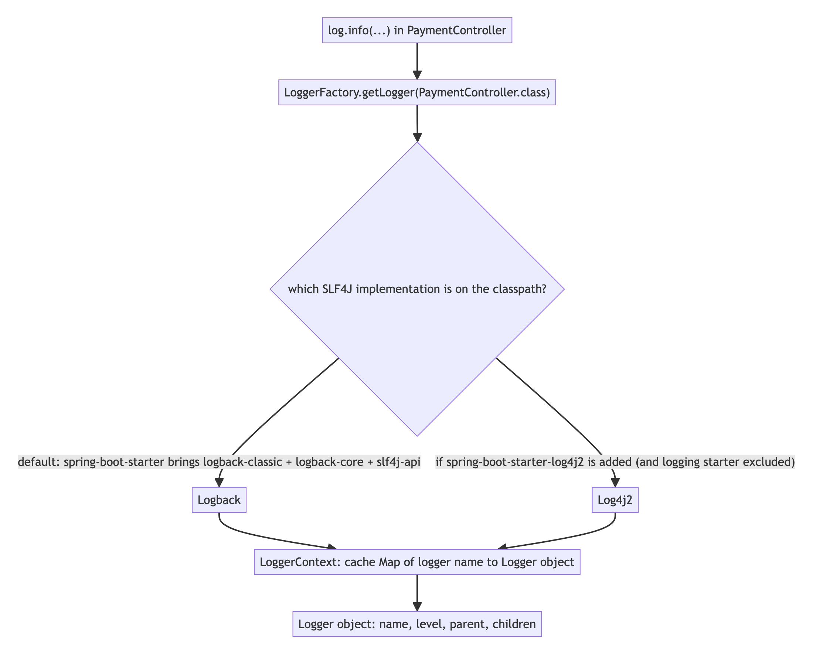
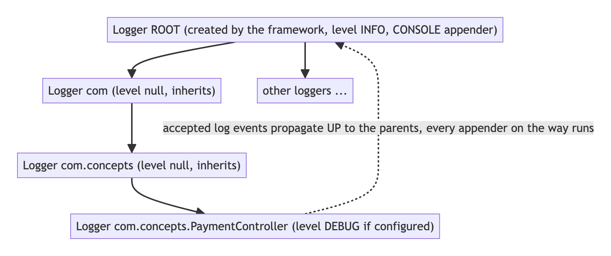

# Distributed Logging – Part 1: How Logging Works in One Application (Distributed Microservices #16)

<!-- nav -->
⬅ [15 Distributed Tracing (Micrometer + OpenTelemetry)](15_Distributed_Tracing_Notes.md) · [Index](00_Distributed_Microservices_Index.md) · [17 Distributed Logging – Part 2: Appenders and logback-spring.xml](17_Distributed_Logging_Part2_Notes.md) ➡
<!-- nav -->

Source: https://drive.google.com/file/d/1A9UfCSivJt8MS6opPfxZc3CvkxodXajk/view?usp=drive_link

## 1. What is logging?

It means **recording important application events** (like requests, errors, warnings, debug info) so that we developers can **monitor and debug what the application is doing at runtime.**

Before we go to distributed logging, first see how it is done in a **single application**.

```java
@RestController
public class PaymentController {

    // Get Logger object (Logback or Log4j2)
    Logger log = LoggerFactory.getLogger(PaymentController.class);

    @GetMapping("/payments")
    public String getPayments() {

        // Start Logging
        log.info("fetch the payments successfully");

        return "successfully fetched all payments";
    }
}
```

That's it. But how? What exactly happened?



## 2. The dependency

When we add this dependency:

```xml
<dependency>
    <groupId>org.springframework.boot</groupId>
    <artifactId>spring-boot-starter</artifactId>
</dependency>
```

it automatically brings these jars: `slf4j-api.jar`, `logback-classic.jar`, `logback-core.jar`.

**SLF4J is only the interface (the facade)**, Logback or Log4j2 is the implementation behind it. That is why your code uses `org.slf4j.Logger` and you can swap the implementation without changing the code.

**One question:** so by default Spring Boot brings the "Logback" library. But what if I want to use "Log4j2"? Then I add the dependency of Log4j2:

```xml
<dependency>
    <groupId>org.springframework.boot</groupId>
    <artifactId>spring-boot-starter-log4j2</artifactId>
</dependency>
```

Now in the classpath we have **2 implementation libraries of SLF4J**: Logback (the default one) and Log4j2 (added manually). **Which implementation will be used now?**

```java
/************* LoggerFactory (Framework code) *******/

private final static void bind() {
    try {
        List<SLF4JServiceProvider> providersList = findServiceProviders();
        reportMultipleBindingAmbiguity(providersList);
        if (providersList != null && !providersList.isEmpty()) {

            // From the list of providers, it will do get(0)
            PROVIDER = providersList.get(0);
            ...
        }
    }
}
```

It picks the **first** one from the list. Also while starting the application it **warns** us about it. **Note:** it is just a warning, not an error message, so the build will succeed. But for production, `get(0)` is **not reliable**. Instead we should **specifically exclude the default library** if we are manually adding another one:

```xml
<!-- Excluding the starter logging library, which internally brings:
     - logback-classic
     - logback-core
-->
<dependency>
    <groupId>org.springframework.boot</groupId>
    <artifactId>spring-boot-starter</artifactId>
    <exclusions>
        <exclusion>
            <groupId>org.springframework.boot</groupId>
            <artifactId>spring-boot-starter-logging</artifactId>
        </exclusion>
    </exclusions>
</dependency>

<!-- Manually add the implementation library which we want to use. -->
<dependency>
    <groupId>org.springframework.boot</groupId>
    <artifactId>spring-boot-starter-log4j2</artifactId>
</dependency>
```

## 3. Getting the Logger object

```java
Logger log = LoggerFactory.getLogger(PaymentController.class);
```

**`LoggerFactory` does:**

- Finds which SLF4J implementation to use (Logback, Log4j2 etc.). It chooses the implementation **by seeing which library is present in the classpath**.
- Invokes the `LoggerContext` of that specific implementation.

**`LoggerContext` does:**

- **Caching based on the logger name.** The logger name can be a class name, a package name or any String: `Map<String, Logger> loggerCache;`
- If a Logger object is already present for a particular name, it **re-uses it**, else it creates a new one and puts it into the cache.

### The Logger object

A few important fields in the `Logger` class: `String name`, `Level level`, `Logger parent`, `List<Logger> child`.

**name:** the name of the logger. It can be a package name, a class name or any String. **For a given logger name only 1 logger object is created and reused.** In a real world application the common practice is **1 logger per class**:

```java
// logger name = com.concepts.PaymentController
Logger log = LoggerFactory.getLogger(PaymentController.class);
```

**level:** for each Logger object we configure a log level.

| Level | Priority |
|---|---|
| ERROR | highest |
| WARN | |
| **INFO** | **(default)** |
| DEBUG | |
| TRACE | lowest |

Each log statement implicitly has its own level, based on the method used: `log.debug("...")`, `log.info("...")`, `log.error("...")`. **The logger prints a log statement only if the log statement's level is the same or higher than the Logger's configured level.**

Example: a logger with level = WARN prints only `error()` and `warn()`. The `info`, `debug` and `trace` statements are ignored.

```java
@RestController
public class PaymentController {

    Logger log = LoggerFactory.getLogger(PaymentController.class);

    @GetMapping("/payments")
    public String getPayments() {

        log.error("error log");
        log.warn("warning log");
        log.info("info log");
        log.debug("debug log");
        log.trace("trace log");

        return "successfully fetched all payments";
    }
}
```

With no configuration, hitting `GET /payments` prints only the **error, warning and info** lines: the debug and trace ones are ignored, because the logger's level by default is **INFO** (the level of the ROOT logger, which it inherits).

**Change the level through configuration** (`application.properties`):

```properties
logging.level.com.concepts.PaymentController=DEBUG
```

Now the console shows error, warn, info **and debug**, but still not trace (debug and above is entertained, the rest is skipped).

### Logger parent and children: the hierarchy



The logging framework internally maintains a **hierarchy of Logger objects**. For the logger name `com.concepts.PaymentController`:

```
ROOT  →  com  →  com.concepts  →  com.concepts.PaymentController
```

`ROOT` is the parent of all and is **always created by the framework itself** (level INFO). In a debugger you can see: `PaymentController` logger (level DEBUG) → parent `com.concepts` (level null, effective level 20000) → parent `com` (level null) → parent `ROOT` (level INFO, parent null). A `null` level means "use my parent's level".

**Advantages of maintaining the parent-child relationship:**

**1. Log level inheritance.** We do not need to configure each and every class. For example, I can set the level on a **package logger** and all of its children automatically inherit it.

```properties
# This logger level is inherited by all its child loggers
# unless those child loggers explicitly override the level.
logging.level.com=DEBUG
```

**2. Override specific child behaviour.**

```properties
logging.level.com=DEBUG

# I have set a different log level for a specific child logger under "com".
logging.level.com.concepts.PaymentController=WARN
```

**3. Accepted logs are propagated upwards.**

- If a log is **rejected**: STOP (do not propagate it).
- If a log is **accepted** by the child logger, it is **propagated upwards (till ROOT) and all appenders are executed.**

Example with `logging.level.com.concepts.PaymentController=DEBUG`: `log.trace("trace log statement")` is rejected, as the logger level is DEBUG, so only DEBUG and upper levels are entertained and the rest is skipped. A statement like `log.info("info log")` is accepted, and **once a child logger accepts a log event it ALWAYS propagates upward, and all parent appenders execute, regardless of the parent levels.**

This propagation (called **additivity**) is `TRUE` by default, but we can turn it FALSE also.

### What is an appender?

An **appender** is the component that decides **where the log will go**: console, file, DB, Kafka etc.

**One thing to notice:** in all our previous examples we have not written any appender and still we are able to see the logs on the **CONSOLE**. How? Appender is required to determine where the logs will go, so who decides it? When we do not specify an appender, the accepted log propagates upwards, and at the **ROOT logger (which the framework provides) a CONSOLE appender is present**, which prints the logs on the console.

| Concept | Role |
|---|---|
| `Logger` (name) | one per class, found/cached by name |
| `Level` | filters which statements are accepted |
| `parent` / `child` | hierarchy, so levels are inherited and logs propagate up |
| `Appender` | destination of an accepted log (console, file, DB, Kafka) |
| `ROOT` | top logger, INFO level, CONSOLE appender by default |

**In simple words:** `LoggerFactory` hands you a named logger (one per class). The logger checks the level before printing, inherits its level from its package if you did not set one, and passes accepted messages up the tree to the ROOT logger, whose console appender prints them. The next parts add our own appenders and make this work across many services ([17 Distributed Logging Part 2](17_Distributed_Logging_Part2_Notes.md)).

---

<!-- nav -->
⬅ [15 Distributed Tracing (Micrometer + OpenTelemetry)](15_Distributed_Tracing_Notes.md) · [Index](00_Distributed_Microservices_Index.md) · [17 Distributed Logging – Part 2: Appenders and logback-spring.xml](17_Distributed_Logging_Part2_Notes.md) ➡
<!-- nav -->
