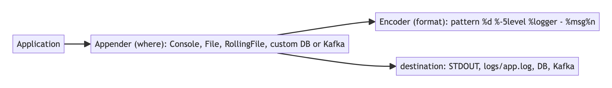
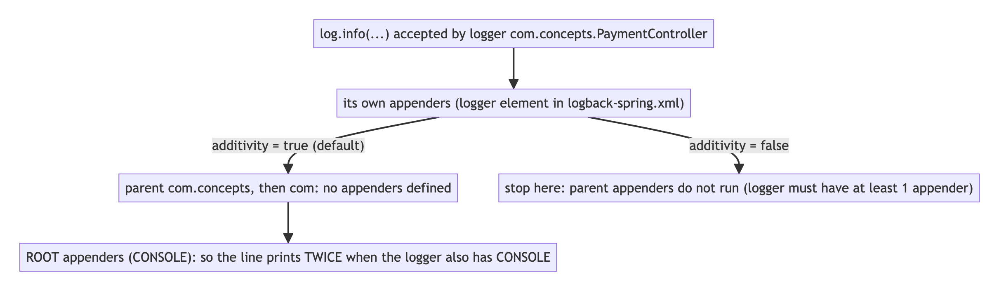

# Distributed Logging – Part 2: Appenders and logback-spring.xml (Distributed Microservices #17)

<!-- nav -->
⬅ [16 Distributed Logging – Part 1: How Logging Works in One Application](16_Distributed_Logging_Part1_Notes.md) · [Index](00_Distributed_Microservices_Index.md) · [18 Distributed Logging – Part 3: Async Logging, Filters, Patterns, JSON and PII](18_Distributed_Logging_Part3_Notes.md) ➡
<!-- nav -->

Source: https://drive.google.com/file/d/1Np9DxNIssaTBarQuyPjz87e5T9-8sVwQ/view?usp=drive_link

Prerequisite: [16 Distributed Logging Part 1](16_Distributed_Logging_Part1_Notes.md). There we saw: what SLF4J, Logback and Log4j2 are, the architecture (high and low level), how to create a Logger object, the logger levels and how the framework uses them, the parent-child hierarchy and the ROOT logger.

## 1. Appenders

An **appender** is the component that decides **where the log will go**: console, file, DB, Kafka etc.

Till now we only created a Logger object and overrode its level through `application.properties`:

```java
@RestController
public class PaymentController {

    Logger log = LoggerFactory.getLogger(PaymentController.class);

    @GetMapping("/payments")
    public String getPayments() {

        log.info("info log");

        return "successfully fetched all payments";
    }
}
```

```properties
logging.level.com.concepts.PaymentController=DEBUG
```

The logs were printed on the console properly. But the appender decides where the logs go, and we have not added any appender yet, so how does it go to the CONSOLE? As answered earlier: even when we have not defined any appender for our Logger, **by default an accepted log propagates upwards till the ROOT logger and executes all the appenders present in the parent loggers, and the ROOT logger has a default CONSOLE appender**, which prints the logs on the console.

## 2. Writing appenders for our logger: `logback-spring.xml`

**Please note:** conceptually both Logback and Log4j2 use appenders to define where the logs will go, but they differ a little in syntax. Here I am using **Logback** (the default for Spring Boot).

`src/main/resources/logback-spring.xml` contains info about: all **appenders**, the log **pattern**, all **loggers**, and the **root** logger.

```xml
<configuration>

    <!-- 1. Define Appender, we can have more than 1 Appender -->
    <appender name="appender name" class="fully.qualified.path.of.appender.class">
        <encoder>
            <pattern>%d %-5level %logger - %msg%n</pattern>
        </encoder>
    </appender>

    <appender . . . >
        . . .
    </appender>

    <!-- 2. Loggers which refer to the above defined Appenders -->
    <logger name="logger name" level="INFO/WARN/ERROR etc.." additivity="true/false">
        <appender-ref ref="appender name"/>
    </logger>

    <logger . . . >
        . . .
    </logger>

    <!-- 3. Root (kind of fallback) -->
    <root level="INFO/WARN/ERROR etc..">
        <appender-ref ref="appender name"/>
    </root>

</configuration>
```



**Encoder:** decides the **format** of the log. Without an encoder the appender does not know the log formatting and it will not work. Pattern letters: `%d` = date, `%level` (or `%-5level`) = log statement level (INFO, WARN etc.), `%logger` = logger name, `%msg` = log message, `%n` = new line.

**Additivity:** controls **appender propagation only**. By default it is `true`. When a log is accepted, it starts running all the appenders of its logger and the parent loggers (till ROOT). If we do not want to execute the parent appenders, we can make it `false`.

**Level:** specifies the level of the logger. If missing, it **inherits the level from the immediate parent**. If the immediate parent has also not defined the level, it checks its parent (and so on); if none is found, it ultimately uses the ROOT logger level.

## 3. Example: only a ROOT logger configured

```xml
<configuration>

    <!-- Console Appender: Write logs to console -->
    <appender name="CONSOLE" class="ch.qos.logback.core.ConsoleAppender">

        <!-- appender decides where the logs go, but its format is decided by the encoder -->
        <encoder>
            <pattern>%d %-5level %logger - %msg%n</pattern>
        </encoder>

    </appender>

    <!-- currently we do not have any configuration for loggers, so all logs will go to the root logger -->

    <!-- Root Logger -->
    <root level="INFO">
        <appender-ref ref="CONSOLE"/>
    </root>

</configuration>
```

I have not defined any configuration for the logger with `name="com.concepts.PaymentController"`: no appender, no level. So for the appender, the log **propagates upward till ROOT** (default behaviour) and runs their appenders: first logger `com.concepts` (no config, no appender), then logger `com` (no config, no appender), then the **ROOT logger**, which has only 1 appender, the `ConsoleAppender`, so that is used. The level is also not defined, so it inherits from the immediate parent, and if they do not have it either, it goes upward to ROOT (INFO).

## 4. Defining a logger with its own appender (additivity)

```xml
<configuration>

    <appender name="CONSOLE" class="ch.qos.logback.core.ConsoleAppender">
        <encoder>
            <pattern>%d %-5level %logger - %msg%n</pattern>
        </encoder>
    </appender>

    <logger name="com.concepts.PaymentController" level="INFO" additivity="true">
        <appender-ref ref="CONSOLE"/>
    </logger>

    <!-- Root logger -->
    <root level="INFO">
        <appender-ref ref="CONSOLE"/>
    </root>

</configuration>
```

**The log prints 2 times**, because:

- This logger has the `CONSOLE` appender, so when a log is accepted, its appender executes and prints the log on the console.
- `additivity="true"` means it **propagates upwards and runs the appenders of the parents (till ROOT)**. The ROOT logger also has a `ConsoleAppender`, so that executes too and prints the log again.



**Making `additivity="false"`:**

```xml
<!-- additivity="false": now for appenders it will not propagate upwards.
     But make sure that the Logger has at least 1 appender. -->
<logger name="com.concepts.PaymentController" level="INFO" additivity="false">
    <appender-ref ref="CONSOLE"/>
</logger>
```

Now the log prints once. **When `additivity="false"` is used, make sure the logger has at least 1 appender**, else we get a WARNING (and the log goes nowhere):

```xml
<logger name="com.concepts.PaymentController" level="INFO" additivity="false">
    <!-- <appender-ref ref="CONSOLE"/> -->
</logger>
```

## 5. Level inheritance in the config file

```xml
<logger name="com.concepts" level="WARN">
    <appender-ref ref="CONSOLE"/>
</logger>

<!-- Level is missing for "com.concepts.PaymentController",
     so it will look at its immediate parent logger "com.concepts" and
     inherit its LEVEL (i.e. WARN in this case)
-->
<logger name="com.concepts.PaymentController" additivity="false">
    <appender-ref ref="CONSOLE"/>
</logger>

<!-- Root Logger -->
<root level="INFO">
    <appender-ref ref="CONSOLE"/>
</root>
```

With `log.error`, `log.warn`, `log.info`, `log.debug`, `log.trace` in the controller, only the **ERROR and WARN** lines are printed: the controller logger has no level of its own, so it inherited WARN from `com.concepts` and takes only the statements whose priority is equal to or higher than that.

## 6. The appenders Logback provides

### 1. Console Appender

- Prints the log to the output stream called **STDOUT** (Standard Output).
  - Local run: the terminal reads the STDOUT content.
  - Docker: the Docker logging driver reads STDOUT.
  - Cloud (Azure): Azure Monitor collects the STDOUT logs.
- The platform handles the log collection, we do not have to worry.
- **Fast.**
- **No persistence** (so no space issue).

```xml
<appender name="CONSOLE" class="ch.qos.logback.core.ConsoleAppender">
    <encoder>
        <pattern>%d %-5level %logger - %msg%n</pattern>
    </encoder>
</appender>

<root level="INFO">
    <appender-ref ref="CONSOLE"/>
</root>
```

### 2. File Appender

- **Persists** logs.
- **Not safe for production.**

```xml
<appender name="CONSOLE" class="ch.qos.logback.core.ConsoleAppender">
    <encoder>
        <pattern>%d %-5level %logger - %msg%n</pattern>
    </encoder>
</appender>

<!--
  It will create a file "app.log" inside the logs folder.
  And keep on appending the log statements.
  append = true
    Logs are retained even when the application is restarted.
  append = false
    Logs are appended but when the application is re-started the "app.log" file
    will be cleared and start adding logs again.
  Remember this file will keep on growing, so using this in production should be avoided.
-->
<appender name="FILE" class="ch.qos.logback.core.FileAppender">
    <file>logs/app.log</file>
    <append>true</append>
    <encoder>
        <pattern>%d %-5level %logger - %msg%n</pattern>
    </encoder>
</appender>

<!-- This Logger has 2 appenders associated with it.
     So the log statement will go to Console + FILE.
     And additivity = false, so parent appenders will not run.
-->
<logger name="com.concepts.PaymentController" level="INFO" additivity="false">
    <appender-ref ref="CONSOLE"/>
    <appender-ref ref="FILE"/>
</logger>

<!-- Root Logger -->
<root level="INFO">
    <appender-ref ref="CONSOLE"/>
</root>
```

The same line appears on the console and in `logs/app.log`.

### 3. Rolling File Appender / log rotation

- **Persists** logs, with a **controlled file size**.
- Supports different policies: **a policy decides WHEN and HOW the log files are rotated.**

**a) Time based rolling policy.** `%d{}` controls the rotation frequency:

| Pattern | Rotation |
|---|---|
| `%d{yyyy-MM-dd}` | daily |
| `%d{yyyy-MM-dd-HH}` | hourly |
| `%d{yyyy-MM-dd-HH-mm}` | every minute |
| `%d{yyyy-MM}` | monthly |

For testing we use `%d{yyyy-MM-dd-HH-mm}`:

```xml
<appender name="ROLLING_FILE_TIME_BASED"
          class="ch.qos.logback.core.rolling.RollingFileAppender">

    <!-- Current minute logging will be written here -->
    <file>logs/app.log</file>

    <rollingPolicy class="ch.qos.logback.core.rolling.TimeBasedRollingPolicy">
        <!-- When archived. For each minute, we will be having different files -->
        <fileNamePattern>logs/app-%d{yyyy-MM-dd-HH-mm}.log</fileNamePattern>
        <!--
          Tells for how long we want to retain the files:
          - for minute wise, read it as: the last 30 minutes of logs will be saved
          - for hourly wise, read it as: the last 30 hrs of logs will be saved
          - for day wise, read it as: the last 30 days of logs will be saved
          etc.
        -->
        <maxHistory>30</maxHistory>
    </rollingPolicy>

    <encoder>
        <pattern>%d %-5level %logger - %msg%n</pattern>
    </encoder>

</appender>

<!-- Specific logger config -->
<logger name="com.concepts.PaymentController" level="INFO" additivity="false">
    <appender-ref ref="CONSOLE"/>
    <appender-ref ref="ROLLING_FILE_TIME_BASED"/>
</logger>
```

**b) Size + time based rolling policy (BEST for production):**

```xml
<appender name="ROLLING_FILE_SIZE_TIME_BASED"
          class="ch.qos.logback.core.rolling.RollingFileAppender">

    <!-- active file -->
    <file>logs/app.log</file>

    <rollingPolicy class="ch.qos.logback.core.rolling.SizeAndTimeBasedRollingPolicy">

        <fileNamePattern>
            logs/app-%d{yyyy-MM-dd}.%i.log
        </fileNamePattern>

        <maxFileSize>100MB</maxFileSize>
        <maxHistory>30</maxHistory>
        <totalSizeCap>2GB</totalSizeCap>

    </rollingPolicy>

    <encoder>
        <pattern>%d %-5level %logger - %msg%n</pattern>
    </encoder>

</appender>
```

- `maxFileSize` tells that **1 log file cannot be greater than 100 MB**. Say we are following day level logging and the `app.log` file size increases more than 100 MB: Logback closes the file, increments the index `%i` (starting from 0) and creates a new file: `app-2025-12-16.0.log` (0-100 MB), `app-2025-12-16.1.log` (100-200 MB), ...
- But again we need to limit the size which these combined (all) log files can use. That is achieved through **`totalSizeCap`**.
- `maxHistory` keeps that many days of archives (here 30 days).

### 4. Writing our own appender class

When we want the logs to go to a custom destination like a **DB** or **Kafka**, we have to write our own appender.

```java
/*
  All appender classes need to extend this abstract class AppenderBase.

  ILoggingEvent: Logback internal representation of a single log event/statement.
*/
public class DbAppender extends AppenderBase<ILoggingEvent> {

    @Override
    protected void append(ILoggingEvent event) {
        // Extract log data
        String message = event.getFormattedMessage();
        String loggerName = event.getLoggerName();
        long timestamp = event.getTimeStamp();

        // Custom destination logic
        // (Pretend this is a DB insert)
        System.out.println(
                "Saving ERROR log to DB: "
                        + timestamp + " - "
                        + loggerName + " - "
                        + message
        );
    }
}
```

`logback-spring.xml`:

```xml
<appender name="DB_APPENDER" class="com.concepts.customappender.DbAppender">
    <!-- no encoder is needed here, all handled by the java code: where to go and how -->
</appender>

<!-- Specific logger config -->
<logger name="com.concepts.PaymentController"
        level="INFO"
        additivity="false">
    <appender-ref ref="DB_APPENDER"/>
</logger>
```

| Appender | Use | Caution |
|---|---|---|
| Console | local, Docker, cloud (STDOUT collected by the platform) | no persistence |
| File | persist logs | grows forever, not for production |
| Rolling file (time) | one file per hour/day | no size limit per file |
| Rolling file (size + time) | **production** | set `maxFileSize`, `maxHistory`, `totalSizeCap` |
| Custom (`AppenderBase`) | DB, Kafka | your code runs on the logging thread, so keep it fast (async in [Part 3](18_Distributed_Logging_Part3_Notes.md)) |

## 7. From the GitLab repo

Folder `DistributedLogging/LogApplication1` of [springboot-microservices](https://gitlab.com/shrayansh8/springboot-microservices) has the final `logback-spring.xml` with **all** the appenders of the next parts already defined, and the active one chosen by uncommenting an `appender-ref`: `CONSOLE`, `FILE` (`append=false`), `ROLLING_FILE_TIME_BASED`, `ROLLING_FILE_SIZE_TIME_BASED`, `DB_APPENDER` (the `DbAppender` class), `ASYNC_FILE` (`AsyncAppender` with `queueSize=1000`, `discardingThreshold=10`), `JSON_CONSOLE` (Logstash encoder with masking), `CONSOLE_WITH_MDC`, `CONSOLE_WITH_ALL_MDC` and `CONSOLE_WITH_JSON`. These are explained in [18 Distributed Logging Part 3](18_Distributed_Logging_Part3_Notes.md) and [19 Part 4](19_Distributed_Logging_Part4_Notes.md).

**In simple words:** the logger decides **whether** a message is accepted (level), the appender decides **where** it goes (console, file, DB), and the encoder decides **how it looks** (pattern). `logback-spring.xml` wires those together, and `additivity` decides whether the message also goes up to the parent's appenders (which is why you can see a line twice).

---

<!-- nav -->
⬅ [16 Distributed Logging – Part 1: How Logging Works in One Application](16_Distributed_Logging_Part1_Notes.md) · [Index](00_Distributed_Microservices_Index.md) · [18 Distributed Logging – Part 3: Async Logging, Filters, Patterns, JSON and PII](18_Distributed_Logging_Part3_Notes.md) ➡
<!-- nav -->
