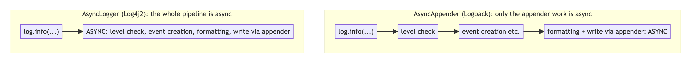
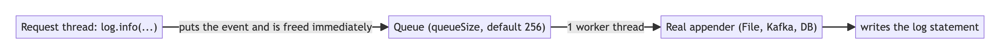
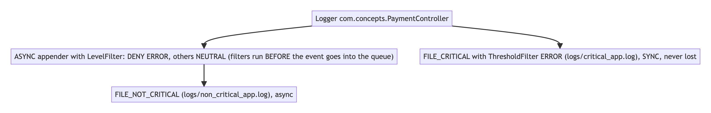

# Distributed Logging – Part 3: Async Logging, Filters, Patterns, JSON and PII (Distributed Microservices #18)

<!-- nav -->
⬅ [17 Distributed Logging – Part 2: Appenders and logback-spring.xml](17_Distributed_Logging_Part2_Notes.md) · [Index](00_Distributed_Microservices_Index.md) · [19 Distributed Logging – Part 4: MDC, Correlation ID and Distributed Logging](19_Distributed_Logging_Part4_Notes.md) ➡
<!-- nav -->

Source: https://drive.google.com/file/d/1KOl9X0M1RfhUEUW5gwOB2M93dH0yH89P/view?usp=drive_link

Previous: [17 Part 2 (appenders)](17_Distributed_Logging_Part2_Notes.md).

## 1. Async logging

- Logging happens in **SYNC** by default.
- Writing to a file or Kafka or DB **takes time.**
- So during heavy traffic, writing logs in SYNC could **impact latency and performance.**

That is why **logging in async** is recommended for components taking heavy traffic.



Async is of 2 types:

**1. AsyncAppender**

- A **Logback** feature.
- **Only the appender work is async** (the level check, event creation and formatting still happen on the request thread).
- Good for **medium level traffic.**
- Logback generally does not support `AsyncLogger`, here we have only `AsyncAppender`.

**2. AsyncLogger**

- A **Log4j2** feature.
- The **complete logging pipeline is async.**
- Good for **high level traffic.**
- Log4j2 supports both `AsyncAppender` and `AsyncLogger`.

## 2. AsyncAppender in detail



Notice:

- `AsyncAppender` is **just a wrapper**. The actual work is still done by the appender only.
- It provides a **queue** to hold the log events.
- It provides a **worker thread** to pick the event from the queue and call the appender.

```xml
<appender name="FILE" class="ch.qos.logback.core.FileAppender">
    <file>logs/app.log</file>
    <append>false</append>
    <encoder>
        <pattern>%d %-5level %logger - %msg%n</pattern>
    </encoder>
</appender>

<appender name="ASYNC_FILE" class="ch.qos.logback.classic.AsyncAppender">
    <queueSize>1000</queueSize>
    <discardingThreshold>10</discardingThreshold>
    <appender-ref ref="FILE"/>
</appender>

<!-- Specific logger config -->
<logger name="com.concepts.PaymentController" level="INFO" additivity="false">
    <appender-ref ref="ASYNC_FILE"/>
</logger>
```

| Setting | Meaning |
|---|---|
| `queueSize` | in-memory space to store log events, **default = 256**, and it has only **1 worker thread** |
| `discardingThreshold` | `0`: never discard any log event. `25`: when the queue reaches 75% (25% space left), **discard low priority events**. `40`: when the queue reaches 60%, discard low priority log events. (Low priority = TRACE, DEBUG, INFO. WARN and ERROR are kept.) |
| `<neverBlock>true</neverBlock>` | **Default: false**, the request thread **blocks** if the queue is full. **True:** drop the log itself but the request thread does not wait |

**In case of app shutdown:** the JVM does not shut down instantly, it performs some cleanups. So when the shutdown happens the `AsyncAppender` **stops accepting new log events** and **tries to flush the events as soon as possible**, but it does **not guarantee** it: as soon as the JVM shuts down, events might get lost as the queue will be discarded.

**In simple words:** the request thread just drops the log message into a mailbox and moves on. One helper thread empties the mailbox and does the slow writing. The price: if the mailbox overflows or the app dies, some messages can be lost.

### Recommendation: ERROR sync, the rest async

For WARN / INFO / DEBUG / TRACE we can go for **ASYNC**, but for **ERROR we can go for SYNC**, so that we are 100% sure that, because of issues like the queue size being full or a log event being discarded, **this critical error log is not lost.**

That is where **filters in appenders** come in handy:

```xml
<appender name="ASYNC" class="ch.qos.logback.classic.AsyncAppender">

    <!-- LevelFilter: Explicitly deny ERROR -->
    <filter class="ch.qos.logback.classic.filter.LevelFilter">
        <level>ERROR</level>
        <onMatch>DENY</onMatch>
        <!-- possible value ACCEPT/DENY -->
        <onMismatch>NEUTRAL</onMismatch>
        <!-- possible value DENY/NEUTRAL, NEUTRAL means let the next
             filter decide what to do with this log -->
    </filter>

    <!-- filters run before the log event is pushed to the queue -->
    <appender-ref ref="FILE_NOT_CRITICAL"/>

</appender>
```

```xml
<appender name="FILE_NOT_CRITICAL" class="ch.qos.logback.core.FileAppender">
    <file>logs/non_critical_app.log</file>
</appender>

<appender name="FILE_CRITICAL" class="ch.qos.logback.core.FileAppender">

    <file>logs/critical_app.log</file>

    <!-- ThresholdFilter: Drop below ERROR -->
    <filter class="ch.qos.logback.classic.filter.ThresholdFilter">
        <level>ERROR</level>
    </filter>

</appender>
```

```xml
<logger name="com.concepts.PaymentController" level="INFO" additivity="false">
    <appender-ref ref="ASYNC"/>
    <appender-ref ref="FILE_CRITICAL"/>
</logger>
```



- The `ASYNC` appender's `LevelFilter` **denies ERROR** (so ERROR never enters the async queue), everything else is `NEUTRAL` (continue).
- `FILE_CRITICAL` is a plain **synchronous** appender with a `ThresholdFilter(ERROR)`: it **drops everything below ERROR**, so it only keeps errors, written immediately.

| Filter | Behaviour |
|---|---|
| `LevelFilter` | matches **exactly** one level; `onMatch` / `onMismatch` = `ACCEPT`, `DENY` or `NEUTRAL` |
| `ThresholdFilter` | drops events **below** the given level and passes that level and above |

Now we have covered the major logging part. Some good-to-know things before we jump to Distributed Logging.

## 3. Log format / log pattern

How a log statement is formatted is decided by the **log pattern**.

```xml
<appender name="CONSOLE" class="ch.qos.logback.core.ConsoleAppender">
    <encoder>
        <pattern>%d %-5level %logger - %msg%n</pattern>
    </encoder>
</appender>
```

`PatternLayout.java` (a Logback framework class) has all the fields which we can use and their implementation (what it does when we use a specific field as a placeholder). For example each placeholder maps to a converter:

```java
public class LevelConverter extends ClassicConverter {

    public String convert(ILoggingEvent le) {
        return le.getLevel().toString();
    }
}
```

## 4. Placeholders in log statements

```java
public String logsWithPlaceholderSamples() {

    log.info("info log");

    /**
     * never do this
     * why? because it will create the string even if the log is not enabled
     * Say our Logger Level is set to WARN,
     * then also it will create the string and then throw it away
     */
    log.info("User" + "Shrayansh" + "created with id" + 123);

    // recommended way, because it will not create the string if the log is not enabled
    log.info("User {} created with id {}", "Shrayansh", 123);

    try {
        throw new Exception("Payment failed");
    } catch (Exception e) {
        /**
         * note: exception is not the placeholder
         * and it is always the last parameter
         * then only the stack trace will be printed
         */
        log.error("Payment failed for User {}", "Shrayansh", e);
    }

    return "successfully fetched all payments";
}
```

## 5. Structured logging (JSON) and PII safe logging

By now one thing might have come to our mind: formatting using `<pattern>` is **not machine friendly.**

```java
log.info("info log and payment id {}", 123);
```

```xml
<pattern>%d %level %logger - %msg%n</pattern>
```

Log aggregation tools have to **parse this plain text** to find the logger name, thread name, date, level, message etc. And this parsing is **not straightforward and not 100% correct**, because they need to rely on **regex, which is error prone** as there is no standard followed:

```
2025-12-17 12:04:16,181 INFO com.concepts.PaymentController - info log and payment id 123
```

I used `-` between the logger name and the msg. What if in some other appender I used `|`:

```
2025-12-17 12:04:16,181 | INFO | com.concepts.PaymentController | info log and payment id 123
```

A totally different structure, so 1 regex or parsing logic will not work. In some logs the parser will see the date as `yyyy:MM:dd`, but in some I might be using `yyyy:MM:dd HH:mm:ss`. Also it is **not easy to extract useful information** from the message like `payment id 123`. It would be better if I could **filter based on the payment id**, but since it is present in plain text, the aggregation tool might not be able to search it.

That is where **Structured Logging (JSON)** comes into the picture.

**Please note:** it does not mean for everything we need to use JSON. **My recommendation:** use the JSON format only for that data on which later we might have to do **query, filter, aggregation** etc.

**Incorrect way (do not do this in production):**

```xml
<pattern> {"time":"%d", "level":"%level", "msg":"%msg"} </pattern>
```

Why? Because if we need to add more fields this pattern will keep on increasing, and again there is a high chance of mistakes (a quote or comma inside a message breaks the JSON). We cannot rely on it fully.

### Best practice: `LogstashEncoder`

**pom.xml** (add a new dependency)

```xml
<dependency>
    <groupId>net.logstash.logback</groupId>
    <artifactId>logstash-logback-encoder</artifactId>
    <version>7.4</version> <!-- use stable version -->
</dependency>
```

```xml
<appender name="JSON_CONSOLE" class="ch.qos.logback.core.ConsoleAppender">

    <!-- JSON encoder -->
    <!--
      This class accepts log events and fetches the details from
      the log events like logger name, thread name, level, message etc..
    -->
    <encoder class="net.logstash.logback.encoder.LogstashEncoder">
    </encoder>

</appender>

<!-- Specific logger config -->
<logger name="com.concepts.PaymentController" level="INFO" additivity="false">
    <appender-ref ref="JSON_CONSOLE"/>
</logger>
```

The output is one JSON object per log line. The `LogstashEncoder` uses the framework class `LogstashFieldNames.java`; some of the field names already present are:

`@timestamp`, `@version`, `message`, `thread_name`, `logger_name`, `level`, `stack_trace`, `caller_class_name`, `caller_method_name`, `caller_file_name`, `caller_line_number` etc.

### Adding dynamic fields: MDC

If we want to add **dynamic fields** into this JSON, we can use **MDC (Mapped Diagnostic Context)**. It will be covered in depth in the next part, as it plays a critical role in achieving distributed logging ([19 Part 4](19_Distributed_Logging_Part4_Notes.md)).

```java
@GetMapping("/payments")
public String getPayments() {

    /*
      Logstash encoder can read MDC fields and
      automatically add them in the JSON.
      But if you don't want that, you can disable that too:
    */
    MDC.put("payment_id", "123");
    log.info("payment is successful");

    return "successfully fetched all payments";
}
```

```xml
<appender name="JSON_CONSOLE" class="ch.qos.logback.core.ConsoleAppender">
    <!-- JSON encoder -->
    <encoder class="net.logstash.logback.encoder.LogstashEncoder">
        <includeMdc>false</includeMdc>
    </encoder>
</appender>
```

(`includeMdc` is `true` by default.)

### Never log PII

We should **never LOG PII (Personally Identifiable Information).** The 1 golden rule: **if you do not know whether a particular data is PII or not, do not log it. It is a compliance issue.**

**What is PII data?** Any information through which we can identify a specific person directly or indirectly, like: phone number, address, Aadhar card, PAN card, email, OTP, password etc.

If a field can still appear in the logs, **mask it** with the masking decorator:

```xml
<appender name="JSON_CONSOLE" class="ch.qos.logback.core.ConsoleAppender">

    <!-- JSON encoder -->
    <encoder class="net.logstash.logback.encoder.LogstashEncoder">

        <!-- Masking decorator, we can have more than one decorator -->
        <jsonGeneratorDecorator class="net.logstash.logback.mask.MaskingJsonGeneratorDecorator">

            <!-- What the masked value should look like -->
            <defaultMask>*****</defaultMask>

            <!-- Fields to mask -->
            <path>password</path>
            <path>token</path>
            <path>creditCard</path>

        </jsonGeneratorDecorator>

    </encoder>

</appender>
```

```java
@GetMapping("/payments")
public String getPayments() {

    MDC.put("payment_id", "123");
    MDC.put("password", "myPassword");
    log.info("payment is successful");

    return "successfully fetched all payments";
}
```

In the JSON output `"payment_id": "123"` is printed as is, while `"password": "*****"`: the value is masked.

## 6. From the GitLab repo

The `logback-spring.xml` of `DistributedLogging/LogApplication1` has exactly these appenders defined: `ASYNC_FILE` (queueSize 1000, discardingThreshold 10, wrapping `FILE`), `JSON_CONSOLE` (Logstash encoder + `MaskingJsonGeneratorDecorator` with `defaultMask=*****` and paths `password`, `token`, `creditCard`) and `CONSOLE_WITH_JSON` (Logstash encoder with `includeMdc=true`). The MDC ones are explained in [19](19_Distributed_Logging_Part4_Notes.md).

**In simple words:** make slow log writing async (a queue and one worker), but keep ERRORs synchronous so they cannot be lost. Use `{}` placeholders instead of string concatenation. Write logs as JSON through the Logstash encoder so tools can search by field, and never log (or at least mask) personal data.

---

<!-- nav -->
⬅ [17 Distributed Logging – Part 2: Appenders and logback-spring.xml](17_Distributed_Logging_Part2_Notes.md) · [Index](00_Distributed_Microservices_Index.md) · [19 Distributed Logging – Part 4: MDC, Correlation ID and Distributed Logging](19_Distributed_Logging_Part4_Notes.md) ➡
<!-- nav -->
