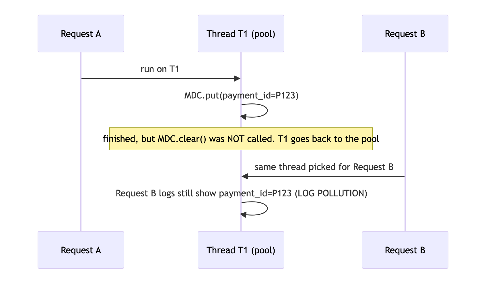
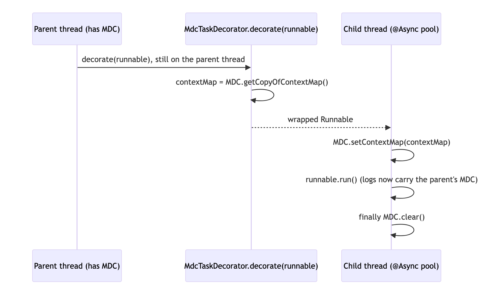
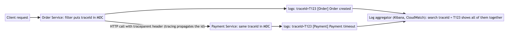

# Distributed Logging – Part 4: MDC, Correlation ID and Distributed Logging (Distributed Microservices #19)

<!-- nav -->
⬅ [18 Distributed Logging – Part 3: Async Logging, Filters, Patterns, JSON and PII](18_Distributed_Logging_Part3_Notes.md) · [Index](00_Distributed_Microservices_Index.md) · [20 Distributed Scheduler – Part 1: Scheduler Fundamentals (Leader-Follower)](20_Distributed_Scheduler_Part1_Notes.md) ➡
<!-- nav -->

Source: https://drive.google.com/file/d/1NbsMDboh1pVvYffURP4zy2dO3HoFaE9U/view?usp=drive_link

Previous parts: [16 (logger basics)](16_Distributed_Logging_Part1_Notes.md), [17 (appenders)](17_Distributed_Logging_Part2_Notes.md), [18 (async, JSON, PII)](18_Distributed_Logging_Part3_Notes.md). Prerequisite for the final part: [15 Distributed Tracing](15_Distributed_Tracing_Notes.md).

## 1. MDC (Mapped Diagnostic Context)

In a logging framework this plays a **very critical role**. It is a **per-thread key-value map**.

```java
MDC.put("payment_id", "P123");
```

The logging framework (Logback, Log4j2) can **automatically read and attach the key-value to the log events.**

**In simple words:** MDC is a sticky note attached to the current thread. Whatever you write on it (payment id, user id) is automatically printed next to every log line that thread writes, so you do not repeat it in each message.

**In the pattern encoder** the MDC access is **false by default**, we explicitly need `%X` if we want to use the MDC data:

- `%X` fetches **all** MDC data: `key1=value1, key2=value2` etc.
- `%X{key}` fetches the value of **a specific key only** (note: only the value comes).

```xml
<appender name="CONSOLE_WITH_ALL_MDC" class="ch.qos.logback.core.ConsoleAppender">
    <encoder>
        <pattern>%d %level %logger - %msg - %X%n</pattern>
    </encoder>
</appender>

<appender name="CONSOLE_WITH_MDC" class="ch.qos.logback.core.ConsoleAppender">
    <encoder>
        <pattern>%d %level %logger - %msg - %X{payment_id}%n</pattern>
    </encoder>
</appender>
```

**In the structured (JSON) encoder** the MDC access is **true by default**: all the MDC data is fetched and added in the existing JSON log as `key1: value1, key2: value2`:

```xml
<appender name="CONSOLE_WITH_JSON" class="ch.qos.logback.core.ConsoleAppender">
    <encoder class="net.logstash.logback.encoder.LogstashEncoder">
        <includeMdc>true</includeMdc> <!-- by-default is true -->
    </encoder>
</appender>
```

**Example:**

```java
@RestController
public class PaymentController {

    Logger log = LoggerFactory.getLogger(PaymentController.class);

    @GetMapping("/payments")
    public String getPayments() {

        /* It's a key-value map */
        MDC.put("payment_id", "P123");
        MDC.put("user_id", "U1234");

        /* Logging framework automatically adds MDC data with each log statement. */
        log.info("payment is successful");
        MDC.clear();

        return "successfully fetched all payments";
    }
}
```

```xml
<logger name="com.concepts.PaymentController" level="INFO" additivity="false">
    <appender-ref ref="CONSOLE_WITH_MDC"/>
    <appender-ref ref="CONSOLE_WITH_ALL_MDC"/>
    <appender-ref ref="CONSOLE_WITH_JSON"/>
</logger>
```

**Output:** the same line three times, in three shapes: `... payment is successful - P123`, `... payment is successful - payment_id=P123, user_id=U1234`, and a JSON object with `"message":"payment is successful"`, `"payment_id":"P123"`, `"user_id":"U1234"`.

## 2. Why `MDC.clear()`?

This is done to avoid **LOG POLLUTION**. How?

- MDC is a **per-thread** key-value map: each thread owns exactly one MDC map.
- But nowadays, because of `ThreadPoolExecutor`, the **same thread can be re-used for multiple requests.**
- So if the thread's MDC is not cleared for Request-A, and the same thread picks up another request Request-B, then within Request-B it can **see the previous request's data (Request-A's)**, which causes log pollution.



Example: Request-A completed and Thread T1 is put back again in the thread pool, but its MDC is not cleared. The next request on T1 logs with A's `payment_id`, which is wrong and dangerous when you debug.

## 3. MDC does not travel to a new thread

Another important point: whenever we create a new thread (like via `@Async`), **the parent thread's MDC is not passed to the child thread.** Again, every thread has its own MDC.

```java
@RestController
public class PaymentController {

    @Autowired
    PaymentService paymentService;

    @GetMapping("/payments/async")
    public String getPaymentsAsync() {

        MDC.put("payment_id", "P123");
        MDC.put("user_id", "U1234");
        paymentService.processPayment();
        MDC.clear();

        return "successfully fetched all payments";
    }
}

@Component
public class PaymentService {

    Logger log = LoggerFactory.getLogger(PaymentService.class);

    @Async
    public void processPayment() {
        /*
          Child thread, this thread has its own MDC
        */

        log.info("Async-Payment processed successfully");
    }
}
```

```xml
<appender name="CONSOLE_WITH_ALL_MDC" class="ch.qos.logback.core.ConsoleAppender">
    <encoder>
        <pattern>%d %level %logger - %msg - %X%n</pattern>
    </encoder>
</appender>

<logger name="com.concepts.service.PaymentService" level="INFO" additivity="false">
    <appender-ref ref="CONSOLE_WITH_ALL_MDC"/>
</logger>
```

The async log line is printed **without** `payment_id` and `user_id`: the MDC stayed behind on the parent thread. (`@EnableAsync` must be on the application class for `@Async` to work.)

## 4. Copy the parent MDC to the child: `TaskDecorator`

So how do we copy the parent MDC value to the child (new thread) MDC? The best way is to use **`TaskDecorator`**.

**Please note:** `TaskDecorator` is a feature of the **Spring framework**, nothing to do with the logging framework. It is just a **wrapper around the `Runnable` task**.

```java
@Component
public class MdcTaskDecorator implements TaskDecorator {

    @Override
    public Runnable decorate(Runnable runnable) {
        /*
          Currently we are in the Parent Thread only,
          so read the values
        */
        Map<String, String> contextMap = MDC.getCopyOfContextMap();

        /*
          New runnable is just a wrapper,
          - set the MDC with the values of the Parent thread MDC
          - Actual runnable
          - MDC clear
          So we just wrapped the actual runnable
        */
        return () -> {
            if (contextMap != null) {
                MDC.setContextMap(contextMap);
            }
            try {
                runnable.run();
            } finally {
                MDC.clear();
            }
        };
    }
}
```



- `decorate()` is called **on the parent thread**, so `MDC.getCopyOfContextMap()` reads the parent's MDC.
- The returned wrapper **runs on the child thread**: it first sets that map into the child's MDC, runs the real task, and in `finally` clears the child's MDC (so the pool thread is not polluted).

When we create the `TaskDecorator`, we can associate it with any `ThreadPoolExecutor`. If we do not have any custom `ThreadPoolExecutor`, this `TaskDecorator` will get added to the **default executor** itself (as a bean, Spring Boot's auto-configured task executor picks it up).

## 5. Correlation ID

Now we know what MDC is. Next: **how would you find the logs for a specific request, say Request1?** The **correlation id** helps to resolve this. It is nothing but a **unique identifier for a single request**, and **the same ID is attached with every log event** (generally saved in MDC, so that every log event gets this ID too).

Prerequisite: **Filters.** A filter is used when we want to intercept the HTTP request and response (covered in the Spring Boot series, and used a lot in the JWT implementation).

```java
@RestController
public class PaymentController {

    Logger log = LoggerFactory.getLogger(PaymentController.class);

    @GetMapping("/payments/correlation")
    public String getPaymentsWithCorrelationId() {

        log.info("payment is successful");

        return "successfully fetched all payments";
    }
}
```

```xml
<appender name="CONSOLE_WITH_ALL_MDC" class="ch.qos.logback.core.ConsoleAppender">
    <encoder>
        <pattern>%d %level %thread %logger - %msg - %X%n</pattern>
    </encoder>
</appender>

<!-- Specific logger config -->
<logger name="com.concepts.PaymentController" level="INFO" additivity="false">
    <appender-ref ref="CONSOLE_WITH_ALL_MDC"/>
</logger>
```

**Our custom filter:**

```java
@Component
public class CorrelationIdFilter extends OncePerRequestFilter {

    public static final String CORRELATION_ID = "correlationId";
    public static final String CORRELATION_HEADER = "X-Correlation-Id";

    @Override
    protected void doFilterInternal(HttpServletRequest request,
                                    HttpServletResponse response,
                                    FilterChain filterChain)
            throws ServletException, IOException {

        String correlationId = request.getHeader(CORRELATION_HEADER);

        // if there is no correlation id coming from the request, set a random one
        if (correlationId == null || correlationId.isBlank()) {
            correlationId = UUID.randomUUID().toString();
        }

        try {
            MDC.put(CORRELATION_ID, correlationId);
            response.setHeader(CORRELATION_HEADER, correlationId);
            filterChain.doFilter(request, response);
        } finally {
            MDC.clear();
        }
    }
}
```

The filter reads `X-Correlation-Id` from the request (so a caller can pass its own id), else generates a UUID, puts it in the MDC (so every log line of this request carries it), returns it in the response header (so the client can quote it when reporting a problem) and always clears the MDC in `finally`.

## 6. Distributed logging: tying it all together

**Prerequisite: Distributed Tracing** ([15](15_Distributed_Tracing_Notes.md)). Why do we need distributed tracing, and what is the difference between Trace ID and Correlation ID?

**Tracing:** tracks the path of a request across microservices. For each request a unique **Trace ID** is created at the entry point and the same Trace ID is passed to the different microservices when they are invoked. So we get to know which service called which service, how much time each service took, the status code of each service etc. But it does **NOT store detailed logs.**

**Logging and correlation id:** as part of logging, detailed logs about the request are stored. To filter the logs of a specific request, each request is assigned a unique id, i.e. the **Correlation ID.** But it does not stitch together or show which service calls which service; in simple terms, **what all services got invoked during the lifecycle of a particular request.** No matter if 10 services got invoked, all 10 services should log events for the particular request **with the same correlation id.**

Now one question might come to your mind: both Trace-ID and Correlation-ID are unique for the request. **Can they be the same?** The answer is **YES**, and that is what many big tech companies do.



If we recall from the distributed tracing topic, it makes use of `ServerHttpObservationFilter`, and the interesting part is that **this filter also adds the `traceId` in the MDC.** So this unique trace id will also get appended with every log event.

**Advantages:**

- We **do not need to add a custom filter** to add the correlation id in MDC: a unique trace id is already present in MDC.
- We **do not need to pass the correlation id in the request header** when another service is invoked, because the **trace id is already passed in the header** to the downstream services.

**But we can still add a filter for the correlation id**, and re-use the trace id if present instead of computing a new UUID, and we can send the correlation id in the **response header**. And if tracing is disabled, the correlation id can be independent.

**Tracing dependencies:**

```xml
<dependency>
    <groupId>org.springframework.boot</groupId>
    <artifactId>spring-boot-starter-actuator</artifactId>
</dependency>

<dependency>
    <groupId>io.micrometer</groupId>
    <artifactId>micrometer-tracing-bridge-otel</artifactId>
</dependency>

<dependency>
    <groupId>io.opentelemetry</groupId>
    <artifactId>opentelemetry-exporter-otlp</artifactId>
</dependency>
```

```properties
server.port=8080
spring.application.name=logging-App-1

# Micrometer tracing
management.tracing.sampling.probability=1.0

# OTLP exporter (Jaeger)
management.otlp.tracing.endpoint=http://localhost:4318/v1/traces
```

**The filter reusing the trace id:**

```java
@Component
public class CorrelationIdFilter extends OncePerRequestFilter {

    public static final String CORRELATION_ID = "correlationId";
    public static final String CORRELATION_HEADER = "X-Correlation-Id";

    @Autowired
    private Tracer tracer;

    @Override
    protected void doFilterInternal(HttpServletRequest request,
                                    HttpServletResponse response,
                                    FilterChain filterChain)
            throws ServletException, IOException {

        try {
            /*
              First priority to the trace id, if it's empty, only then generate
              a new Correlation id, else reuse the trace id
            */
            String uniqueID = tracer.currentSpan().context().traceId();
            if (uniqueID == null) {
                uniqueID = UUID.randomUUID().toString();
            }
            /*
              Put in MDC, now our MDC has both trace id and correlation id
            */
            MDC.put(CORRELATION_ID, uniqueID);
            /*
              In the response also we added it
            */
            response.setHeader(CORRELATION_HEADER, uniqueID);
            filterChain.doFilter(request, response);
        } finally {
            /*
              Need to clear the MDC, so that this thread's data does not leak
              to another request.
            */
            MDC.clear();
        }
    }
}
```

(In real code guard `tracer.currentSpan()` for `null` before calling `.context()`, as it is `null` when tracing is off or sampling skipped the request, otherwise the filter throws a `NullPointerException`. An `if (uniqueID == null)` check placed after that call would never be reached in that case.)

```xml
<appender name="CONSOLE_WITH_ALL_MDC" class="ch.qos.logback.core.ConsoleAppender">
    <encoder>
        <pattern>%d %level %thread %logger - %msg - %X%n</pattern>
    </encoder>
</appender>

<!-- Specific logger config -->
<logger name="com.concepts.PaymentController" level="INFO" additivity="false">
    <appender-ref ref="CONSOLE_WITH_ALL_MDC"/>
</logger>
```

Because of tracing, **the other service also has the same filter, which uses the same trace id and sets it in MDC.** And in that application also, if required we can add the correlation id filter.

**The result:** every log line of every service, for one request, carries the **same id**. In Kibana / CloudWatch you search that id and get the complete story of the request across all services, in order, and the **tracing** view (Jaeger) tells you which hop was slow.

## 7. From the GitLab repo

Folder `DistributedLogging/LogApplication1` (`Logger1Application` has `@EnableAsync`):

| File | What it shows |
|---|---|
| `PaymentController` | `/payments` (MDC put + clear), `/payments/async` (MDC lost in the async child), `/payments/correlation`, and a `logsWithPlaceholderSamples()` method (placeholders and the exception as the last argument) |
| `service/PaymentService` | the `@Async` method |
| `MdcTaskDecorator` | the MDC-copying `TaskDecorator` |
| `requestfilter/CorrelationIdFilter` | the filter above (reads the trace id from `Tracer`) |
| `customappender/DbAppender` | the custom appender from [17](17_Distributed_Logging_Part2_Notes.md) |
| `resources/logback-spring.xml` | all appenders: `CONSOLE_WITH_MDC`, `CONSOLE_WITH_ALL_MDC`, `CONSOLE_WITH_JSON`, `JSON_CONSOLE`, `ASYNC_FILE`, rolling files |

**In simple words:** MDC is a per-thread notepad that logs read automatically. Always clear it (threads are reused) and copy it to child threads with a `TaskDecorator`. Put one id (the correlation id, which can simply be the trace id) in the MDC of every service for a request, and your log tool can show the whole journey by searching that single id.

---

<!-- nav -->
⬅ [18 Distributed Logging – Part 3: Async Logging, Filters, Patterns, JSON and PII](18_Distributed_Logging_Part3_Notes.md) · [Index](00_Distributed_Microservices_Index.md) · [20 Distributed Scheduler – Part 1: Scheduler Fundamentals (Leader-Follower)](20_Distributed_Scheduler_Part1_Notes.md) ➡
<!-- nav -->
