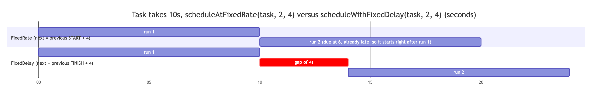
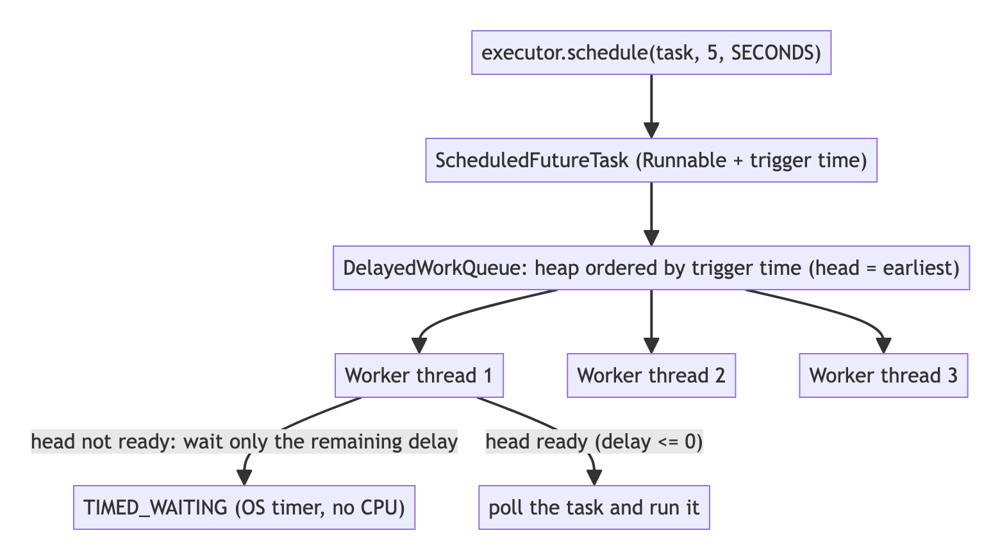
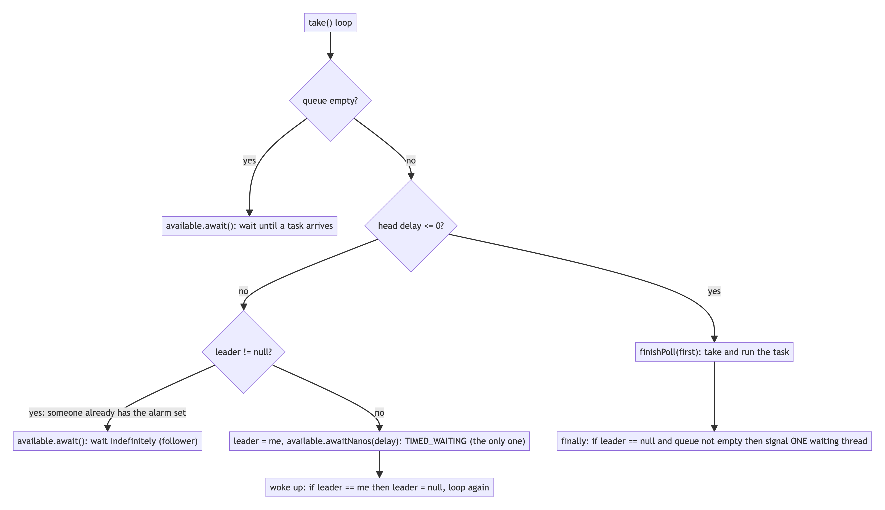

# Distributed Scheduler – Part 1: Scheduler Fundamentals (Leader-Follower) (Distributed Microservices #20)

<!-- nav -->
⬅ [19 Distributed Logging – Part 4: MDC, Correlation ID and Distributed Logging](19_Distributed_Logging_Part4_Notes.md) · [Index](00_Distributed_Microservices_Index.md) · [21 Distributed Scheduler – Part 2: the @Scheduled Annotation and Cron](21_Distributed_Scheduler_Part2_Notes.md) ➡
<!-- nav -->

Source: https://drive.google.com/file/d/1Uc1VRhyPYeqLSAzuSFIdWBVsLwwtLIwp/view?usp=drive_link

## 1. What is a scheduler?

It is **just a background thread that sleeps until a given time, wakes up, runs a method, then sleeps again.**

Spring Boot does no magic: internally it just uses Java's **`ScheduledThreadPoolExecutor`** (also discussed in depth in the Java notes: 37 Scheduled ThreadPool (Java notes)). Let us first see what happens internally, before we cover how Spring Boot abstracted all of this for us.

```java
ScheduledThreadPoolExecutor executor = new ScheduledThreadPoolExecutor(3);

Runnable task = () -> System.out.println("Hello Shrayansh!");

executor.schedule(task, 5, TimeUnit.SECONDS);
```

## 2. A few `ScheduledExecutorService` methods

| # | Method | What it does |
|---|---|---|
| 1 | `schedule(Runnable command, long delay, TimeUnit unit)` | **Runs only once.** The delay is counted from the task **submission** time. `executor.schedule(task, 5, SECONDS)` → at 5 s the task starts. |
| 2 | `scheduleAtFixedRate(Runnable command, long initialDelay, long period, TimeUnit unit)` | Runs the task repeatedly at a **fixed rate**. |
| 3 | `scheduleWithFixedDelay(Runnable command, long initialDelay, long delay, TimeUnit unit)` | Runs the task repeatedly with a **fixed delay** after each finish. |

### `scheduleAtFixedRate`

`executor.scheduleAtFixedRate(task, 2, 4, TimeUnit.SECONDS);`

- Initial delay = 2 s: at **2 s** the task starts.
- When the task finishes it is **re-queued** with the next run time = **previous start time + period** = 2 + 4 = **6 s**.
- 6 s: task starts. Finished → re-queued with 6 + 4 = **10 s**. 10 s: starts → next 14 s ... and so on.

Time(s): 2 task started, 6 task started, 10 task started, 14 ...

**Important (interviewers ask this): what if the task takes too much time, what would happen in that case?** The answer: even if the task takes too much time, **the runs are always sequential** (never two runs of the same task at the same time). Why? Because **the same task (object) is re-queued** only after it finishes.

Example: `scheduleAtFixedRate(task, 2, 4, SECONDS)` and the task takes **10 seconds**: starts at 2 s, finishes at 12 s. Now it needs to compute the new start time: previous start + period = 2 + 4 = 6 s, but 6 < current time (12). It then keeps adding the period (6 → 10 → 14) until the time is not in the past, and re-queues at 14 s.

**What the JDK really does (I checked this by running it):** the JDK does **not** skip the missed slots. The next trigger time is simply `previous scheduled time + period` (here 6 s), which is already in the past, so the task is picked **immediately after it finishes**: it **catches up** and runs back-to-back. A scaled-down run (initial 0.2 s, period 0.4 s, task takes 1.0 s) printed these start times:

```
fixedRate  quick task (0.1s) starts at: 0.2s 0.6s 1.0s 1.4s 1.8s 2.2s 2.6s 3.0s 3.4s
fixedRate  slow task  (1.0s) starts at: 0.2s 1.2s 2.2s 3.2s     <- back to back, sequential, no overlap
```

So the two things that are true either way: **runs never overlap**, and a slow task **delays** the following runs. If you need "skip what I missed", you have to build it yourself.

### `scheduleWithFixedDelay`

`executor.scheduleWithFixedDelay(task, 2, 4, TimeUnit.SECONDS);`

The new time is computed as **new time = when the task finished + delay**.

- Initial delay = 2 s: at 2 s the task starts, and say it **finishes at 12 s**.
- New run time = previous finish + delay = 12 + 4 = **16 s**. 16 s: starts, 18 s: finishes → new run time = 18 + 4 = **22 s**. 22 s: starts ... and so on.

```
fixedDelay quick task (0.1s) starts at: 0.2s 0.7s 1.2s 1.7s 2.2s 2.7s 3.2s   (0.1 run + 0.4 delay = every 0.5)
fixedDelay slow task  (1.0s) starts at: 0.2s 1.6s 3.0s                      (1.0 run + 0.4 delay = every 1.4)
```



| | `scheduleAtFixedRate` | `scheduleWithFixedDelay` |
|---|---|---|
| Next time = | previous **start** + period | previous **finish** + delay |
| Gap between runs | shrinks to 0 if the task is slow (then catches up) | always at least `delay` |
| Use for | "every 5 minutes on the clock" | "wait 5 minutes after each run" (polling, cleanup) |

**In simple words:** fixed rate is a train timetable (departures are fixed). Fixed delay is "rest for N minutes after every lap".

## 3. How `ScheduledThreadPoolExecutor` works inside

When we did `new ScheduledThreadPoolExecutor(3)`, we created a scheduled thread pool with **3 worker threads**. When we call `executor.schedule(task, 5, SECONDS)`:



Internally it creates a **`ScheduledFutureTask`** (which has the Runnable task and the delay / trigger time information) and **inserts it into the `DelayedWorkQueue`**: a priority queue (heap) ordered by trigger time, so the **head is always the task due first**.

### The not-optimized flow first

**Step 1.** The `DelayedWorkQueue` is empty and all the worker threads are in the **wait** state. (Note: the threads are created in the Runnable state, but they look for a task in the queue, and since there is none they move to the wait state.)

```java
public RunnableScheduledFuture<?> take() throws InterruptedException {
    final ReentrantLock lock = this.lock;
    lock.lockInterruptibly();
    try {
        for (;;) {
            /*
              Looks at the head of the queue, if there is no task,
              goes to the wait state.
            */
            RunnableScheduledFuture<?> first = queue[0];
            if (first == null)
                available.await();
            else {
                . . .
            }
        }
    } finally {
        . . .
    }
}
```

**Step 2.** The first task arrives in the delayed queue. It wakes **only 1 worker thread** from those in the waiting state:

```java
public boolean offer(Runnable x) {
    if (x == null)
        throw new NullPointerException();
    RunnableScheduledFuture<?> e = (RunnableScheduledFuture<?>) x;
    final ReentrantLock lock = this.lock;
    lock.lock();
    try {
        int i = size;
        if (i >= queue.length)
            /* Increase the size of the queue (by 50%) if it is full. */
            grow();
        size = i + 1;
        if (i == 0) {
            queue[0] = e;
            setIndex(e, 0);
        } else {
            /* Heapify after insertion */
            siftUp(i, e);
        }
        if (queue[0] == e) {
            leader = null;
            /*
              If this task is the only item (the new head), it means all threads might be in
              the waiting state. So signal 1 thread which is in the wait state.
            */
            available.signal();
        }
    } finally {
        lock.unlock();
    }
    return true;
}
```

**Step 3.** Worker1 checks the head task. Two possibilities:

- **Possibility 1: current time >= task's run time.** It takes the task out of the queue and starts working on it. (Say the current time is 2:01 and the task was due at 2:00.)
- **Possibility 2: current time < task's run time.** Compute `delay = task run time - current time = X seconds` and go into the **Timed Waiting** state. The JVM **parks** the thread (it does **not busy-wait**): it waits for only X seconds and then wakes up, and **until then it does not consume any CPU cycles**. It makes use of **OS level timers**, so when the timer expires the OS wakes the thread and control returns to the JVM. (Say the time is 1:55 PM and the task is due at 2 PM: the delay remaining is 5 minutes.)

```java
public RunnableScheduledFuture<?> take() throws InterruptedException {
    final ReentrantLock lock = this.lock;
    lock.lockInterruptibly();
    try {
        for (;;) {
            RunnableScheduledFuture<?> first = queue[0];
            if (first == null)
                available.await();
            else {
                long delay = first.getDelay(NANOSECONDS);
                if (delay <= 0L)
                    /*
                      Possibility 1 scenario:
                      If delay is <= 0 it means it is ready to be picked now.
                      Poll/remove from the delayed queue.
                    */
                    return finishPoll(first);
                first = null; // don't retain ref while waiting
                if (leader != null)
                    available.await();
                else {
                    Thread thisThread = Thread.currentThread();
                    leader = thisThread;
                    try {
                        /*
                          Possibility 2 scenario:
                          If the task is not yet ready for execution,
                          go into Timed Waiting state.
                        */
                        available.awaitNanos(delay);
                    } finally {
                        if (leader == thisThread)
                            leader = null;
                    }
                }
            }
        }
    } finally {
        if (leader == null && queue[0] != null)
            available.signal();
        lock.unlock();
    }
}
```

After the timed wait is over, Worker1 wakes up, **checks the queue again**, and if the task's run time has arrived it removes the task from the queue and processes it. Now the one thread which was awake is going to process the task, but then **no one will be looking at the delayed queue**. So if there are more tasks in the queue, it **notifies 1 more thread** that is in the waiting state (the `finally` block: `if (leader == null && queue[0] != null) available.signal();`). And the process keeps on repeating (the `for (;;)` infinite loop).

### Why is it "not optimized"?

Look at this use case. Current time: 2:00, three tasks are ready.

- Thread1 (Runnable): checks the head, task1 is ready, removes it, **wakes 1 more waiting thread** to look at the queue before processing, then runs task1.
- Thread2: same, takes task2, wakes one more.
- Thread3: same, takes task3. No more threads in the queue, all are busy.

At **3:00 all three workers finish their tasks.** Now all 3 compete for the task in the delayed queue (its run time is not yet reached):

- Thread1 acquires the lock first, checks the run time is not yet expired, computes the delay, goes into **Timed_Waiting**.
- Thread2 acquires the lock, checks, computes the delay, goes into **Timed_Waiting**.
- Thread3: the same, **Timed_Waiting**.

So **all 3 unnecessarily go into timed waiting**, and the OS has to maintain a timer for each thread for the same wake-up moment. That is wasteful.

## 4. The optimization: Leader-Follower

**Only 1 thread should go into TIMED_WAITING. The others go into (indefinite) WAITING until someone wakes them up.** Why should the OS unnecessarily maintain a timer for each thread? That is where the **LEADER-FOLLOWER** optimization comes into the picture.

Very basic idea: **only 1 thread goes into TIMED_WAITING, the others just go into waiting (indefinitely).** There is **no specific leader thread or follower thread**, it is all managed through **just 1 variable**: `leader`.



Steps 1 and 2 are unchanged (empty queue, all waiting; the first task wakes only 1 thread), and in step 3 **Possibility 1 is unchanged** (the task is ready, take it). **Possibility 2 is where the `leader` variable is used**, because at this point the thread will go into the TIMED_WAIT state and we must make sure **only 1 thread** does, not more:

- Current time < the task's run time: compute `delay = run time - current time = X seconds`.
- **If the `leader` variable is not null** (some leader is already present): go into **WAIT** (indefinite) state.
- **Else** make itself the **LEADER** and go into **Timed Waiting** for X seconds. When the timer is up and it is woken by the OS, it sets back **`leader = null`**.

Walk through (current time 3:00, task due at 4:00):

- **Thread1** acquires the lock first, checks the run time has not arrived, computes the delay = x s, sees `leader == null`, sets `leader = Thread.currentThread()`, **releases the lock and goes into timed waiting** (`awaitNanos(x)`).
- **Thread2** acquires the lock, checks, computes the delay, sees `leader != null`, **releases the lock and goes into (indefinite) waiting.**
- **Thread3** acquires the lock: the same, waits indefinitely.
- At **4:00**, WorkerThread1 wakes up, sets `leader = null` (in the `finally`), and the step 3 process repeats: it takes the task (or becomes the leader again if the head changed).
- When it takes a task and starts running it, the `finally` block `if (leader == null && queue[0] != null) available.signal()` wakes up **one** waiting thread, which then becomes the next leader.

This is exactly the code you saw in `take()` above (that code is the optimized one: the `if (leader != null) available.await(); else { leader = thisThread; ... awaitNanos(delay) ... leader = null }` part).

| | Without leader-follower | With leader-follower |
|---|---|---|
| Idle workers waiting for a not-yet-due task | **all** in TIMED_WAITING (N OS timers) | **1** in TIMED_WAITING, the rest in plain WAITING (1 OS timer) |
| Wake-ups when the task becomes due | all N wake and race for the lock | the leader wakes, takes the task, signals one more |

**In simple words:** a scheduler thread pool does not poll. Tasks sit in a time-ordered queue, workers sleep, and exactly one worker (the "leader") sleeps with an alarm clock set for the next due task while the others sleep until poked. That saves OS timers and needless wake-ups. Spring's `@Scheduled` is built on this; next: [21 Distributed Scheduler Part 2](21_Distributed_Scheduler_Part2_Notes.md).

---

<!-- nav -->
⬅ [19 Distributed Logging – Part 4: MDC, Correlation ID and Distributed Logging](19_Distributed_Logging_Part4_Notes.md) · [Index](00_Distributed_Microservices_Index.md) · [21 Distributed Scheduler – Part 2: the @Scheduled Annotation and Cron](21_Distributed_Scheduler_Part2_Notes.md) ➡
<!-- nav -->
