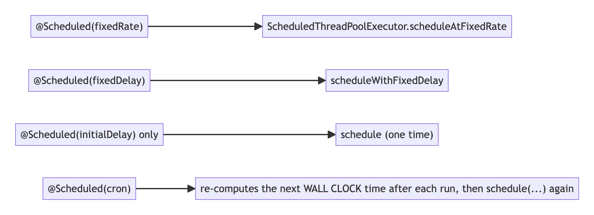

# Distributed Scheduler – Part 2: the @Scheduled Annotation and Cron (Distributed Microservices #21)

<!-- nav -->
⬅ [20 Distributed Scheduler – Part 1: Scheduler Fundamentals (Leader-Follower)](20_Distributed_Scheduler_Part1_Notes.md) · [Index](00_Distributed_Microservices_Index.md) · [22 Distributed Scheduler – Part 3: Common Pitfalls of Background Jobs](22_Distributed_Scheduler_Part3_Notes.md) ➡
<!-- nav -->

Source: https://drive.google.com/file/d/1skz-q6DSH7_UCpaJ5gcuJR7aznGNOOkJ/view?usp=drive_link

Prerequisite: [20 Part 1](20_Distributed_Scheduler_Part1_Notes.md). Spring Boot does no magic: internally it just uses Java's `ScheduledThreadPoolExecutor`. In other words, **`@Scheduled` is just a wrapper above Java's `ScheduledThreadPoolExecutor`.**



## 1. Enable scheduling

**`@EnableScheduling`** enables the scheduling capability by loading all the scheduler related beans, and makes Spring **scan for `@Scheduled` annotations.**

```java
import org.springframework.scheduling.annotation.EnableScheduling;

@SpringBootApplication
@EnableScheduling
public class SchedulerApplication {

    public static void main(String[] args) {
        SpringApplication.run(SchedulerApplication.class, args);
    }
}
```

## 2. `fixedRate`

Equivalent to the Java method `scheduleAtFixedRate(Runnable command, long initialDelay, long period, TimeUnit unit)` (covered in depth in Part 1).

```java
@Component
public class FixedRate {

    @Scheduled(initialDelay = 3000, fixedRate = 5000)
    public void myJob() {
        System.out.println("Start: " + LocalTime.now());
    }
}
```

If we do not set the initial delay, by default `initialDelay = 0` (it can be started immediately). But in the above example we have set it to 3 seconds specifically. Output: a `Start: ...` line at 3 s, 8 s, 13 s ... (every 5 s from the start of the previous run).

## 3. `fixedDelay`

Equivalent to `scheduleWithFixedDelay(Runnable command, long initialDelay, long delay, TimeUnit unit)`.

```java
@Component
public class Scheduler {

    @Scheduled(initialDelay = 1000, fixedDelay = 5000)
    public void myJob() {

        LocalTime startTime = LocalTime.now();
        try {
            Thread.sleep(3000);
        } catch (Exception e) {
            e.printStackTrace();
        }
        LocalTime endTime = LocalTime.now();
        System.out.println("StartedAt: " + startTime + " finishedAt: " + endTime);
    }
}
```

The task takes 3 s, then waits 5 s, so the output shows start times about **8 s apart** (3 s run + 5 s delay).

## 4. One-time scheduling

Equivalent to `schedule(Runnable command, long delay, TimeUnit unit)`.

```java
@Component
public class OneTimeSchedule {

    /*
      initialDelay field is mandatory, if we need to schedule the task only once.
    */
    @Scheduled(initialDelay = 2000)
    public void myJob() {
        System.out.println("Start: " + LocalTime.now());
    }
}
```

The job will run **only once**, after the 2 seconds of initial delay. (`fixedRate` and `fixedDelay` repeat it, so with neither of them set it is one-time. In current Spring versions a bare `@Scheduled(initialDelay = ...)` with no other trigger is accepted for this.)

## 5. Cron job

We can say it is **repeated one-time scheduling**, based on **wall clock time.**

Example of wall clock time: the current time is 10:14 and we need to run the task every 3 minutes.

**It does not calculate the next execution time like `fixedRate`:**

```
next execution time = previous execution START time + interval
first pick: 10:14
next: 10:14 + 3 = 10:17
next: 10:17 + 3 = 10:20
```

**Neither like `fixedDelay`:**

```
next execution time = previous execution END time + interval
first pick: 10:14 -> finished at 10:15
next: 10:15 + 3 = 10:18 -> which completes at 10:19
next: 10:19 + 3 = 10:22
```

**Cron works on wall clock time.** The valid cron minutes (for "every 3 minutes") are `00, 03, 06, 09, 12, 15, 18, 21, ...`. So after the pick at 10:14: if the task completes on time (10:15), the next run is at **10:18**; but if the task takes longer, say till 10:16, the next run time is still 10:18, because it is the next valid wall clock slot.

### Missed slots are skipped

Scenario: cron = every 10 minutes, the task starts at 10:00 and runs for **25 minutes**. Expected cron times: 10:00, 10:10, 10:20, 10:30.


What actually happens:

- 10:00: the task starts.
- 10:10: the cron time occurs, but **missed**, as the task is still running.
- 10:20: the cron time occurs, but **missed**, as the task is still running.
- 10:25: the task finishes, it computes the next execution time: start + every 10 minutes: 10:00 + 10 = 10:10 (missed), 10:10 + 10 = 10:20 (missed), 10:20 + 10 = **10:30** (future). `delay = 10:30 - 10:25 = 5 minutes`, so it goes to the **Timed_Wait** state.
- 10:30: the task starts.

This is different from `fixedRate` (which, in the JDK, catches up and runs back to back, see Part 1): a cron job **skips** the slots it missed and waits for the next real one.

```java
@Component
public class CronSchedule {

    @Scheduled(cron = "0/3 * * * * *")
    public void myJob() {
        System.out.println("Start: " + LocalTime.now());
    }
}
```

Output: a `Start:` line at seconds `00, 03, 06, 09, ...` of every minute.

## 6. Cron expression syntax

```
[second] [minute] [hour] [day of month] [month] [day of week]
```

| Field | Values |
|---|---|
| second | 0-59 |
| minute | 0-59 |
| hour | 0-23 |
| day of month | 1-31 |
| month | 1-12 or JAN-DEC |
| day of week | 0-7 or SUN-SAT (0 is SUN, **7 is also SUN**) |

**Spring's cron has 6 fields (it starts with the seconds).** A classic Unix cron has 5 (no seconds). Always count 6 for `@Scheduled`.

### Special characters

1. **Asterisk `*`:** means "every". `*` in the minute field = every minute, in the hour field = every hour, likewise.
2. **List `,`:** multiple values. `0,20` in the seconds field = runs at 0 s and 20 s only. `9,15` in the hours field = 9 AM and 3 PM only.
3. **Range `-`:** a period. `9-15` in the hours field = every hour from 9 AM to 3 PM.
4. **Slash `/`:** intervals (`start/step`). `4/10` in the second field = start at 4 s, then keep adding 10 s (4, 14, 24, 34, 44, 54). `*/10` in the second field = 0, 10, 20, 30, 40, 50.
5. **Last `L`:** means "last". Allowed only in: **day-of-month** (`L` = last day of the month: Feb → 28 or 29, April → 30, December → 31) and **day-of-week** (`DAYL`: the last occurrence of the given weekday in the month: `FRIL` = last Friday of the month, `MONL` = last Monday).
6. **Don't know `?`:** when `?` is added, that specific field is **ignored**. Allowed only in day-of-month and day-of-week. Main use is to **remove ambiguity.**

```
[second] [minute] [hour] [day of month] [month] [day of week]
0 0 9 * * MON      -> ambiguous: is it every day? or every month's Monday?
0 0 9 ? * MON      -> now it is clear: runs at 9 AM on Mondays, the day-of-month field is ignored
```

### Practical examples (6 fields)

| Meaning | Cron |
|---|---|
| Every 5 seconds | `*/5 * * * * *` |
| Every 4 seconds | `*/4 * * * * *` |
| Every day at 11:15 AM | `0 15 11 * * *` |
| Every weekday at 09:00 AM | `0 0 9 * * MON-FRI` |
| Every Sunday at midnight | `0 0 0 * * SUN` |
| Midnight on the 1st day of every month | `0 0 0 1 * ?` |
| Last day of every month at midnight | `0 0 0 L * ?` |

(Classic 5-field versions such as `*/4 * * * *` or `15 11 * * *` do not work in Spring, which needs the leading seconds field, so the examples above use 6 fields.)

## 7. Summary

| Annotation | Java equivalent | Next run |
|---|---|---|
| `@Scheduled(fixedRate = n)` | `scheduleAtFixedRate` | previous **start** + n |
| `@Scheduled(fixedDelay = n)` | `scheduleWithFixedDelay` | previous **finish** + n |
| `@Scheduled(initialDelay = n)` alone | `schedule` | once |
| `@Scheduled(cron = "...")` | re-schedules itself | next **wall clock** slot (missed ones skipped) |

## 8. From the GitLab repo

Folder `DistributedScheduler`: `SchedulerApplication` (`@EnableScheduling`, and `@EnableSchedulerLock(defaultLockAtMostFor = "10m")` for the next parts), and `SchedulersTest` with the four jobs of this note: `@Scheduled(initialDelay = 3000, fixedRate = 5000)`, `@Scheduled(initialDelay = 1000, fixedDelay = 5000)` (sleeps 3 s), a one-time `@Scheduled(initialDelay = 0)`, and `@Scheduled(cron = "0/3 * * * * *")`.

The note ends with: *let us see the common pitfalls while writing a background job and their solutions*, which is the next part: [22 Distributed Scheduler Part 3](22_Distributed_Scheduler_Part3_Notes.md).

**In simple words:** `@Scheduled` is a friendly label on top of the Java scheduled thread pool. `fixedRate` keeps a steady beat, `fixedDelay` rests after each run, and `cron` follows the wall clock (like "every weekday at 9"), skipping any slot it was too busy to take.

---

<!-- nav -->
⬅ [20 Distributed Scheduler – Part 1: Scheduler Fundamentals (Leader-Follower)](20_Distributed_Scheduler_Part1_Notes.md) · [Index](00_Distributed_Microservices_Index.md) · [22 Distributed Scheduler – Part 3: Common Pitfalls of Background Jobs](22_Distributed_Scheduler_Part3_Notes.md) ➡
<!-- nav -->
