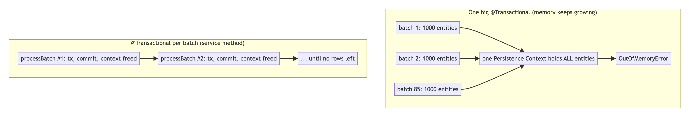
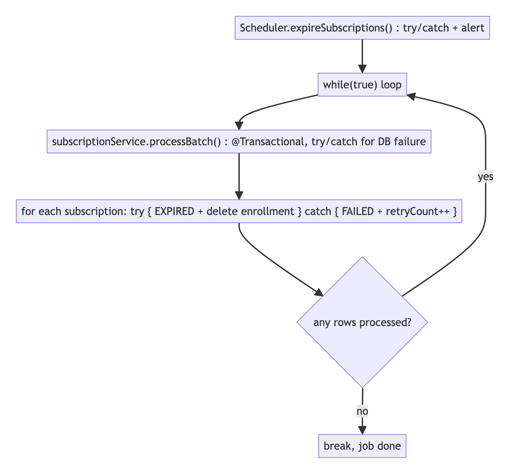

# Distributed Scheduler – Part 3: Common Pitfalls of Background Jobs (Distributed Microservices #22)

<!-- nav -->
⬅ [21 Distributed Scheduler – Part 2: the @Scheduled Annotation and Cron](21_Distributed_Scheduler_Part2_Notes.md) · [Index](00_Distributed_Microservices_Index.md) · [23 Distributed Scheduler – Part 4: Multiple Instances and ShedLock](23_Distributed_Scheduler_Part4_Notes.md) ➡
<!-- nav -->

Source: https://drive.google.com/file/d/1-Js_ki_mWgCWyJWzmBP3dVMWy0XU-EcF/view?usp=drive_link (titled "Part 3 and Part 4"; the same file is listed for #23, so pitfalls 1–6 are here and pitfall 7 plus ShedLock are in [23 Part 4](23_Distributed_Scheduler_Part4_Notes.md)).

So far we have scheduled jobs on a **single instance**. Now the most common pitfalls when writing a background job, each with its fix. The running example: a nightly job that expires subscriptions and removes their enrollments.

## 1. Cron + time zone

```java
@Scheduled(cron = "0 0 9 * * *")
public void myNotificationJob() {
    sendMorningUpdates();
}
```

"Every day at 9 AM", but in **which time zone?** By default cron uses the **server's** time zone. Server = UTC, user = IST: the job runs at 9:00 AM UTC = 2:30 PM IST, so the user gets "morning updates" in the afternoon.

**Solution: always specify the zone.**

```java
@Scheduled(cron = "0 0 9 * * *", zone = "Asia/Kolkata")
public void myNotificationJob() {
    sendMorningUpdates();
}
```

## 2. Missing `@Transactional`

```java
@Component
public class SubscriptionScheduler {

    @Scheduled(cron = "0 0 1 * * *")
    public void expireSubscriptions() {
        List<Subscription> expired = subRepo.findByExpiryDateBefore(LocalDate.now());
        for (Subscription sub : expired) {
            // Step 1: update subscription
            sub.setStatus("EXPIRED");
            subscriptionRepo.save(sub);
            // Step 2: remove enrollment
            enrollmentRepo.deleteBySubscriptionId(sub.getId());   // throws Exception
        }
    }
}
```

Subscription #101: the status update to EXPIRED is **committed** (each repository call has its own transaction), then the enrollment deletion fails. There is no rollback of the subscription status, so the data is now **inconsistent**.

**Solution: add `@Transactional`** so both steps succeed or fail together:

```java
@Component
@Transactional
public class SubscriptionScheduler { ... }
```

Now when the enrollment deletion fails, the status update is rolled back (back to ACTIVE), the data stays consistent, and the next run retries. (Pitfall 4 below refines where exactly this annotation should go.)

## 3. Fetching huge data at once

With `@Transactional` in place, what if the query returns **85,000 records**, each about 10 KB? All of them are loaded into memory: `85000 × 10 KB = 850 MB` for this query alone. With a 512 MB JVM heap: `java.lang.OutOfMemoryError: Java heap space`.

**Solution: batch processing.** Fetch 1000 rows at a time and loop until nothing is left.

```java
@Scheduled(cron = "0 0 1 * * *")
public void expireSubscriptions() {
    while (true) {
        List<Subscription> expired = subRepo.fetchTop1000Expired(LocalDate.now());
        if (expired.isEmpty()) {
            break;
        }
        for (Subscription sub : expired) {
            sub.setStatus("EXPIRED");
            subscriptionRepo.save(sub);
            enrollmentRepo.deleteBySubscriptionId(sub.getId());
        }
    }
}
```

```java
@Repository
public interface SubRepository extends JpaRepository<Subscription, Long> {

    @Query(value = """
        SELECT *
        FROM subscription
        WHERE expiry_date < :today
          AND status NOT IN ('EXPIRED')
        ORDER BY expiry_date ASC
        LIMIT 1000
        """, nativeQuery = true)
    List<Subscription> fetchTop1000Expired(@Param("today") LocalDate today);
}
```

85 batches × 1000 records (10 MB) each, and the garbage collector can reclaim memory after each batch (we will see that this is not quite true yet).

> **Be careful:** we are inside `while (true)`, so double check the query filter. The rows we process **must stop matching the query** (here, status becomes EXPIRED, which is excluded by `status NOT IN ('EXPIRED')`), otherwise this ends in an **infinite loop**.

## 4. Memory leak: one big transaction

Even after batching, memory still grows, because the whole method runs under **one** `@Transactional`. The JPA **Persistence Context** (first level cache) keeps a reference to **every entity loaded during the transaction**, so the GC cannot reclaim them.

Persistence context scope:

| Situation | One persistence context per |
|---|---|
| HTTP request, Open Session In View enabled (**the default**) | HTTP request |
| HTTP request, `spring.jpa.open-in-view=false` | `@Transactional` |
| Scheduler / background job (no HTTP request) | `@Transactional` (the only option) |



**Solution: `@Transactional` per batch.** Move the batch work into a separate service bean (a self call inside the same class would bypass the Spring proxy and ignore `@Transactional`).

```java
@Component
public class SubscriptionScheduler {

    @Autowired
    private SubscriptionService subService;

    @Scheduled(cron = "0 0 1 * * *")
    public void expireSubscriptions() {
        while (true) {
            boolean processed = subService.processBatch();
            if (!processed) {
                break;
            }
        }
    }
}
```

```java
@Service
public class SubscriptionService {

    @Autowired private SubRepository subRepo;
    @Autowired private EnrollmentRepository enrollmentRepo;

    @Transactional
    public boolean processBatch() {

        List<Subscription> expired = subRepo.fetchTop1000Expired(LocalDate.now());

        if (expired.isEmpty()) {
            return false;
        }

        for (Subscription sub : expired) {
            sub.setStatus("EXPIRED");
            subRepo.save(sub);
            enrollmentRepo.deleteBySubscriptionId(sub.getId());
        }
        return true;
    }
}
```

Each batch gets its own transaction and persistence context; when it commits, the context is closed and all those entities become garbage.

## 5. Exception handling

Problems: **1 bad subscription fails the entire batch**, **1 failing batch kills the whole scheduler**, and there is **no logging**. Handle it at three levels.

### Level 1: one bad record

Say the 900th subscription throws a DB constraint error while deleting its enrollment. Without handling, the whole transaction rolls back: 899 processed records are lost and the remaining 100 are never touched. Catch the exception **per record** and mark it:

```java
for (Subscription sub : expired) {
    try {
        sub.setStatus("EXPIRED");
        subRepo.save(sub);
        enrollmentRepo.deleteBySubscriptionId(sub.getId());
    } catch (Exception e) {
        log.error("Failed sub {}", sub.getId(), e);
        sub.incrementRetryCount();
        sub.setStatus("FAILED");
        subRepo.save(sub);
    }
}
```

The query now excludes failed rows too, so the `while` loop cannot spin forever on them: `AND status NOT IN ('EXPIRED', 'FAILED')`.

(A practical caveat: in a real JPA project, an exception thrown by a repository call can mark the surrounding transaction rollback-only, so this per-record catch is safest when each record's work runs in its own small transaction (`REQUIRES_NEW`) or the failure is a plain business exception. Check this against your setup before relying on it.)

### Level 2: one bad batch

If batch #3 throws (for example while fetching from the DB), the scheduler stops entirely: batches #1 and #2 are safe (committed) but the remaining batches are never processed. Wrap the batch body in a `try/catch` that logs `"Batch DB failure"` so only that batch is impacted and the others can continue.

### Level 3: protect the whole job

An uncaught exception might **silently kill the job**. Wrap the whole loop:

```java
@Scheduled(cron = "0 0 1 * * *")
public void expireSubscriptions() {
    try {
        while (true) {
            boolean processed = subService.processBatch();
            if (!processed) {
                break;
            }
        }
    } catch (Exception e) {
        // full-proof protection: there must be no silent failures
        log.error("Scheduler failed", e);
        alertService.notify(e);
    }
}
```



(Watch out: if `processBatch` catches its own batch failure and still returns `true`, a database that is permanently failing makes the loop retry forever. Return `false`, or count consecutive failures and stop, in real code.)

## 6. DB operations: use Hibernate batching

Per record we run 1 `UPDATE subscription` + 1 `DELETE enrollment`:

```
1000 records x 2 SQL = 2000 SQL per batch
85 batches  x 2000   = 170,000 SQL statements
```

Hibernate may group some SQL, but logically about 170k statements still reach the DB, each one a network round trip.

**Solution: Hibernate (JDBC) batching.**

```properties
spring.jpa.properties.hibernate.jdbc.batch_size=50
spring.jpa.properties.hibernate.order_updates=true
```

The statements still run, but the **network round trips drop drastically**: lower CPU usage and a shorter job duration.

- `batch_size=50`: Hibernate collects up to 50 **similar** SQL statements in memory and sends them together as **one JDBC batch call**.
- `order_updates=true`: without it the operations alternate between tables (`update subscription 1`, `update enrollment 5`, `update subscription 2`, `update enrollment 6`...) and every table switch breaks the batch. With it, Hibernate reorders them (`subscription 1, subscription 2, enrollment 5, enrollment 6`) so they can be batched.

(Batched deletes and updates that go through derived queries like `deleteBySubscriptionId` may still execute as separate statements; the batching helps most for entity inserts and updates that Hibernate flushes itself.)

## 7. Summary of the checklist

| # | Pitfall | Fix |
|---|---|---|
| 1 | Wrong time zone | `zone = "Asia/Kolkata"` |
| 2 | Partial updates, inconsistent data | `@Transactional` |
| 3 | Out of memory on big queries | Fetch in batches (`LIMIT 1000`) and make sure rows leave the filter |
| 4 | Persistence context grows | `@Transactional` per batch in a separate service bean |
| 5 | Silent failures | try/catch per record, per batch and for the whole job, plus logs and alerts |
| 6 | Too many round trips | Hibernate `batch_size` + `order_updates` |
| 7 | Many pods run the same job | [Part 4](23_Distributed_Scheduler_Part4_Notes.md): locks and ShedLock |

**In simple words:** a nightly job that "works on my laptop" breaks in production in predictable ways: wrong clock, half-finished work, too much data in memory, one bad row ruining everything, and too many tiny DB calls. Work in small committed batches, catch errors at every level, and always tell someone when it fails.

---

<!-- nav -->
⬅ [21 Distributed Scheduler – Part 2: the @Scheduled Annotation and Cron](21_Distributed_Scheduler_Part2_Notes.md) · [Index](00_Distributed_Microservices_Index.md) · [23 Distributed Scheduler – Part 4: Multiple Instances and ShedLock](23_Distributed_Scheduler_Part4_Notes.md) ➡
<!-- nav -->
