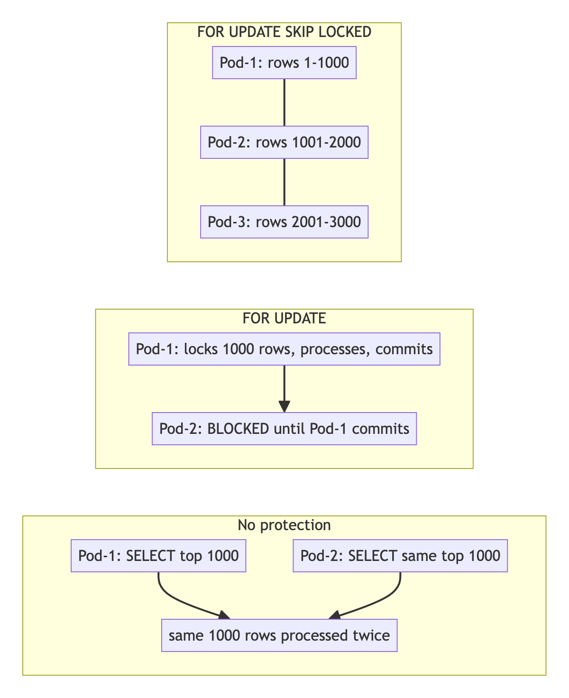
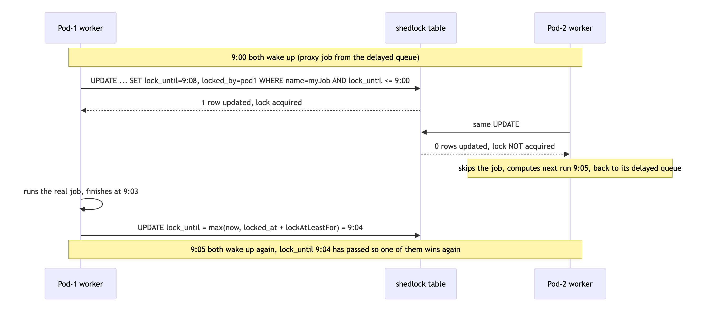

# Distributed Scheduler – Part 4: Multiple Instances and ShedLock (Distributed Microservices #23)

<!-- nav -->
⬅ [22 Distributed Scheduler – Part 3: Common Pitfalls of Background Jobs](22_Distributed_Scheduler_Part3_Notes.md) · [Index](00_Distributed_Microservices_Index.md)
<!-- nav -->

Source: https://drive.google.com/file/d/1-Js_ki_mWgCWyJWzmBP3dVMWy0XU-EcF/view?usp=drive_link (the same "Part 3 and Part 4" file as [22 Part 3](22_Distributed_Scheduler_Part3_Notes.md)).

## 1. Problem: duplicate execution with multiple instances

Microservice instance 1 and instance 2 **both** run the same job at 1 AM every day. Each pod has its own scheduler thread pool and its own delayed queue, so both fire.

| Step | Pod-1 | Pod-2 |
|---|---|---|
| 1 | SELECT top 1000 | SELECT the **same** top 1000 |
| 2 | Update status | Update status again |
| 3 | Delete enrollment | Delete again / error |

Duplicate execution of the same job, if not handled properly, causes real damage: sending money multiple times, sending notifications multiple times, and so on.



## 2. Solution 1: pessimistic lock (`FOR UPDATE`)

```java
@Query(value = """
    SELECT *
    FROM subscription
    WHERE expiry_date < :today
      AND status NOT IN ('EXPIRED', 'FAILED')
    ORDER BY expiry_date ASC
    LIMIT 1000
    FOR UPDATE
    """, nativeQuery = true)
List<Subscription> fetchTop1000Expired(@Param("today") LocalDate today);
```

The lock is acquired on those 1000 rows by only **one transaction**; the others wait for the lock to be released.

| Time | Instance-1 | Instance-2 |
|---|---|---|
| 01:00 | locks rows | waiting |
| 01:02 | processing | waiting |
| 01:03 | commit | gets the lock |
| 01:03 | | now processes |

Runtime: instance 1 does `BEGIN TX`, `SELECT ... FOR UPDATE` (locks 1000 rows), processes, `COMMIT` (unlock). Instance 2 does `SELECT ... FOR UPDATE` and **blocks** until instance 1 commits.

**Cons:** it is **blocking, so it is not scalable.** If instance 1 is busy for one hour (a long running task), all the other instances are blocked for that hour too. Go for it only when instances are few (1 or 2), batches are small and strict order is required.

## 3. Solution 2: `FOR UPDATE SKIP LOCKED`

If strict ordering is not required we can do **parallel processing**. `SKIP LOCKED` lets a query **bypass rows that are already locked** by other transactions.

```java
@Query(value = """
    SELECT *
    FROM subscription
    WHERE expiry_date < :today
      AND status NOT IN ('EXPIRED', 'FAILED')
    ORDER BY expiry_date ASC
    LIMIT 1000
    FOR UPDATE SKIP LOCKED
    """, nativeQuery = true)
List<Subscription> fetchTop1000Expired(@Param("today") LocalDate today);
```

Instance 1 takes the first 1000, instance 2 the next 1000, instance 3 the next... So: **no duplicates, no waiting, parallel processing** (scalable). Availability depends on the DB and its version, but all major DBs (PostgreSQL, MySQL 8+, Oracle, SQL Server in its own form) support it.

Both solutions **share the work**. What if the requirement is **only 1 instance should run the job**? The answer is **ShedLock**.

## 4. ShedLock

- Without ShedLock: all instances execute the scheduler job (and row locks are what prevent duplicate work).
- With ShedLock: only **one** instance executes the job; the others simply **skip** that execution if one instance is already running it.

### 4.1 The `shedlock` table

A new table is created to manage scheduler jobs:

| Column | Meaning |
|---|---|
| `name` (primary key) | every scheduler job gets a unique name |
| `lock_until` | after this time any instance (any pod) may acquire and run the job again |
| `locked_at` | the time the worker thread of some pod started working on the job |
| `locked_by` | identity of the instance that last acquired the job: who is running it now, or, if it finished and nobody took it yet, who ran it last |

Why not say "time when someone puts a lock"? Because in ShedLock **no row is locked**; it works on **optimistic concurrency**: a conditional `UPDATE` either changes the row (you got the lock) or changes nothing (someone else has it). The table in the repo (`schema.sql`):

```sql
CREATE TABLE shedlock(
    name       VARCHAR(64)  NOT NULL,
    lock_until TIMESTAMP(3) NOT NULL,
    locked_at  TIMESTAMP(3) NOT NULL,
    locked_by  VARCHAR(255) NOT NULL,
    PRIMARY KEY (name)
);
```

### 4.2 Interceptor (proxy job)

For every job where we want ShedLock, a **proxy** is created and **that proxy is what gets inserted into the delayed queue**, not the real job. When the schedule time arrives, the call goes to the proxy, which does tasks before and after the real job:

```java
class JobProxy extends Job {
    @Override
    public void runMyJob() {
        // Pre-processing (try to acquire the lock)
        super.runMyJob();          // actual job
        // Post-processing (adjust lock_until)
    }
}
```

At startup, `@EnableScheduling` scans the `@Scheduled` methods and registers them, and `@EnableSchedulerLock` scans the `@SchedulerLock` methods and creates the proxies.

### 4.3 Setup

**Dependencies** (`pom.xml`), the second one depending on the storage (JDBC here; there are also Redis, MongoDB and other providers):

```xml
<dependency>
    <groupId>net.javacrumbs.shedlock</groupId>
    <artifactId>shedlock-spring</artifactId>
    <version>5.13.0</version>
</dependency>
<dependency>
    <groupId>net.javacrumbs.shedlock</groupId>
    <artifactId>shedlock-provider-jdbc-template</artifactId>
    <version>5.13.0</version>
</dependency>
```

Plus the DB and its driver. Proxy creation, pre-processing and the INSERT / UPDATE queries are all provided by the library; we only choose **which storage** to use and create its bean:

```java
@Configuration
public class ShedLockConfig {

    @Bean
    public LockProvider lockProvider(DataSource dataSource) {
        return new JdbcTemplateLockProvider(
                JdbcTemplateLockProvider.Configuration.builder()
                        .withJdbcTemplate(new JdbcTemplate(dataSource))
                        .usingDbTime()      // safer for multi-pod (all use the DB clock)
                        .build()
        );
    }
}
```

**Enable it** and annotate the job:

```java
@SpringBootApplication
@EnableScheduling
@EnableSchedulerLock(defaultLockAtMostFor = "10m")
public class SchedulerApplication {
    public static void main(String[] args) {
        SpringApplication.run(SchedulerApplication.class, args);
    }
}
```

```java
@Component
public class SchedulersTest {

    @Scheduled(fixedRate = 300000)   // every 5 minutes
    @SchedulerLock(name = "myJob", lockAtMostFor = "8m", lockAtLeastFor = "4m")
    public void myJob() {
        System.out.println("job execution started");
    }
}
```

`@SchedulerLock` parameters:

| Parameter | Meaning | Stored in DB? |
|---|---|---|
| `name` (optional) | unique name of the job. If omitted it is generated from the class name + method name | yes |
| `lockAtMostFor` (optional) | **safety net**: after this time any instance may take the job again (for example when the owner pod crashed). Default comes from `@EnableSchedulerLock(defaultLockAtMostFor)` | yes (as `lock_until`) |
| `lockAtLeastFor` (optional) | even the instance that got the job should not release it before this much time, **even if the job finishes early** (protects against clock skew and very fast jobs running on another pod right after) | no, just a configuration value |

`@EnableSchedulerLock` enables the ShedLock functionality, loads all the related beans and scans the `@SchedulerLock` methods to create the proxies at startup.

> Make `lockAtMostFor` **longer than the longest run** of the job; if the job is still running when it expires, another pod can start it too.

Custom table or column names must be told to the provider (defaults: table `shedlock`, columns `name`, `lock_until`, `locked_at`, `locked_by`):

```java
return new JdbcTemplateLockProvider(
        JdbcTemplateLockProvider.Configuration.builder()
                .withJdbcTemplate(new JdbcTemplate(dataSource))
                .withTableName("scheduler_lock")
                .withColumnNames(new ColumnNames("job_name", "expires_at", "started_at", "instance_id"))
                .usingDbTime()
                .build()
);
```

### 4.4 Walkthrough (job config: name `myJob`, `lockAtMostFor=8m`, `lockAtLeastFor=4m`, `fixedRate=5m`)



**Step 1 – startup (8:55).** `@EnableScheduling` registers the proxy job in each pod's delayed queue. The `shedlock` table is empty.

**Step 2 – 9:00, workers of both pods wake up.** Each runs the proxy job's pre-processing: try to insert/update the row for `myJob` with `lock_until = now + 8m`. Pod-1 wins:

| name | locked_at | lock_until | locked_by |
|---|---|---|---|
| myJob | 9:00 | 9:08 | pod1 |

Pod-2 failed to acquire the lock, so it **skips the execution**, computes its next run time (fixedRate: 9:00 + 5m = 9:05) and puts the job back into its own delayed queue.

**Step 3 – Pod-1 finishes early at 9:03.** In post-processing it updates `lock_until` so another instance can pick the job up later, but not before `lockAtLeastFor`:

```
newLockUntil = max(now, locked_at + lockAtLeastFor)
             = max(9:03, 9:00 + 4m) = 9:04
```

```sql
UPDATE shedlock SET lock_until = :newLockUntil WHERE name = 'myJob' AND locked_by = 'pod1';
```

| name | locked_at | lock_until | locked_by |
|---|---|---|---|
| myJob | 9:00 | 9:04 | pod1 |

**Step 4 – Pod-1 re-queues the job.** The finished job goes back into Pod-1's delayed queue with its next run time (9:00 + 5m = 9:05).

**Step 5 – 9:05, both pods wake up.** The acquire query is:

```sql
UPDATE shedlock
SET lock_until = :now + 8 minutes, locked_at = :now, locked_by = :me
WHERE name = 'myJob' AND lock_until <= :now;
```

The condition `lock_until <= now` matches only if the previous lease has expired. Whoever's `UPDATE` changes 1 row owns the job; the other gets 0 rows, skips, and computes its next run (9:10). (The source's step 5 shows the lock still held at 9:05; with `lock_until = 9:04` the lease has actually expired, so one pod acquires the lock and the other is the one that skips. If the job had run longer, `lock_until` would be later than now and both would skip.)

**Step 6 and 7 – a long running job.** Say Pod-2 acquired the lock at 9:05 and is slow. At 9:10 Pod-1's `UPDATE` finds `lock_until` (9:13) still in the future, changes nothing, so Pod-1 skips and schedules its next run (9:15). When 9:15 arrives and the lease (up to 9:13) is over, Pod-1 acquires it: `lock_until = 9:15 + 8m = 9:23`, `locked_by = pod1`, and invokes the real method. This is where `lockAtMostFor` protects against a stuck or dead pod.

**Step 8 –** and it goes on like that.

### 4.5 Using it in the repo

Folder `DistributedScheduler/.../shedlockexample`: `ShedLockScheduler` (`@Scheduled(fixedRate = 60000)` + `@SchedulerLock(name = "myJob", lockAtLeastFor = "4m", lockAtMostFor = "8m")`, sleeps 30 s to simulate work) and `ShedLockConfig` (the `JdbcTemplateLockProvider` bean above). To see it work, run two copies of the application on different ports against a shared DB (the repo default is an in-memory H2 per instance, so switch to a shared MySQL / Postgres for a real test) and watch that only one of them prints `job execution started` per window.

## 5. Which one to choose

| Need | Use |
|---|---|
| Only **one instance** runs the whole job at a time | ShedLock |
| Instances should **share** the work (parallel) | `FOR UPDATE SKIP LOCKED` |
| Few instances, strict order | `FOR UPDATE` |

**In simple words:** when you run 3 copies of your service, all 3 wake up at 1 AM. Either let them split the rows between them (`SKIP LOCKED`), or put a small "who is running this job right now" sticky note in the database (ShedLock): the first pod writes its name and an expiry time, the others read it and go back to sleep.

---

<!-- nav -->
⬅ [22 Distributed Scheduler – Part 3: Common Pitfalls of Background Jobs](22_Distributed_Scheduler_Part3_Notes.md) · [Index](00_Distributed_Microservices_Index.md)
<!-- nav -->
